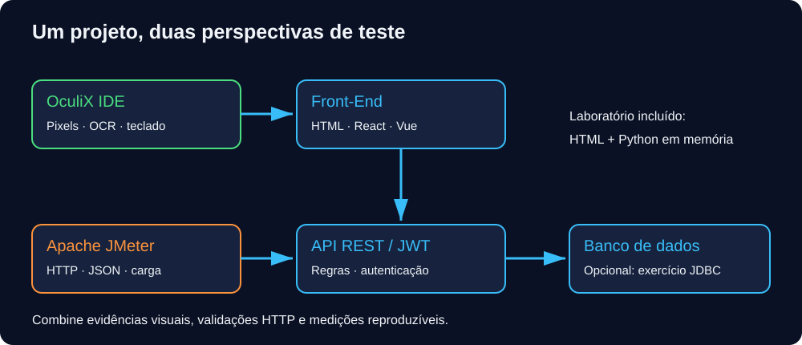
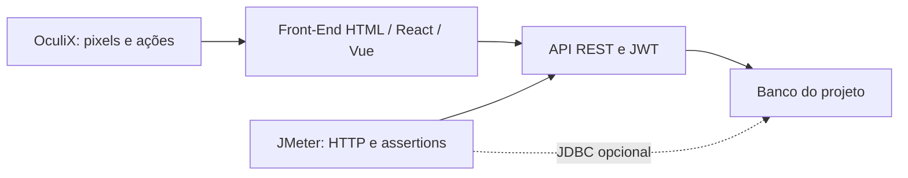
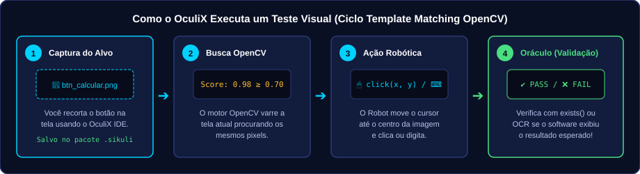
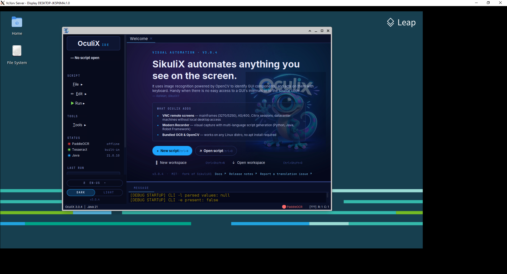

# 🧪 Portal de Engenharia de Testes Web Full Stack

 

Aprenda a verificar a interface, as regras da API e o comportamento sob carga em um mesmo projeto de treino. **Ambiente das aulas: Windows.**

| 🦎 OculiX IDE — Front-End / GUI | 🪶 Apache JMeter — API / Carga |
| --- | --- |
| Imagens, OCR, teclado, arquivos, canvas e E2E | REST, JWT, CSV, assertions, JDBC e desempenho |
| **[Entrar na trilha: 12 capítulos](capitulos/README.md)** | **[Entrar na trilha: 10 capítulos](capitulos-jmeter/README.md)** |
| [Começar com instalação](capitulos/01-introducao-e-instalacao.md) | [Começar com instalação](capitulos-jmeter/01-introducao-e-instalacao-jmeter.md) |





No laboratório incluído, o Front-End é HTML/JavaScript e os dados ficam na memória do Python. O banco do diagrama representa a arquitetura de um projeto real; o exercício JDBC usa um banco separado.

| Necessidade | Ferramenta | Evidência |
| --- | --- | --- |
| Botão, diálogo nativo, aparência e canvas | OculiX | Captura e assert visual |
| Média correta, erro 400/401, CRUD | JMeter | Status e assertions JSON |
| P95, vazão, erro sob concorrência | JMeter CLI | JTL e dashboard HTML |
| Interface durante tráfego concorrente | Ambas | Jornada UI, consulta API e relatório |
| Projeto integrador / TCC | Ambas | Critérios, ambiente, scripts e medições reproduzíveis |

## Começar pelo laboratório

```shell
python exemplos/app-alvo-teste/servidor_fullstack.py
```

Abra `http://localhost:8080`. Usuário `estudante_qa`, senha `oculix123`. Sem servidor, o HTML ainda funciona por duplo clique para praticar testes visuais. Leia o [contrato da API e roteiro de execução](exemplos/README.md).

<details>
<summary>🦎 Índice OculiX — 12 capítulos</summary>

- [01-introducao-e-instalacao](capitulos/01-introducao-e-instalacao.md)
- [02-conhecendo-a-interface-oculix-ide](capitulos/02-conhecendo-a-interface-oculix-ide.md)
- [03-primeiro-script-e-captura-de-tela](capitulos/03-primeiro-script-e-captura-de-tela.md)
- [04-gravador-moderno-sem-codigo](capitulos/04-gravador-moderno-sem-codigo.md)
- [05-ajuste-de-padroes-similaridade-e-offset](capitulos/05-ajuste-de-padroes-similaridade-e-offset.md)
- [06-sincronizacao-esperas-e-validacoes](capitulos/06-sincronizacao-esperas-e-validacoes.md)
- [07-regioes-ocr-e-teclado-avancado](capitulos/07-regioes-ocr-e-teclado-avancado.md)
- [08-depuracao-erros-e-boas-praticas](capitulos/08-depuracao-erros-e-boas-praticas.md)
- [09-projeto-pratico-completo](capitulos/09-projeto-pratico-completo.md)
- [10-glossario-e-folha-de-consulta](capitulos/10-glossario-e-folha-de-consulta.md)
- [11-recursos-avancados-web-fullstack](capitulos/11-recursos-avancados-web-fullstack.md)
- [12-testes-hibridos-ui-api](capitulos/12-testes-hibridos-ui-api.md)

</details>

<details>
<summary>🪶 Índice JMeter — 10 capítulos</summary>

- [Introdução, instalação e métricas](capitulos-jmeter/01-introducao-e-instalacao-jmeter.md)
- [Interface, hierarquia e escopo](capitulos-jmeter/02-conhecendo-a-interface-jmeter.md)
- [CRUD REST passo a passo](capitulos-jmeter/03-testando-apis-rest-fullstack.md)
- [Asserções e oráculos](capitulos-jmeter/04-assercoes-e-validacoes-de-api.md)
- [JWT, sessões e correlação](capitulos-jmeter/05-correlacao-autenticacao-jwt-e-sessoes.md)
- [Dados CSV, variáveis e funções](capitulos-jmeter/06-testes-orientados-a-dados-csv-e-variaveis.md)
- [Gravador proxy e jornadas](capitulos-jmeter/07-gravador-web-proxy-e-controladores-logicos.md)
- [Timers, JDBC, arquivos e Groovy](capitulos-jmeter/08-timers-banco-de-dados-jdbc-e-upload.md)
- [CLI, listeners e dashboard HTML](capitulos-jmeter/09-metricas-listeners-cli-e-relatorio-html.md)
- [Projeto integrador e folha de consulta](capitulos-jmeter/10-projeto-pratico-fullstack-e-cheat-sheet.md)

</details>

**Módulo integrador:** [UI + API no OculiX](capitulos/12-testes-hibridos-ui-api.md) · [Projeto de carga JMeter](capitulos-jmeter/10-projeto-pratico-fullstack-e-cheat-sheet.md).

**Comandos para praticar:** [Tabela única de comandos e exemplos OculiX](capitulos/03-primeiro-script-e-captura-de-tela.md#5-tabela-única-de-comandos-e-exemplos), com exemplos diretos de mouse, teclado, formulários, navegador, arquivos e verificação visual.

**Verificação do material:** [Resultados e limites da validação](VALIDACAO.md).

---

## Guia visual OculiX original

<div align="center">


# 🧪 Guia Prático de Testes de Software com OculiX IDE

**Aprenda do zero a automatizar testes visuais de interface gráfica (GUI) passo a passo — sem precisar ser um programador experiente.**

[](https://github.com/oculix-org/Oculix)
[](https://adoptium.net/)
[](#️-trilha-de-aprendizagem-capítulos)
[](capitulos/01-introducao-e-instalacao.md)
[](#)

<br/>

[**🚀 Começar pelo Capítulo 1**](capitulos/01-introducao-e-instalacao.md) · [**🖥️ Mapa da Interface**](capitulos/02-conhecendo-a-interface-oculix-ide.md) · [**🟢 Gravador Sem Código**](capitulos/04-gravador-moderno-sem-codigo.md) · [**🎯 Projeto Prático**](capitulos/09-projeto-pratico-completo.md) · [**📋 Cheat Sheet**](capitulos/10-glossario-e-folha-de-consulta.md)

</div>

---

## 👋 Bem-vindo(a), Estudante!

Você já precisou testar um programa dezenas de vezes — clicando nos mesmos botões, preenchendo os mesmos formulários e conferindo se a mensagem certa apareceu na tela — toda vez que uma nova versão do software era entregue?

O **OculiX IDE** (evolução direta e moderna do clássico *SikuliX*) é uma ferramenta gratuita e de código aberto que permite ensinar o computador a **olhar para a tela como um ser humano** e executar esses testes automaticamente!

<table>
<tr>
<td width="160" align="center">

</td>
<td>

### 💡 Por que este guia foi feito para você?
- **Zero experiência prévia necessária:** Você não precisa dominar programação nem conhecer ferramentas complexas de automação.
- **Nesta trilha, foco na Interface Gráfica (OculiX IDE):** Tudo é feito visualmente, capturando pedacinhos da tela (screenshots) e usando o novo **Gravador Moderno**.
- **Qualquer software pode ser testado:** Funciona em aplicativos Desktop (Windows), sistemas Web, jogos em Canvas, calculadoras, planilhas e até telas remotas.

</td>
</tr>
</table>

> [!TIP]
> **Regra de ouro do OculiX:** *"Se você consegue ver um botão na tela e tirar um print dele, você consegue automatizar um teste com o OculiX!"*

---

## 🔍 Como o OculiX Funciona na Prática?

Diferente de outras ferramentas de teste que exigem inspecionar o código-fonte interno do programa (como HTML, XPath ou IDs invisíveis), o OculiX utiliza **Visão Computacional (OpenCV)** e **Leitura de Texto (OCR Tesseract)** diretamente sobre os pixels da tela:

<div align="center">

</div>

---

## 🗺️ Trilha de Aprendizagem (Capítulos)

Siga os capítulos na ordem abaixo. Cada etapa constrói o conhecimento necessário para a próxima, com **exemplos visuais, exercícios guiados e gabaritos interativos**:

```mermaid
flowchart LR
    C1["📦 Cap. 01\nInstalação"] --> C2["🖥️ Cap. 02\nInterface IDE"]
    C2 --> C3["📸 Cap. 03\n1º Script e Captura"]
    C3 --> C4["🟢 Cap. 04\nGravador Moderno"]
    C4 --> C5["🎯 Cap. 05\nSimilaridade e Offset"]
    C5 --> C6["⏳ Cap. 06\nEsperas e Validação"]
    C6 --> C7["🔤 Cap. 07\nRegiões e OCR"]
    C7 --> C8["🛠️ Cap. 08\nErros e Depuração"]
    C8 --> C9["🏆 Cap. 09\nProjeto Completo"]
    C9 --> C10["📋 Cap. 10\nCheat Sheet"]
    C10 --> C11["📁 Cap. 11\nRecursos Web"]
    C11 --> C12["🔗 Cap. 12\nUI e API"]
```



### 📚 Índice Completo do Guia

| Cap. | Capítulo | O que você vai aprender | Tempo Estimado | Progresso da Trilha |
| :---: | :--- | :--- | :---: | :---: |
| **01** | [**Introdução aos Testes Visuais e Instalação**](capitulos/01-introducao-e-instalacao.md) | O que é teste de GUI por imagem, instalação do Java 17+ e abertura do `oculixide.jar`. | ⏱️ 20 min | `█░░░░░░░░░ 10%` |
| **02** | [**Conhecendo a Interface do OculiX IDE**](capitulos/02-conhecendo-a-interface-oculix-ide.md) | Tour pela Barra Lateral, Espaço de Trabalho, Editor com Miniaturas, Console e idioma **PT-BR**. | ⏱️ 25 min | `██░░░░░░░░ 20%` |
| **03** | [**Primeiro Script e Captura de Tela**](capitulos/03-primeiro-script-e-captura-de-tela.md) | Capturas e sequências simples para clicar, preencher, apagar, usar atalhos, rolar e conferir login ou cálculo. | ⏱️ 60 min | `███░░░░░░░ 30%` |
| **04** | [**Gravador Moderno (Sem Código)**](capitulos/04-gravador-moderno-sem-codigo.md) | Criando testes apontando e clicando com o **Gravador Moderno** (Imagem, OCR, Teclado e App). | ⏱️ 35 min | `████░░░░░░ 40%` |
| **05** | [**Ajuste de Padrões: Similaridade e Offset**](capitulos/05-ajuste-de-padroes-similaridade-e-offset.md) | Janela **Configurações de Padrão**: calibrando a Similaridade (`0.70`–`0.99`) e a mira **Target Offset**. | ⏱️ 40 min | `█████░░░░░ 50%` |
| **06** | [**Sincronização, Esperas e Validações**](capitulos/06-sincronizacao-esperas-e-validacoes.md) | `wait()`, `waitVanish()`, `exists()`, asserções `assert` (PASS/FAIL) e captura de evidências. | ⏱️ 40 min | `██████░░░░ 60%` |
| **07** | [**Regiões de Busca (ROI), OCR e Teclado**](capitulos/07-regioes-ocr-e-teclado-avancado.md) | Restringindo áreas da tela (`Region`), lendo textos com `text()` (OCR) e atalhos (`Key`, `KeyModifier`). | ⏱️ 40 min | `███████░░░ 70%` |
| **08** | [**Depuração, Erros (`FindFailed`) e Boas Práticas**](capitulos/08-depuracao-erros-e-boas-praticas.md) | Como resolver o erro `FindFailed`, escala de tela (DPI), `try/except` e exportação `.zip`. | ⏱️ 35 min | `████████░░ 80%` |
| **09** | [**Projeto Prático Completo (Laboratório)**](capitulos/09-projeto-pratico-completo.md) | Testando nosso **App-Alvo de Treino** com 3 Casos de Teste completos + modelo de relatório. | ⏱️ 60 min | `█████████░ 90%` |
| **10** | [**Glossário e Folha de Consulta (Cheat Sheet)**](capitulos/10-glossario-e-folha-de-consulta.md) | Resumo de consulta rápida com todos os comandos, atalhos e vocabulário de QA. | ⏱️ Consulta | `██████████ 100%` |

---

## 🖥️ Visão Geral do OculiX IDE

Quando você abrir o **OculiX IDE**, encontrará uma interface moderna com suporte nativo ao tema **Escuro (Dark)** e **Claro (Light)**, além de tradução integrada para **Português (PT-BR)**:

<div align="center">

<p><em>Tela de Boas-Vindas (Welcome Tab) e Barra Lateral do OculiX IDE em execução.</em></p>
</div>

---

## 🧪 Aplicativo de Treino Incluído no Repositório!

Para que você possa praticar todos os exercícios sem depender de instalar softwares pesados ou ter acesso a sistemas externos, este repositório inclui um **Sistema Web Local de Treino** pronto para uso:

- 📂 **Localização:** [`exemplos/app-alvo-teste/index.html`](exemplos/app-alvo-teste/index.html)
- **Como abrir:** Basta dar um **duplo clique** no arquivo `index.html` e ele abrirá no seu navegador (Chrome, Edge, Firefox, Safari) sem precisar de internet ou servidor!
- **O que ele possui para você testar:**
  - Formulário de login e cadastro com rótulos claros (perfeito para treinar `click`, `paste` e **Target Offset**).
  - Simulador de carregamento assíncrono (spinner de *"Processando..."* de 2 segundos para você treinar `wait()` e `waitVanish()`).
  - Calculadora de notas e status de aprovação (**APROVADO** / **REPROVADO**) para você ler com **OCR** e validar com `assert exists()`.
  - Mensagens de alerta e erro para testar fluxos negativos (Caixa-Preta).

---

## 🧭 Como Aproveitar os Recursos Visuais deste Guia no GitHub

Este material utiliza recursos interativos do GitHub Flavored Markdown (GFM) para facilitar seus estudos:

### 1. Caixas de Destaque Coloridas (Alertas)
Ao longo dos capítulos, fique atento às caixas coloridas:

> [!NOTE]
> **Nota Conceitual:** Explica conceitos importantes de Engenharia de Testes de Software e Qualidade (QA).

> [!TIP]
> **Dica Prática:** Truques que economizam tempo e deixam seus scripts mais rápidos e confiáveis.

> [!IMPORTANT]
> **Informação Essencial:** Passos obrigatórios para que o OculiX funcione corretamente no seu computador.

> [!WARNING]
> **Atenção:** Armadilhas comuns que costumam causar falhas (`FindFailed`) nos testes de iniciantes.

> [!CAUTION]
> **Cuidado:** Como interromper o script caso o robô comece a clicar ou digitar fora do lugar esperado!

### 2. Teclas de Atalho Estilizadas
Sempre que indicarmos um atalho no teclado, ele aparecerá no formato de tecla física:
- Executar script: <kbd>Ctrl</kbd> + <kbd>R</kbd>
- Executar em câmera lenta: <kbd>Alt</kbd> + <kbd>Ctrl</kbd> + <kbd>R</kbd>
- **PARADA DE EMERGÊNCIA (Abortar execução):** <kbd>Alt</kbd> + <kbd>Shift</kbd> + <kbd>C</kbd>

### 3. Gabaritos e Dicas Retráteis (Clique para expandir!)
Nos exercícios práticos, a resposta fica escondida para você tentar primeiro. Experimente clicar na seta abaixo:

<details>
<summary><b>👉 Clique aqui para testar como funcionam os blocos interativos de Gabarito!</b></summary>
<br/>

🎉 **Muito bem!** Ao longo dos capítulos, você encontrará desafios práticos e quizzes de fixação. Sempre tente realizar o passo no seu OculiX IDE antes de abrir o gabarito!

```python
# Exemplo de código que você encontrará nos gabaritos:
wait("btn_iniciar.png", 10).click()
paste("Teste concluído com sucesso!")
```
</details>

---

## ⚡ Atalhos Essenciais de Sobrevivência

Guarde esta tabela para consultar sempre que estiver com o OculiX IDE aberto:

| Ação no OculiX IDE | Atalho Windows | Onde encontrar na Interface |
| :--- | :---: | :--- |
| **Novo Script** | <kbd>Ctrl</kbd> + <kbd>N</kbd> | Barra Lateral ➔ `Arquivo` ➔ `Novo: Script` |
| **Abrir Script** | <kbd>Ctrl</kbd> + <kbd>O</kbd> | Barra Lateral ➔ `Arquivo` ➔ `Abrir: Script` |
| **Salvar Script** | <kbd>Ctrl</kbd> + <kbd>S</kbd> | Barra Lateral ➔ `Arquivo` ➔ `Salvar` |
| **Executar Script** | <kbd>Ctrl</kbd> + <kbd>R</kbd> | Barra Lateral ➔ `Executar` ➔ `Executar` |
| **Executar em Câmera Lenta** | <kbd>Alt</kbd> + <kbd>Ctrl</kbd> + <kbd>R</kbd> | Barra Lateral ➔ `Executar` ➔ `Executar em câmera lenta` |
| **Parar / Abortar Script** | <kbd>Alt</kbd> + <kbd>Shift</kbd> + <kbd>C</kbd> | Atalho global durante a execução |
| **Captura Rápida de Tela** | <kbd>Ctrl</kbd> + <kbd>Shift</kbd> + <kbd>2</kbd> | Barra Lateral ➔ `Ferramentas` ➔ `Capturar` |
| **Abrir Preferências** | <kbd>Ctrl</kbd> + <kbd>P</kbd> | Barra Lateral ➔ `Arquivo` ➔ `Preferências` |

---

## 📂 Estrutura deste Repositório

```text
oculix_aulas/
├── README.md                                           # 🏠 Página inicial e mapa do curso
├── assets/                                             # 🎨 Imagens, diagramas SVG e capturas do OculiX IDE
│   ├── oculix-ide.png
│   ├── gecko_cyclope.png
│   ├── oculix-screenshot.png
│   ├── ide-anatomia.svg
│   ├── gravador-moderno.svg
│   ├── configuracoes-padrao.svg
│   └── fluxo-captura.svg
├── capitulos/                                          # 📖 Capítulos passo a passo em ordem
│   ├── 01-introducao-e-instalacao.md
│   ├── 02-conhecendo-a-interface-oculix-ide.md
│   ├── 03-primeiro-script-e-captura-de-tela.md
│   ├── 04-gravador-moderno-sem-codigo.md
│   ├── 05-ajuste-de-padroes-similaridade-e-offset.md
│   ├── 06-sincronizacao-esperas-e-validacoes.md
│   ├── 07-regioes-ocr-e-teclado-avancado.md
│   ├── 08-depuracao-erros-e-boas-praticas.md
│   ├── 09-projeto-pratico-completo.md
│   └── 10-glossario-e-folha-de-consulta.md
└── exemplos/                                           # 🧪 Aplicativo alvo e templates de teste
    └── app-alvo-teste/
        └── index.html                                  # Sistema interativo local para praticar os testes
```

---

<div align="center">

### Pronto(a) para dar o primeiro passo?

### 👉 [**Iniciar Capítulo 01: Introdução aos Testes Visuais e Instalação ➔**](capitulos/01-introducao-e-instalacao.md)

</div>
