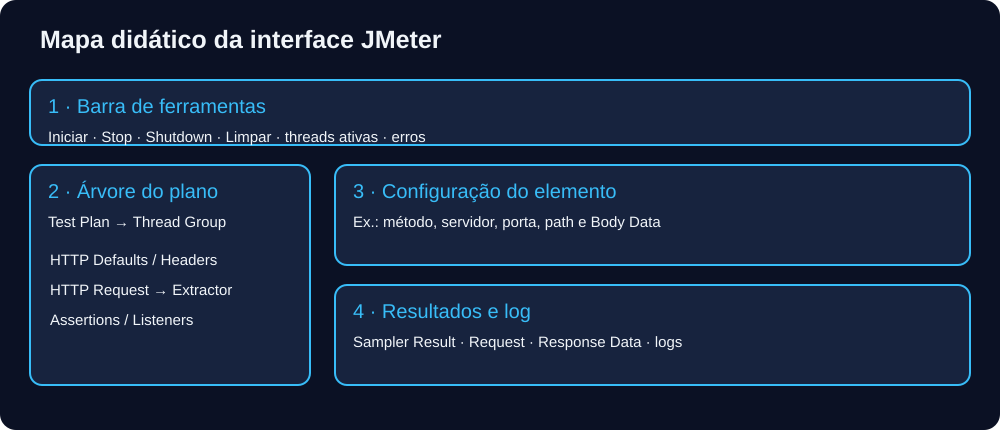
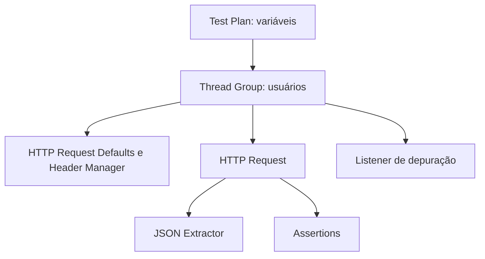

[🏠 Hub Full Stack](../README.md) · [🦎 Menu OculiX](../capitulos/README.md) · [🪶 Menu JMeter](../capitulos-jmeter/README.md) · [🛡️ Menu ZAP](../capitulos-zap/README.md)

---

# 🪶 Capítulo 02: Interface, hierarquia e escopo

**Objetivo:** aplicar interface, hierarquia e escopo ao laboratório local, verificando resultados observáveis. Reserve 35–60 minutos.

## Um mapa para se orientar

1. Use **Options → Choose Language** para escolher Português (Brasil), quando disponível na distribuição. Os nomes em inglês aparecem neste guia para facilitar a busca.
2. Em **Options → Look and Feel**, selecione um tema instalado. Darklaf depende da distribuição e não é necessário para os testes.
3. Na árvore, clique com o botão direito em Test Plan → Add → Threads → Thread Group.
4. Configure 2 threads, ramp-up 4 s e loop count 1. O intervalo aproximado entre partidas é 4/2 = 2 s; ramp-up não limita a vazão.
5. Adicione Sampler → HTTP Request: protocolo `http`, servidor `localhost`, porta `8080`, path `/api/health`.
6. Adicione Listener → View Results Tree. Inicie pelo botão verde e veja as duas amostras; use <kbd>Ctrl</kbd>+<kbd>S</kbd> para salvar.

## Árvore e ordem

| Elemento | Papel |
| --- | --- |
| Test Plan / User Defined Variables | Raiz e valores iniciais |
| Thread Group | Concorrência, partidas e repetições |
| Config Elements | Defaults, headers, CSV, cookies |
| Pre-Processors | Preparação antes da amostra |
| Timers | Pausas antes da amostra |
| Samplers | Requisições |
| Post-Processors | Extração depois da resposta |
| Assertions | Oráculos e limites |
| Listeners | Recebimento dos resultados |

Na execução de uma amostra: configurações → pré-processadores → timers → sampler → pós-processadores → assertions → listeners. Controladores determinam quais amostras executam. Um timer no Thread Group afeta todas as amostras daquele escopo; a posição visual não o transforma em uma pausa entre dois nós.

Use Stop para interrupção e Shutdown para encerramento cooperativo. A barra mostra threads ativas/total e erros de log; o painel de log ajuda a distinguir falha de script de falha HTTP. Limpe resultados antigos antes de depurar novamente.

## Laboratório guiado

Mova um Constant Timer de 500 ms do grupo para um único sampler. O que muda?

Gabarito comentado

No grupo ele afeta cada sampler em seu escopo. Como filho de uma requisição, afeta apenas essa requisição; o elapsed HTTP não incorpora o tempo de pensamento.

## Checklist

- [ ] Executei o procedimento com o servidor local.
- [ ] Conferi resposta, assertion e evidência.
- [ ] Consigo explicar o resultado e uma limitação do ensaio.

## Referências

Consulte a [referência oficial dos componentes](https://jmeter.apache.org/usermanual/component_reference.html) e o [manual de execução](https://jmeter.apache.org/usermanual/get-started.html).

---

[← Anterior](01-introducao-e-instalacao-jmeter.md) · [Menu](README.md) · [Próximo →](03-testando-apis-rest-fullstack.md)
