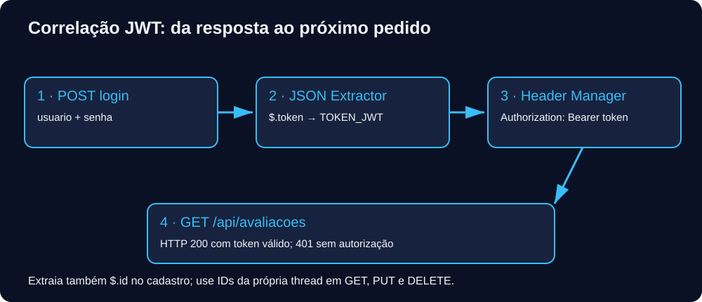

[🏠 Hub Full Stack](../README.md) · [🦎 Menu OculiX](../capitulos/README.md) · [🪶 Menu JMeter](../capitulos-jmeter/README.md) · [🛡️ Menu ZAP](../capitulos-zap/README.md)

---

# 🪶 Capítulo 05: JWT, sessões e correlação


**Objetivo:** aplicar jwt, sessões e correlação ao laboratório local, verificando resultados observáveis. Reserve 35–60 minutos.



## Login → extração → autorização

1. Adicione um POST `/api/auth/login` com Body Data:

```json
{"usuario":"estudante_qa","senha":"oculix123"}
```

2. Como filho do login, Add → Post Processors → JSON Extractor. Names `TOKEN_JWT`, JSONPath `$.token`, Match No. `1`, Default `TOKEN_AUSENTE`.
3. Adicione JSON Assertion para exigir `$.token`. No grupo protegido (Simple Controller), adicione HTTP Header Manager: `Authorization: Bearer ${TOKEN_JWT}`.
4. Execute GET `/api/avaliacoes`. Verifique o header em Request. Token inválido deve produzir 401.
5. No POST de avaliação, extraia `$.id` para `ID_AVALIACAO`. Cada thread mantém suas próprias variáveis, evitando misturar registros entre usuários.

O laboratório gera JWT HS256 assinado, válido por uma hora; a chave é aleatória a cada inicialização, portanto reiniciar invalida tokens anteriores. É um ambiente didático em memória, não um serviço de identidade para produção. O alias `/api/login` existe, mas prefira `/api/auth/login`.

## Cookies, cache e páginas SSR

HTTP Cookie Manager armazena e reenvia cookies por thread. HTTP Cache Manager simula parte do cache HTTP; não gerencia login e não executa JavaScript. Este laboratório usa JWT e não emite cookie de sessão; para exercitar JSESSIONID/connect.sid/PHPSESSID use uma aplicação de aula que os emita.

Em HTML SSR com `<input name="_csrf" value="abc">`, use CSS Selector Extractor: selector `input[name=_csrf]`, attribute `value`, variável `CSRF`. Como alternativa, Regex Extractor: expressão `name="_csrf"\s+value="([^"]+)"`, template `$1$`, match `1`, default `CSRF_AUSENTE`. A regex depende da ordem dos atributos; prefira o seletor para HTML.

Acrescente Debug Sampler e View Results Tree apenas ao depurar; veja JMeter Variables para conferir as extrações. Remova-os da execução de carga e não publique resultados com tokens.

## Laboratório guiado

Troque um caractere do token e confira a resposta; depois reinicie o servidor e reutilize o token antigo.

<details>
<summary>Gabarito comentado</summary>

Ambos os casos devem retornar 401: a assinatura deixa de conferir no primeiro e a chave mudou no segundo. Faça novo login para recuperar o fluxo.

</details>

## Checklist

- [ ] Executei o procedimento com o servidor local.
- [ ] Conferi resposta, assertion e evidência.
- [ ] Consigo explicar o resultado e uma limitação do ensaio.

## Referências

Consulte a [referência oficial dos componentes](https://jmeter.apache.org/usermanual/component_reference.html) e o [manual de execução](https://jmeter.apache.org/usermanual/get-started.html).

---

[← Anterior](04-assercoes-e-validacoes-de-api.md) · [Menu](README.md) · [Próximo →](06-testes-orientados-a-dados-csv-e-variaveis.md)
