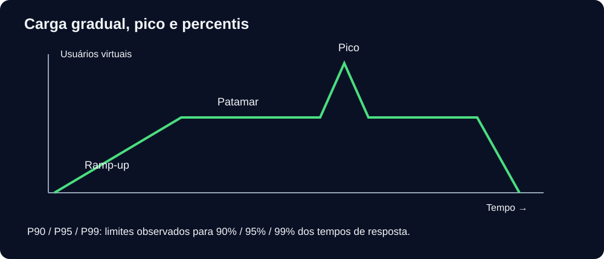

[🏠 Hub Full Stack](../README.md) · [🦎 Menu OculiX](../capitulos/README.md) · [🪶 Menu JMeter](../capitulos-jmeter/README.md)

---

# 🪶 Capítulo 08: Timers, JDBC, arquivos e Groovy


**Objetivo:** aplicar timers, jdbc, arquivos e groovy ao laboratório local, verificando resultados observáveis. Reserve 35–60 minutos.



## Pausas e perfis

| Timer | Configuração inicial | Interpretação |
| --- | --- | --- |
| Constant | 300 ms | Pausa fixa por amostra no escopo |
| Uniform Random | offset 200, máximo aleatório 400 | Pausa entre 200 e 600 ms |
| Gaussian Random | offset 300, desvio 100 | Variação aproximadamente gaussiana, sem garantia de distribuição humana |
| Constant Throughput | 120 amostras/min, all active threads in current group (shared) | Aproxima 2 RPS se houver capacidade |
| Synchronizing | grupo 10, timeout 5000 ms | Barreira que libera threads próximas no tempo |

Constant Throughput Timer não garante meta exata nem cria threads. Synchronizing Timer não garante partida no mesmo milissegundo: escalonamento e rede interferem. Configure timeout positivo e um grupo que possa chegar à barreira, para evitar espera indefinida. Comece com 5–10 usuários no laboratório local antes de aumentar a 50.

## Upload e download

1. Crie HTTP Request POST `/api/upload-comprovante` dentro do escopo autenticado.
2. Marque Use multipart/form-data. Na aba Files Upload: File Path aponta para [comprovante.txt](../exemplos/jmeter/comprovante.txt), Parameter Name `arquivo`, MIME `text/plain`.
3. Não herde `Content-Type: application/json`: use um Header Manager que remova/substitua esse header para que o sampler gere `multipart/form-data` com boundary. Uma opção simples é mover o header JSON para o controlador das rotas JSON.
4. Espere 201; extraia `$.download` para `DOWNLOAD` e `$.bytes` para `TAMANHO`.
5. GET `${DOWNLOAD}` com Bearer; espere 200 e confira tamanho/hash do conteúdo. O limite de 2 MiB inclui o envelope multipart. Uploads ficam na memória e desaparecem ao reiniciar.

## JDBC em um banco separado

O servidor didático usa dicionários em memória. Este exercício requer um banco de aula, separado da API. Exemplo reproduzível: baixe o driver H2 da [distribuição oficial](https://h2database.com/html/download.html), copie o JAR para `JMETER_HOME/lib` e reinicie JMeter.

1. Add → Config Element → JDBC Connection Configuration: Variable Name `banco`, URL `jdbc:h2:mem:aula;DB_CLOSE_DELAY=-1`, Driver `org.h2.Driver`, user `sa`, password vazio, Max Connections 1.
2. JDBC Request, Variable Name `banco`, Query Type Update Statement: `CREATE TABLE IF NOT EXISTS notas (id INT PRIMARY KEY, media DOUBLE)`.
3. Outro Update Statement: `MERGE INTO notas KEY(id) VALUES (1, 8.5)`.
4. Select Statement: `SELECT media FROM notas WHERE id=1`. Valide o conteúdo retornado com Response Assertion.
5. PostgreSQL usa `jdbc:postgresql://localhost:5432/aula` e `org.postgresql.Driver`; MySQL usa `jdbc:mysql://localhost:3306/aula` e `com.mysql.cj.jdbc.Driver`. SQLite exige driver próprio e tem limitações de concorrência. Adapte schema e SQL ao banco escolhido.

Compare tempos de consultas e API sob condições equivalentes, incluindo pool de conexões; diferenças isoladas não provam onde está o gargalo.

## JSR223 + Groovy

Selecione Groovy e cache de compilação. Use `vars.get()` em vez de interpolar variáveis no código compilado:

```groovy
def mac = javax.crypto.Mac.getInstance('HmacSHA256')
mac.init(new javax.crypto.spec.SecretKeySpec('segredo-de-aula'.getBytes('UTF-8'), 'HmacSHA256'))
vars.put('ASSINATURA', mac.doFinal(vars.get('nome').getBytes('UTF-8')).encodeHex().toString())
vars.put('AMANHA', java.time.LocalDate.now().plusDays(1).toString())
log.info('Preparação concluída para thread {}', ctx.getThreadNum())
```

Essa assinatura é um exemplo de HMAC hexadecimal, não um gerador de JWT. Não registre senhas nem tokens no log.

## Laboratório guiado

Envie o comprovante e baixe-o; depois repita o GET sem token.

<details>
<summary>Gabarito comentado</summary>

O upload deve retornar 201 e um caminho dinâmico. O download autenticado retorna os mesmos bytes; sem Bearer retorna 401. Um ID de arquivo inexistente retorna 404.

</details>

## Checklist

- [ ] Executei o procedimento com o servidor local.
- [ ] Conferi resposta, assertion e evidência.
- [ ] Consigo explicar o resultado e uma limitação do ensaio.

## Referências

Consulte a [referência oficial dos componentes](https://jmeter.apache.org/usermanual/component_reference.html) e o [manual de execução](https://jmeter.apache.org/usermanual/get-started.html).

---

[← Anterior](07-gravador-web-proxy-e-controladores-logicos.md) · [Menu](README.md) · [Próximo →](09-metricas-listeners-cli-e-relatorio-html.md)
