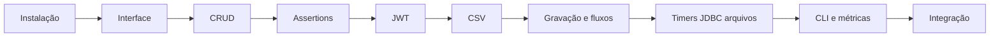

[🏠 Hub Full Stack](../README.md) · [🦎 Menu OculiX](../capitulos/README.md) · [🪶 Menu JMeter](../capitulos-jmeter/README.md)

---

# 🪶 Trilha Apache JMeter — API e desempenho

Do primeiro HTTP Request à análise de uma jornada autenticada. Comece com 1 usuário e valide a correção antes de aumentar carga.



| Capítulo | Conteúdo |
| --- | --- |
| 01 | [Introdução, instalação e métricas](01-introducao-e-instalacao-jmeter.md) |
| 02 | [Interface, hierarquia e escopo](02-conhecendo-a-interface-jmeter.md) |
| 03 | [CRUD REST passo a passo](03-testando-apis-rest-fullstack.md) |
| 04 | [Asserções e oráculos](04-assercoes-e-validacoes-de-api.md) |
| 05 | [JWT, sessões e correlação](05-correlacao-autenticacao-jwt-e-sessoes.md) |
| 06 | [Dados CSV, variáveis e funções](06-testes-orientados-a-dados-csv-e-variaveis.md) |
| 07 | [Gravador proxy e jornadas](07-gravador-web-proxy-e-controladores-logicos.md) |
| 08 | [Timers, JDBC, arquivos e Groovy](08-timers-banco-de-dados-jdbc-e-upload.md) |
| 09 | [CLI, listeners e dashboard HTML](09-metricas-listeners-cli-e-relatorio-html.md) |
| 10 | [Projeto integrador e folha de consulta](10-projeto-pratico-fullstack-e-cheat-sheet.md) |

## Guia rápido

1. Inicie `python exemplos/app-alvo-teste/servidor_fullstack.py` na raiz.
2. Abra o [plano JMX](../exemplos/jmeter/plano_api_e_carga_fullstack.jmx) no JMeter 5.6.3+.
3. Para CLI, entre em `exemplos/jmeter` e execute:

```shell
jmeter -n -t plano_api_e_carga_fullstack.jmx -l resultados.jtl -e -o relatorio_dashboard
```

| Componente | Para que serve |
| --- | --- |
| HTTP Request | Enviar uma chamada |
| JSON Extractor | Capturar token/id |
| JSON Assertion | Verificar regra de negócio |
| CSV Data Set Config | Variar entradas |
| Timer | Controlar pausas |
| Listener / JTL | Coletar resultados |

Consulte o [contrato da API e parâmetros do plano](../exemplos/README.md). O laboratório JDBC e a gravação HTTPS são exercícios opcionais que exigem configuração própria.
