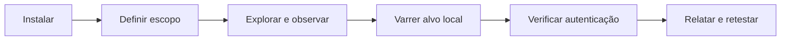

[🏠 Hub Full Stack](../README.md) · [🦎 Menu OculiX](../capitulos/README.md) · [🪶 Menu JMeter](../capitulos-jmeter/README.md) · [🛡️ Menu ZAP](README.md)

---

# 🛡️ Trilha OWASP ZAP 2.17 — segurança de aplicações Web

Aprenda a observar o tráfego HTTP, investigar alertas e produzir um relatório de segurança no laboratório deste repositório. **Versão de referência: ZAP 2.17.0; ambiente: Windows.** O projeto também é apresentado como ZAP by Checkmarx na documentação oficial.

| Capítulo | Roteiro | Tempo estimado |
| --- | --- | --- |
| 01 | [Introdução, instalação e laboratório](01-introducao-instalacao-e-laboratorio.md) | 30 min |
| 02 | [Interface, proxy e escopo](02-interface-proxy-e-escopo.md) | 30 min |
| 03 | [Exploração manual e análise passiva](03-exploracao-manual-e-analise-passiva.md) | 40 min |
| 04 | [Spider e varredura ativa](04-spider-e-varredura-ativa.md) | 40 min |
| 05 | [API, JWT e testes de autenticação](05-api-jwt-e-autenticacao.md) | 40 min |
| 06 | [Alertas, relatório e projeto prático](06-alertas-relatorio-e-projeto-pratico.md) | 45 min |



## Preparação rápida

Na raiz do repositório, execute:

```powershell
python exemplos/app-alvo-teste/servidor_fullstack.py --port 8081
```

Abra `http://localhost:8081/`. Login: `estudante_qa` / `oculix123`. O laboratório fica na **8081**, deixando a **8080** para o proxy do ZAP. Para estes exercícios, abrir o HTML por duplo clique não serve: precisamos de tráfego HTTP.

> [!IMPORTANT]
> Execute as atividades somente neste laboratório local ou em aplicações com autorização explícita. A análise ativa envia requisições de ataque e pode alterar dados. Use dados fictícios e mantenha o alvo restrito a `http://localhost:8081/`.

## Entrega da trilha

- Escopo e versões do ambiente registrados.
- Evidências de uma jornada de login e cálculo.
- Comparação de resposta autenticada e sem token.
- Relatório HTML e uma ficha de achado revisada, ou justificativa da ausência de achados.
- Limitações de cobertura e proposta de reteste.

ZAP complementa os testes visuais do OculiX e os testes de API/carga do JMeter. Uma execução sem alertas não comprova a segurança da aplicação.

Referências: [release 2.17.0](https://www.zaproxy.org/docs/desktop/releases/2.17.0/), [guia oficial 2.17](https://www.zaproxy.org/pdf/ZAPGettingStartedGuide-2.17.pdf) e [contrato do laboratório](../exemplos/README.md).
