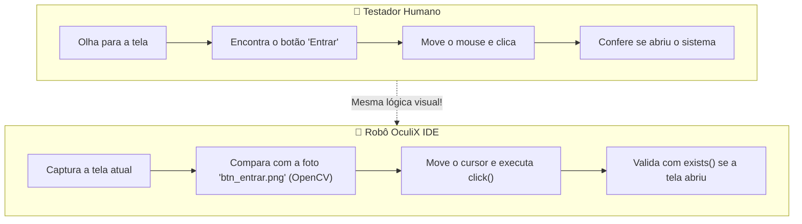
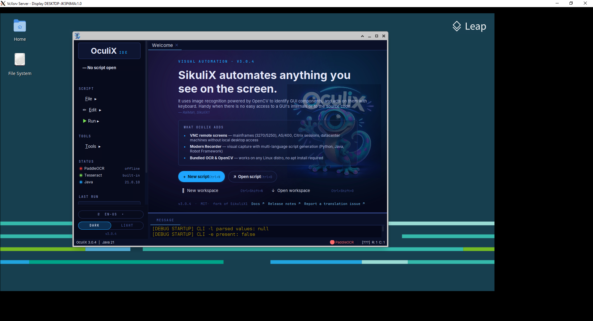

[🏠 Hub Full Stack](../README.md) · [🦎 Menu OculiX](../capitulos/README.md) · [🪶 Menu JMeter](../capitulos-jmeter/README.md) · [🛡️ Menu ZAP](../capitulos-zap/README.md)

---

<div align="center">

[🏠 Voltar ao Início](../README.md) · **Capítulo 01 de 12** · [Próximo: Conhecendo a Interface do OculiX IDE ➔](02-conhecendo-a-interface-oculix-ide.md)

# 📦 Capítulo 01: Introdução aos Testes Visuais e Instalação do Ambiente

-00D2FF?style=flat-square)


</div>

---

## 🎯 Objetivos deste Capítulo

Ao concluir este capítulo, você será capaz de:
- [x] Entender o que é **Teste de Software Baseado em Imagem (Visual GUI Testing)** e quando utilizá-lo.
- [x] Compreender como o **OculiX** localiza elementos na tela usando visão computacional (OpenCV) e OCR (Tesseract).
- [x] Verificar e instalar o **Java (JDK 17 ou superior)** no seu computador.
- [x] Baixar e abrir a interface gráfica do **OculiX IDE** (`oculixide.jar`).

---

## 1. O que é o OculiX e por que usá-lo para Testar Software?

Quando testamos um software manualmente (seja um site, um aplicativo do Windows, uma calculadora ou um jogo), nossos olhos procuram elementos visuais na tela — como o botão **"Salvar"** ou o ícone de uma **lupa** — e nossas mãos movem o mouse e digitam no teclado.

O **OculiX** (sucessor direto do famoso projeto *Sikuli / SikuliX*, iniciado no MIT) faz exatamente a mesma coisa! Ele é uma ferramenta de **Automação e Teste Visual** que interage com qualquer software através do que **aparece na tela (pixels)**.



### 📊 Comparativo: OculiX vs. Ferramentas Tradicionais (Selenium / Cypress / Playwright)

Muitas ferramentas de teste exigem que você conheça o "código por trás da tela" (HTML, CSS, IDs, XPath). Veja a diferença:

| Característica | Ferramentas por Seletores (ex: Selenium) | 🦎 OculiX IDE (Automação Visual) |
| :--- | :--- | :--- |
| **Como encontra um botão?** | Pelo código interno: `By.xpath("//button[@id='btn-submit']")` | Pela **aparência visual**: `click("botao_salvar.png")` |
| **Precisa saber HTML/DOM?** | Sim, é obrigatório inspecionar o código da página. | **Não!** Basta tirar um print do botão na tela. |
| **Quais programas consegue testar?** | Apenas navegadores Web (ou exige drivers específicos). | **Qualquer coisa na tela:** Desktop (Windows), Web, Java, Delphi, Jogos (Canvas/WebGL), Planilhas, VNC/RDP. |
| **Testa se o botão ficou invisível ou cortado?** | Não facilmente (o código HTML pode existir mesmo com o botão escondido). | **Sim!** Se um humano não consegue ver o botão na tela, o OculiX também apontará a falha. |

> [!NOTE]
> **Na Engenharia de Software:** Os testes feitos com o OculiX são classificados como **Testes de Sistema (System Testing)** e **Testes de Caixa-Preta (Black-Box Testing)**, pois avaliamos o software de ponta a ponta exatamente pela perspectiva do usuário final, sem depender da estrutura interna do código-fonte.

---

## 2. Pré-requisito Único: Instalando o Java (JDK 17+)

O OculiX IDE é distribuído como um pacote executável Java (`.jar`) que já traz **tudo embutido** (OpenCV para visão computacional, Tesseract para leitura de textos por OCR e Jython/Python para os scripts). Você **não** precisa instalar Python nem bibliotecas extras!

A única coisa que seu computador precisa ter é o **Java 17 ou superior** (recomendamos o **Java 21 LTS**).

### Passo 2.1: Verificar se você já tem o Java instalado

Abra o PowerShell ou o Prompt de Comando no Windows:
- **No Windows:** Pressione as teclas <kbd>⊞ Win</kbd> + <kbd>R</kbd>, digite `powershell` (ou `cmd`) e pressione <kbd>Enter</kbd>.

Digite o comando abaixo e pressione <kbd>Enter</kbd>:

```powershell
java -version
```

#### Como interpretar o resultado:

<table>
<tr>
<td width="50%" valign="top">

#### ✅ Cenário Ideal (Pronto para usar!)
```text
openjdk version "21.0.4" 2024-07-16 LTS
OpenJDK Runtime Environment Temurin-21.0.4+7
OpenJDK 64-Bit Server VM (build 21.0.4+7-LTS)
```
Se aparecer `version "17..."`, `"21..."` ou superior (e `64-Bit`), seu computador já está pronto! Pule direto para a **Seção 3**.

</td>
<td width="50%" valign="top">

#### ⚠️ Precisa Instalar ou Atualizar
```text
java : O termo 'java' não é reconhecido como
nome de cmdlet, função ou programa operável.
```
ou `java version "1.8.0_391"` (Java 8 antigo). Siga o **Passo 2.2** abaixo para instalar o Java 21 gratuitamente em 2 minutos.

</td>
</tr>
</table>

### Passo 2.2: Como instalar o Java 21 LTS (Caso não tenha)

No Windows, escolha uma das duas opções abaixo:

<details open>
<summary><b>🪟 Windows (Método Rápido via Winget ou Instalador Gráfico)</b></summary>
<br/>

**Opção A — Pelo Instalador Gráfico (Mais fácil):**
1. Acesse o site oficial gratuito da Eclipse Adoptium: [https://adoptium.net/temurin/releases/?version=21](https://adoptium.net/temurin/releases/?version=21)
2. Baixe o instalador **`.msi` (Windows x64)**.
3. Dê duplo clique no arquivo baixado e clique em **Next ➔ Next ➔ Install**.

**Opção B — Pelo PowerShell (1 linha de comando):**
```powershell
winget install EclipseAdoptium.Temurin.21.JDK
```
*(Após instalar, feche e abra novamente o PowerShell para que o comando `java` seja reconhecido).*
</details>

---

## 3. Baixando e Abrindo o OculiX IDE

Com o Java instalado, vamos abrir a interface gráfica do **OculiX IDE**.

### Passo 3.1: Onde está o arquivo do OculiX IDE?

1. Crie uma pasta dedicada nos seus Documentos para manter tudo organizado, por exemplo:
   `C:\Users\SeuNome\Documents\oculix\`
2. Coloque o arquivo **`oculixide-4.0.0-windows.jar`** (fornecido pelo professor ou baixado na página oficial de [Releases do OculiX no GitHub](https://github.com/oculix-org/Oculix/releases)) dentro dessa pasta.

> [!TIP]
> O nome do arquivo `.jar` pode variar conforme a versão (por exemplo: `oculixide-3.0.4.jar` ou `oculixide-4.0.0-windows.jar`). O funcionamento é exatamente o mesmo!

### Passo 3.2: Iniciando o OculiX IDE

Existem **duas formas** de abrir o OculiX IDE. Recomendamos fortemente conhecer ambas:

| Método | Como fazer | Quando usar? |
| :--- | :--- | :--- |
| **Método 1: Terminal (Recomendado)** | Abra o terminal na pasta onde está o arquivo e execute:<br/>`java -jar oculixide-4.0.0-windows.jar` | **Sempre que possível!** Se houver qualquer aviso do sistema operacional, você verá detalhes claros no terminal. |
| **Método 2: Duplo Clique** | Dê um **duplo clique** com o botão esquerdo sobre o arquivo `oculixide-4.0.0-windows.jar` no Explorador de Arquivos. | Prático para o dia a dia quando o `.jar` já está associado ao Java. |

Como alternativa ao duplo clique, abra o terminal na pasta do arquivo baixado e execute:

```shell
java -jar nome-do-arquivo-oculix.jar
```

Substitua `nome-do-arquivo-oculix.jar` pelo nome completo do arquivo que você baixou. Se o nome contiver espaços, coloque-o entre aspas: `java -jar "nome do arquivo oculix.jar"`.

#### Passo a passo para abrir pelo Terminal no Windows:
1. Abra a pasta onde está o arquivo `oculixide-4.0.0-windows.jar` no Explorador de Arquivos.
2. Clique com o **botão direito** em um espaço vazio da pasta e selecione **"Abrir no Terminal"** (ou digite `cmd` na barra de endereços da pasta e aperte <kbd>Enter</kbd>).
3. Digite `java -jar oculix` e aperte a tecla <kbd>Tab</kbd> (o Windows completará o nome do arquivo automaticamente!) e pressione <kbd>Enter</kbd>:

```powershell
java -jar .\oculixide-4.0.0-windows.jar
```

4. Aguarde alguns segundos (na primeira execução, o OculiX extrai automaticamente as bibliotecas nativas de visão computacional OpenCV e o motor OCR Tesseract). Em seguida, a janela principal do **OculiX IDE** se abrirá!

<div align="center">

</div>

---

## 🛠️ Solução de Problemas Comuns (FAQ de Instalação)

Teve algum contratempo ao abrir? Clique no problema correspondente abaixo para ver a solução imediata:

<details>
<summary><b>❓ 1. Dei duplo clique no arquivo .jar e ele abriu no WinRAR / 7-Zip em vez de abrir o programa!</b></summary>
<br/>

Isso acontece quando um descompactador de arquivos "rouba" a extensão `.jar` no Windows.
- **Solução rápida:** Abra pelo terminal usando o comando `java -jar oculixide-4.0.0-windows.jar`.
- **Solução definitiva:** Clique com o botão direito no arquivo `.jar` ➔ **Abrir com** ➔ **Escolher outro aplicativo** ➔ Selecione **OpenJDK Platform binary** (ou *Java(TM) Platform SE binary*) e marque **"Sempre usar este aplicativo para abrir arquivos .jar"**.
</details>

<details>
<summary><b>❓ 2. No Windows, a tela de captura fica cortada ou o OculiX erra a posição do clique em telas Full HD / Notebooks!</b></summary>
<br/>

> [!IMPORTANT]
> **Dica de Ouro sobre Escala de Tela (DPI) no Windows:**
> Em muitos notebooks, o Windows vem configurado com **Escala e Layout em 125% ou 150%**. Embora o OculiX 3.0+/4.0 possua suporte avançado a DPI, para garantir **100% de precisão cirúrgica** durante as aulas:
> 1. Clique com o botão direito na Área de Trabalho do Windows ➔ **Configurações de exibição**.
> 2. Em **Escala e layout**, verifique se está em **100% (Recomendado para testes visuais)** ou mantenha sempre a mesma escala em que você capturou as imagens!
</details>

---

## ✅ Checklist de Conclusão do Capítulo 01

Antes de avançar para o Capítulo 02, confirme se você completou todas as etapas abaixo:

- [ ] Executei `java -version` no terminal e confirmei que tenho o Java 17 ou 21 instalado.
- [ ] Localizei o arquivo `.jar` do OculiX IDE no meu computador.
- [ ] Iniciei o OculiX IDE e estou vendo a tela de Boas-Vindas (*Welcome*) com o mascote lagarto azul.

---

<div align="center">

| [🏠 Voltar ao Índice Principal](../README.md) | [Próximo Capítulo: Conhecendo a Interface do OculiX IDE ➔](02-conhecendo-a-interface-oculix-ide.md) |
| :--- | ---: |

</div>
