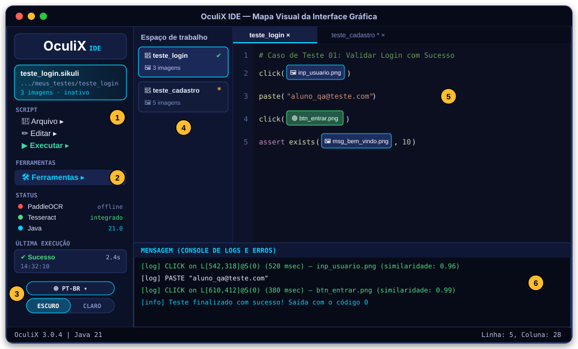
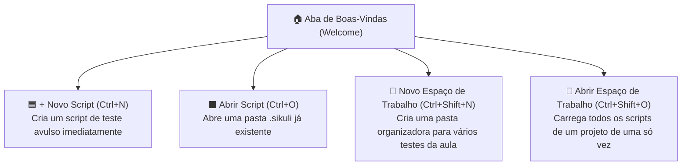

[🏠 Hub Full Stack](../README.md) · [🦎 Menu OculiX](../capitulos/README.md) · [🪶 Menu JMeter](../capitulos-jmeter/README.md) · [🛡️ Menu ZAP](../capitulos-zap/README.md)

---

[⬅️ Anterior: Introdução e Instalação](01-introducao-e-instalacao.md) · [🏠 Início](../README.md) · **Capítulo 02 de 12** · [Próximo: Primeiro Script e Captura ➔](03-primeiro-script-e-captura-de-tela.md)

# 🖥️ Capítulo 02: Conhecendo a Interface Gráfica do OculiX IDE

-00D2FF?style=flat-square)

---

## 🎯 Objetivos deste Capítulo

Ao concluir este capítulo, você será capaz de:
- [x] Alterar o idioma do OculiX IDE para **Português (Brasil)** e alternar entre os temas **Escuro** e **Claro**.
- [x] Identificar as **6 áreas principais** da janela do OculiX IDE.
- [x] Entender o significado dos indicadores luminosos da seção **STATUS** (PaddleOCR, Tesseract e Java).
- [x] Configurar as **Preferências essenciais** para facilitar a captura de tela durante os testes.

---

## 1. Primeiro Passo: Colocando o OculiX IDE em Português (PT-BR)

Na primeira vez que você abre o OculiX IDE, ele pode iniciar em Inglês (`EN-US`) ou no idioma padrão do seu sistema operacional. Vamos garantir que toda a sua interface fique em **Português**:

1. Olhe para o **canto inferior esquerdo** da barra lateral do OculiX IDE (logo acima do botão `DARK | LIGHT`).
2. Clique no botão arredondado de idioma (por exemplo: `🌐 EN-US ▾`).
3. No menu que se abre, navegue até **Europe (Latin) / Europa (latim)** e selecione **Português (Brasil)**.
4. Uma janela de confirmação aparecerá informando: *"Idioma definido como Português (Brasil). Reinicie o OculiX para que toda a IU seja alterada."*
5. Feche o OculiX IDE e abra-o novamente. Pronto! Todos os menus estarão em Português! 🎉

> [!TIP]
> Logo abaixo do botão de idioma, você pode clicar no seletor **`ESCURO | CLARO`** a qualquer momento para mudar instantaneamente as cores da interface conforme sua preferência visual!

---

## 2. Mapa Visual da Interface do OculiX IDE

Quando você cria ou abre um script de teste, a janela do OculiX IDE se divide em **6 regiões estratégicas**. Observe os números amarelos (**① a ⑥**) na ilustração abaixo:

### 📋 Legenda Detalhada das 6 Áreas (Siga os números!)

| Nº | Região da Interface | Para que serve? |
| :---: | :--- | :--- |
| **①** | **Seção `SCRIPT` (Barra Lateral)** | Reúne os três menus principais de trabalho: • **📁 Arquivo:** Criar ou abrir Scripts e Espaços de Trabalho, Salvar (<kbd>Ctrl</kbd>+<kbd>S</kbd>), Exportar `.zip`/`.jar` e abrir **Preferências** (<kbd>Ctrl</kbd>+<kbd>P</kbd>). • **✏️ Editar:** Desfazer, Refazer, Copiar, Colar, Indentar e Localizar (<kbd>Ctrl</kbd>+<kbd>F</kbd>). • **▶️ Executar:** Rodar seu teste normalmente (<kbd>Ctrl</kbd>+<kbd>R</kbd>), rodar em **Câmera Lenta** (<kbd>Alt</kbd>+<kbd>Ctrl</kbd>+<kbd>R</kbd>) ou rodar apenas as linhas selecionadas. |
| **②** | **Seção `FERRAMENTAS`** | O coração da automação visual! Ao clicar em **🛠️ Ferramentas**, você acessa: • **📷 Capturar:** Tira um recorte de imagem da tela e insere no código. • **🖼️ Inserir uma imagem:** Importa um arquivo `.png` ou `.jpg` que já está salvo no computador. • **🔴 Gravar:** Gravador clássico de cliques. • **🟢 Gravador moderno (beta):** O painel flutuante inteligente que gera testes completos sem precisar programar! |
| **③** | **Painel de Status, Última Execução e Rodapé** | Mostra a "saúde" do ambiente em tempo real: • **STATUS:** Mostra se o **Tesseract OCR** (sempre 🟢 *integrado*), o **PaddleOCR** e o **Java** estão ativos. • **ÚLTIMA EXECUÇÃO:** Informa se o último teste passou (**✔ Sucesso**) ou falhou, quanto tempo levou (ex: `2.4s`) e o horário. • **Rodapé:** Seletor de idioma e botão **ESCURO \| CLARO**. |
| **④** | **Explorador do Espaço de Trabalho (Workspace)** | Exibe **cartões visuais** para cada script aberto. Mostra o nome do script, quantas imagens (`.png`) ele possui e um ícone: • **✔ (Verde):** O script está salvo. • **\* (Asterisco laranja):** Há alterações não salvas! |
| **⑤** | **Editor de Código com Miniaturas** | Onde o seu roteiro de teste é montado. A grande mágica do OculiX IDE é que, em vez de mostrar apenas o texto `"btn_entrar.png"`, ele **mostra a própria foto do botão dentro do comando `click()`**! |
| **⑥** | **Área de Mensagens (Console Inferior)** | Onde o OculiX "conversa" com você durante e após o teste. Cada clique realizado aparece como `[log] CLICK on ...` e qualquer erro indica exatamente o número da linha que falhou. |

> [!NOTE]
> **Dica de espaço na tela:** Se você der um **duplo clique** em um espaço vazio da Barra Lateral Esquerda, ela se recolhe para uma barra fina de ícones, dando mais espaço para o seu editor de código! Dê outro duplo clique para expandi-la novamente.

---

## 3. Entendendo a Aba de Boas-Vindas (Welcome Tab)

Quando nenhum script está aberto, o centro da tela exibe a **Aba de Boas-Vindas**:

### Qual a diferença entre **Script** e **Espaço de Trabalho (Workspace)**?
- 📄 **Script (`.sikuli`):** É um **único caso de teste** (por exemplo: `teste_login.sikuli`).
- 📁 **Espaço de Trabalho (Workspace):** É uma **pasta principal do seu projeto ou disciplina** (por exemplo: `Aula_Testes_Oculix`) que guarda vários scripts diferentes organizados lado a lado no painel esquerdo (**④**).

---

## 4. Entendendo os Indicadores de STATUS na Barra Lateral

Muitos estudantes ficam em dúvida ao olhar a seção **STATUS** na barra lateral e ver uma bolinha vermelha ao lado de `PaddleOCR`. Não se preocupe! Veja o que cada indicador significa:

| Indicador na Barra Lateral | Estado Padrão | O que significa para você? |
| :--- | :---: | :--- |
| 🔴 **PaddleOCR** | `offline` | É um servidor externo opcional de inteligência artificial para idiomas asiáticos complexos. **Pode ficar `offline` normalmente!** Você não precisa dele nas aulas. |
| 🟢 **Tesseract** | `integrado` | É o motor oficial de leitura de textos (OCR) que já vem **100% embutido** dentro do OculiX IDE. Sempre que estiver verde, você já pode ler textos da tela! |
| 🔵 **Java** | `17.x` / `21.x` | Mostra a versão do motor Java que está executando o seu OculiX IDE. |

---

## 5. Configurando as Preferências Essenciais (<kbd>Ctrl</kbd> + <kbd>P</kbd>)

Antes de criarmos nosso primeiro script no próximo capítulo, vamos fazer **3 pequenos ajustes** nas Preferências do OculiX IDE que vão facilitar imensamente a sua vida:

### Passo a passo:
1. Na Barra Lateral Esquerda, clique em **📁 Arquivo ➔ Preferências** (ou pressione <kbd>Ctrl</kbd> + <kbd>P</kbd>).
2. Na aba **Capturando a tela (Screen Capturing)**:
   - **Espera, antes de capturar (Delay before capture):** Observe que o padrão é `0.5` segundos. Se você quiser tempo para abrir um menu antes que a foto seja tirada, pode aumentar para `1.0` ou `2.0` segundos.
   - **Nomear automaticamente (Automatic Naming):**
     - Selecione **Manualmente (off / manual input)**!
     - *Por quê?* Quando marcado como "Manualmente", toda vez que você capturar a foto de um botão na tela, o OculiX IDE perguntará qual nome você quer dar à imagem (ex: `btn_calcular`), deixando seu teste muito mais organizado do que números aleatórios como `1731168923.png`!
3. Clique no botão **`mais opções...` (more options...)** no canto inferior da janela de Preferências:
   - Em **Opções para salvar**, marque **`excluir imagens não utilizadas`** (assim o OculiX limpa automaticamente prints antigos que você apagou do código).
   - Em **TextSearch e OCR**, marque **`permitir pesquisa por texto`** e **`permitir OCR`** (usaremos isso para ler textos da tela!).
   - Clique em **Salvar** e depois em **OK**.

<b>🧠 Quiz Rápido de Fixação (Clique para responder mentalmente e conferir!)</b>

 

1. **Onde você olha para saber se o seu teste clicou no botão certo ou em qual linha ocorreu um erro?**
   - *Resposta:* Na **Área de Mensagens (Console Inferior — área ⑥)** e no cartão **ÚLTIMA EXECUÇÃO** da Barra Lateral.
2. **Por que é recomendável ativar a nomeação manual de imagens nas Preferências?**
   - *Resposta:* Para dar nomes significativos às capturas (como `btn_salvar.png`), facilitando a leitura e manutenção do teste.
3. **O indicador `PaddleOCR offline` em vermelho impede o uso do OculiX?**
   - *Resposta:* **Não!** O leitor de textos **Tesseract** já vem `integrado` (bolinha verde) e pronto para uso.

---

## ✅ Checklist de Conclusão do Capítulo 02

- [ ] Mudei o idioma do meu OculiX IDE para **Português (Brasil)** e testei o botão **ESCURO | CLARO**.
- [ ] Identifiquei onde ficam os menus **Arquivo**, **Executar** e **Ferramentas** na Barra Lateral.
- [ ] Abri as **Preferências** (<kbd>Ctrl</kbd> + <kbd>P</kbd>), ativei a nomeação manual de imagens e habilitei as opções de OCR.

---

| [⬅️ Capítulo 01: Introdução e Instalação](01-introducao-e-instalacao.md) | [🏠 Início](../README.md) | [Próximo Capítulo: Primeiro Script e Captura de Tela ➔](03-primeiro-script-e-captura-de-tela.md) |
| :--- | :---: | ---: |

