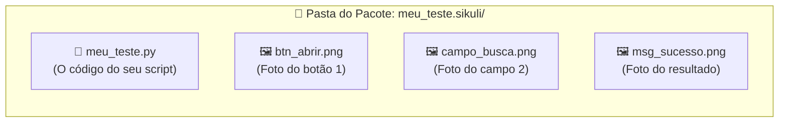
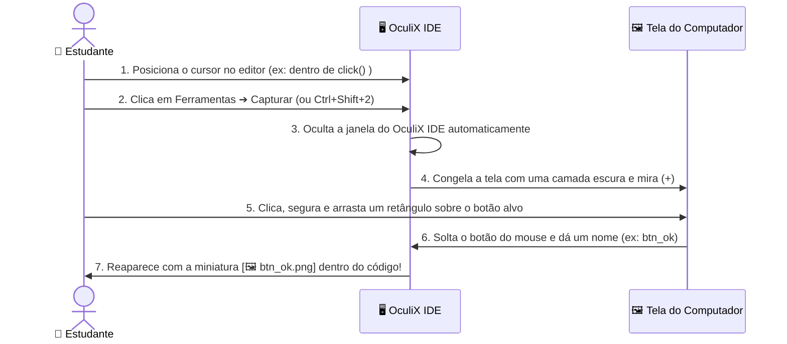

[🏠 Hub Full Stack](../README.md) · [🦎 Menu OculiX](../capitulos/README.md) · [🪶 Menu JMeter](../capitulos-jmeter/README.md)

---

<div align="center">

[⬅️ Anterior: Conhecendo a Interface](02-conhecendo-a-interface-oculix-ide.md) · [🏠 Início](../README.md) · **Capítulo 03 de 12** · [Próximo: Gravador Moderno ➔](04-gravador-moderno-sem-codigo.md)

# 📸 Capítulo 03: Seu Primeiro Teste Automatizado — Captura de Tela e Ações Básicas

-00D2FF?style=flat-square)


</div>

---

## 🎯 Objetivos deste Capítulo

Ao concluir este capítulo, você será capaz de:
- [x] Criar um **Espaço de Trabalho** e salvar um script no formato pacote **`.sikuli`**.
- [x] Capturar recortes perfeitos da tela usando a ferramenta **Capturar** do OculiX IDE.
- [x] Aplicar as **4 Regras de Ouro da Captura Visual** para evitar que o teste falhe.
- [x] Executar cliques (`click`, `doubleClick`, `rightClick`) e entrada de texto (`paste` e `type`).
- [x] Executar testes em **Câmera Lenta** para visualizar onde o OculiX está clicando e usar o atalho de **Parada de Emergência**.

---

## 1. O Segredo da Pasta `.sikuli` (Entenda antes de salvar!)

Diferente de um arquivo de texto comum, um script do OculiX contém **código + imagens**. Por isso, quando você salva um teste no OculiX IDE com o nome `meu_teste`, ele cria automaticamente uma **pasta especial chamada `meu_teste.sikuli`**:



> [!WARNING]
> **Atenção, Estudante!**
> Nunca envie apenas o arquivo `.py` solto para o seu professor ou colega! Sem as imagens `.png` que estão dentro da pasta `.sikuli`, o OculiX não terá o que procurar na tela. Sempre mantenha a pasta **`nome_do_teste.sikuli`** inteira (ou use a função de exportar `.zip`, que veremos no Capítulo 08).

---

## 2. Criando seu Espaço de Trabalho e Primeiro Script

Vamos organizar nossas aulas criando um **Espaço de Trabalho (Workspace)** dedicado:

### Passo 2.1: Criar o Espaço de Trabalho
1. Na Aba de Boas-Vindas (ou no menu **📁 Arquivo ➔ Novo ➔ Espaço de trabalho**), clique em **Novo espaço de trabalho** (<kbd>Ctrl</kbd> + <kbd>Shift</kbd> + <kbd>N</kbd>).
2. Preencha os campos da janela:
   - **Nome:** `Aulas_Oculix`
   - **Descrição:** `Scripts práticos de teste de software`
   - **Autor:** Seu nome
3. Clique em **Criar** e escolha a pasta onde deseja guardá-lo (ex: `Documentos`).
4. Note que o painel **Espaço de trabalho** à esquerda agora exibe o título `Aulas_Oculix`!

### Passo 2.2: Criar e Salvar seu Primeiro Script
1. Clique em **📁 Arquivo ➔ Novo ➔ Script** (ou pressione <kbd>Ctrl</kbd> + <kbd>N</kbd>).
2. Uma nova aba chamada `Sem título` (*Untitled*) aparecerá no editor central.
3. Pressione <kbd>Ctrl</kbd> + <kbd>S</kbd> (ou **📁 Arquivo ➔ Salvar como...**), digite o nome **`aula01_basico`** e clique em **Salvar**.
4. Observe que o cartão **`📄 aula01_basico`** agora aparece salvo (**✔**) no painel do seu Espaço de Trabalho e no topo da Barra Lateral!

---

## 3. Como Capturar Elementos da Tela Passo a Passo

Agora vamos aprender o recurso mais importante do OculiX IDE: a **Captura de Imagem**.



### Experimente agora mesmo no seu OculiX IDE:
1. No editor de código do seu script `aula01_basico`, digite:
   ```python
   click()
   ```
2. Deixe o cursor piscando **exatamente entre os parênteses** `click(|)`.
3. Na Barra Lateral Esquerda, clique em **🛠️ Ferramentas ➔ 📷 Capturar** (ou use o atalho rápido <kbd>Ctrl</kbd> + <kbd>Shift</kbd> + <kbd>2</kbd>).
4. O OculiX IDE vai se esconder e sua tela ficará levemente escurecida com a mensagem *"Selecione uma imagem"*.
5. Clique e arraste o mouse formando um retângulo ao redor de qualquer ícone da sua Área de Trabalho ou Barra de Tarefas (por exemplo, o ícone do menu Iniciar ou da Calculadora) e **solte o botão do mouse**.
6. *(Se você ativou a nomeação manual no Capítulo 02)* Digite `icone_teste` e pressione <kbd>Enter</kbd>.
7. **Olhe para o editor do OculiX IDE:** a foto que você acabou de recortar apareceu **dentro** dos parênteses de `click()`!

> [!TIP]
> **E se eu entrar no modo de captura sem querer?**
> Basta pressionar a tecla <kbd>Esc</kbd> no teclado a qualquer momento enquanto a tela estiver escura para cancelar a captura e voltar ao OculiX IDE!

---

## 4. As 4 Regras de Ouro para uma Captura Perfeita

90% dos erros de estudantes iniciantes acontecem porque o recorte da imagem foi grande demais ou pegou partes que mudam de cor. Siga sempre este guia visual:

| Situação | ❌ Como NÃO Capturar (Errado) | ✅ Como Capturar (Correto) | Por quê? |
| :--- | :--- | :--- | :--- |
| **1. Tamanho do Recorte** | Capturar o botão inteiro junto com um pedaço grande do papel de parede ou da janela de fundo atrás dele. | Recortar **apenas o interior do botão** (o texto/ícone central e um pouquinho da cor do botão). | Se a janela mudar de lugar na tela, o papel de parede ao fundo muda e o OculiX não achará a imagem! |
| **2. Efeito *Hover* (Mouse em cima)** | Deixar a seta do mouse em cima do botão antes de capturar (quando o botão muda de cor ao passar o mouse). | Garantir que o botão esteja no seu **estado normal (em repouso)** antes de iniciar a captura. | Durante o teste, antes de o OculiX clicar, o mouse ainda não está em cima do botão! |
| **3. Cursor Piscando em Campos** | Capturar um campo de texto enquanto a barrinha vertical `\|` de digitação está piscando dentro dele. | Clicar fora do campo primeiro para tirar o foco antes de capturar. | A barrinha piscante altera os pixels internos da caixa de texto. |
| **4. Elementos Repetidos** | Capturar uma palavra genérica como `"Sim"` ou uma caixa branca vazia quando existem várias iguais na tela. | Capturar o botão junto com o rótulo único ao lado (e usar **Target Offset**, que veremos no Cap. 05). | Evita que o OculiX clique no botão ou campo errado. |

---

## 5. Os Comandos Fundamentais de Ação (Mouse e Teclado)

No OculiX IDE, escrevemos comandos simples em Python (Jython). Você não precisa decorar nada complicado — com apenas **6 comandos**, você já consegue automatizar quase qualquer interação:

### 🖱️ Ações de Mouse

```python
# 1. Clique simples com o botão esquerdo no centro da imagem:
click("btn_confirmar.png")

# 2. Clique duplo (ideal para abrir ícones na área de trabalho ou pastas):
doubleClick("icone_pasta.png")

# 3. Clique com o botão direito (abre o menu de contexto):
rightClick("arquivo_relatorio.png")

# 4. Apenas mover o mouse para cima do elemento (sem clicar):
hover("menu_suspenso.png")
```

### ⌨️ Ações de Teclado: `paste()` vs. `type()`

Quando queremos preencher um campo de texto em um teste, temos dois comandos: **`paste()`** (colar) e **`type()`** (digitar tecla por tecla).

> [!IMPORTANT]
> **Qual a diferença entre `paste()` e `type()` no Brasil?**
> - Use **`paste("João da Silva - Avaliação Nº 1")`** sempre que o texto tiver **acentos (`ã`, `é`, `ê`), cedilha (`ç`) ou caracteres especiais**! O `paste()` copia o texto para a área de transferência e cola instantaneamente (<kbd>Ctrl</kbd>+<kbd>V</kbd>), funcionando 100% com acentuação em português e sendo muito mais rápido.
> - Use **`type(...)`** quando quiser simular o pressionamento físico de teclas sem acento (ex: `type("12345")`) ou **teclas especiais** como <kbd>Enter</kbd> e <kbd>Tab</kbd> (ex: `type(Key.ENTER)`).

Veja como combiná-los:

```python
# Opção A: Clicar no campo primeiro e depois colar o texto com acentos
click("campo_nome.png")
paste("Maria José Conceição")

# Opção B: Passar a imagem e o texto juntos no mesmo comando!
paste("campo_nome.png", "Maria José Conceição")

# E para apertar a tecla ENTER depois de preencher:
type(Key.ENTER)
```

---

## 6. Executando seu Teste: Modo Normal vs. Câmera Lenta

Depois de montar seus comandos no editor, você tem duas formas de executar o teste no menu **▶️ Executar** da Barra Lateral:

| Modo de Execução | Atalho | Como funciona? |
| :--- | :---: | :--- |
| **▶️ Executar (Normal)** | <kbd>Ctrl</kbd> + <kbd>R</kbd> | Executa os cliques e digitações na velocidade real de teste. |
| **🐢 Executar em câmera lenta** | <kbd>Alt</kbd> + <kbd>Ctrl</kbd> + <kbd>R</kbd> | **O melhor amigo do estudante!** Antes de cada clique, o OculiX desenha um **alvo circular vermelho piscante** na tela exatamente onde encontrou a imagem, permitindo que você veja cada passo com calma! |
| **✂️ Executar seleção** | <kbd>Ctrl</kbd> + <kbd>Shift</kbd> + <kbd>R</kbd> | Executa **apenas as linhas que você selecionou** com o mouse no editor. Perfeito para testar só um pedacinho do script! |

> [!CAUTION]
> **BOTÃO DE EMERGÊNCIA — Como parar o robô imediatamente:**
> Quando o teste está rodando, o OculiX assume o controle do seu mouse e teclado. Se o seu script começar a clicar no lugar errado ou ficar preso em um loop, pressione imediatamente:
> <div align="center">
>
> ### <kbd>Alt</kbd> + <kbd>Shift</kbd> + <kbd>C</kbd>
>
> </div>
> Isso aborta a execução do script na mesma hora e devolve o controle do mouse para você!

---

## 🧪 Laboratório Prático 01: Seu Primeiro Teste no App de Treino

Vamos colocar a mão na massa! Neste exercício, você vai automatizar o login no nosso **Aplicativo Alvo de Treino** que está incluído neste repositório.

### Passo a passo guiado:
1. Abra a pasta do nosso repositório no seu computador e dê um **duplo clique** no arquivo:
   📂 [`exemplos/app-alvo-teste/index.html`](../exemplos/app-alvo-teste/index.html)
   *(Ele abrirá no seu navegador web. Deixe a janela do navegador visível na tela).*
2. No **OculiX IDE**, crie um novo script (<kbd>Ctrl</kbd> + <kbd>N</kbd>) e salve-o (<kbd>Ctrl</kbd> + <kbd>S</kbd>) como **`lab01_login`**.
3. Digite as 3 linhas abaixo, capturando as imagens correspondentes na tela do navegador usando **🛠️ Ferramentas ➔ 📷 Capturar**:
   - Na linha 1: capture o interior da caixa de texto **"Usuário / E-mail"** (onde diz *Digite seu usuário...*).
   - Na linha 2: capture o interior da caixa de texto **"Senha"**.
   - Na linha 3: capture o botão azul **"Entrar no Sistema"**.

<details>
<summary><b>👀 Clique aqui para ver como deve ficar o seu código no OculiX IDE (Gabarito)</b></summary>
<br/>

```python
# Laboratório 01 - Teste de Login Básico
paste("campo_usuario.png", "estudante_qa")
paste("campo_senha.png", "oculix123")
click("btn_entrar.png")
```

> **Dica:** Lembre-se de que no editor do OculiX IDE, no lugar de `"campo_usuario.png"`, você verá a **miniatura da foto** que você capturou!
</details>

4. Deixe o navegador com a página de treino visível ao fundo (não minimize o navegador!).
5. No OculiX IDE, clique em **▶️ Executar ➔ Executar em câmera lenta** (<kbd>Alt</kbd> + <kbd>Ctrl</kbd> + <kbd>R</kbd>) e tire a mão do mouse!
6. Observe o círculo vermelho do OculiX localizar cada campo, preencher os dados e clicar no botão **Entrar no Sistema**!
7. Ao final, confira no painel inferior **MENSAGEM** os logs `[log] CLICK on ...` e no cartão **ÚLTIMA EXECUÇÃO** da Barra Lateral o status **✔ Sucesso**!

---

## ✅ Checklist de Conclusão do Capítulo 03

- [ ] Entendi que todo script do OculiX é salvo em uma pasta `.sikuli` que guarda o `.py` e os arquivos `.png`.
- [ ] Capturei imagens da tela usando `Ferramentas ➔ Capturar` e vi as miniaturas aparecerem no código.
- [ ] Entendi por que devemos usar `paste()` para textos com acentos em português.
- [ ] Executei meu primeiro teste em **Câmera Lenta** (<kbd>Alt</kbd> + <kbd>Ctrl</kbd> + <kbd>R</kbd>) e memorizei o atalho de parada <kbd>Alt</kbd> + <kbd>Shift</kbd> + <kbd>C</kbd>.

---

<div align="center">

| [⬅️ Capítulo 02: Conhecendo a Interface](02-conhecendo-a-interface-oculix-ide.md) | [🏠 Início](../README.md) | [Próximo Capítulo: Gravador Moderno (Sem Código) ➔](04-gravador-moderno-sem-codigo.md) |
| :--- | :---: | ---: |

</div>
