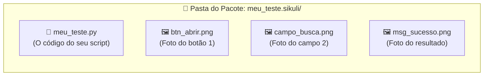
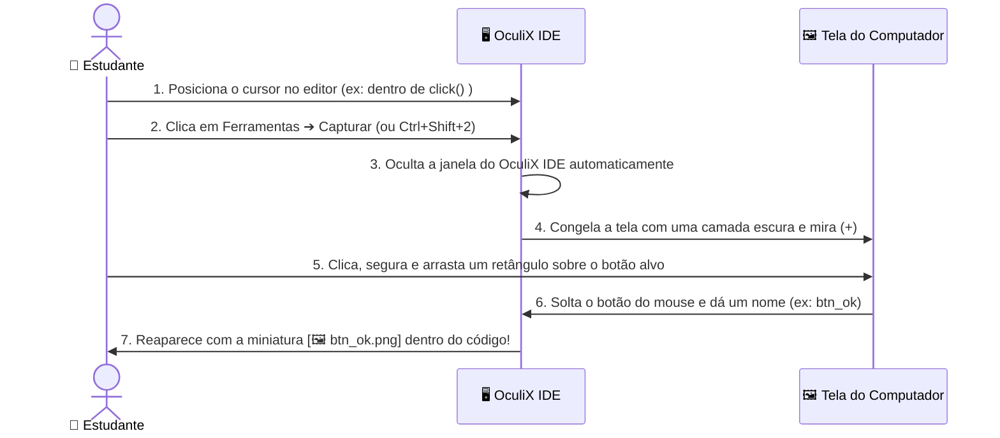

[🏠 Hub Full Stack](../README.md) · [🦎 Menu OculiX](../capitulos/README.md) · [🪶 Menu JMeter](../capitulos-jmeter/README.md)

---

<div align="center">

[⬅️ Anterior: Conhecendo a Interface](02-conhecendo-a-interface-oculix-ide.md) · [🏠 Início](../README.md) · **Capítulo 03 de 12** · [Próximo: Gravador Moderno ➔](04-gravador-moderno-sem-codigo.md)

# 📸 Capítulo 03: Seu Primeiro Teste Automatizado — Captura de Tela e Ações Básicas

-00D2FF?style=flat-square)


</div>

---

## 🎯 Objetivos deste Capítulo

Ao concluir este capítulo, você será capaz de:
- [x] Criar um **Espaço de Trabalho** e salvar um script no formato pacote **`.sikuli`**.
- [x] Capturar recortes perfeitos da tela usando a ferramenta **Capturar** do OculiX IDE.
- [x] Aplicar as **4 Regras de Ouro da Captura Visual** para evitar que o teste falhe.
- [x] Executar cliques (`click`, `doubleClick`, `rightClick`) e entrada de texto (`paste` e `type`).
- [x] Executar testes em **Câmera Lenta** para visualizar onde o OculiX está clicando e usar o atalho de **Parada de Emergência**.
- [x] Combinar esperas, asserções, atalhos, rolagem, regiões e capturas de evidência em testes reutilizáveis.
- [x] Testar login inválido, aprovação, reprovação e entradas incorretas com resultados esperados explícitos.

---

## 1. O Segredo da Pasta `.sikuli` (Entenda antes de salvar!)

Diferente de um arquivo de texto comum, um script do OculiX contém **código + imagens**. Por isso, quando você salva um teste no OculiX IDE com o nome `meu_teste`, ele cria automaticamente uma **pasta especial chamada `meu_teste.sikuli`**:



> [!WARNING]
> **Atenção, Estudante!**
> Nunca envie apenas o arquivo `.py` solto para o seu professor ou colega! Sem as imagens `.png` que estão dentro da pasta `.sikuli`, o OculiX não terá o que procurar na tela. Sempre mantenha a pasta **`nome_do_teste.sikuli`** inteira (ou use a função de exportar `.zip`, que veremos no Capítulo 08).

---

## 2. Criando seu Espaço de Trabalho e Primeiro Script

Vamos organizar nossas aulas criando um **Espaço de Trabalho (Workspace)** dedicado:

### Passo 2.1: Criar o Espaço de Trabalho
1. Na Aba de Boas-Vindas (ou no menu **📁 Arquivo ➔ Novo ➔ Espaço de trabalho**), clique em **Novo espaço de trabalho** (<kbd>Ctrl</kbd> + <kbd>Shift</kbd> + <kbd>N</kbd>).
2. Preencha os campos da janela:
   - **Nome:** `Aulas_Oculix`
   - **Descrição:** `Scripts práticos de teste de software`
   - **Autor:** Seu nome
3. Clique em **Criar** e escolha a pasta onde deseja guardá-lo (ex: `Documentos`).
4. Note que o painel **Espaço de trabalho** à esquerda agora exibe o título `Aulas_Oculix`!

### Passo 2.2: Criar e Salvar seu Primeiro Script
1. Clique em **📁 Arquivo ➔ Novo ➔ Script** (ou pressione <kbd>Ctrl</kbd> + <kbd>N</kbd>).
2. Uma nova aba chamada `Sem título` (*Untitled*) aparecerá no editor central.
3. Pressione <kbd>Ctrl</kbd> + <kbd>S</kbd> (ou **📁 Arquivo ➔ Salvar como...**), digite o nome **`aula01_basico`** e clique em **Salvar**.
4. Observe que o cartão **`📄 aula01_basico`** agora aparece salvo (**✔**) no painel do seu Espaço de Trabalho e no topo da Barra Lateral!

---

## 3. Como Capturar Elementos da Tela Passo a Passo

Agora vamos aprender o recurso mais importante do OculiX IDE: a **Captura de Imagem**.



### Experimente agora mesmo no seu OculiX IDE:
1. No editor de código do seu script `aula01_basico`, digite:
   ```python
   click()
   ```
2. Deixe o cursor piscando **exatamente entre os parênteses** `click(|)`.
3. Na Barra Lateral Esquerda, clique em **🛠️ Ferramentas ➔ 📷 Capturar** (ou use o atalho rápido <kbd>Ctrl</kbd> + <kbd>Shift</kbd> + <kbd>2</kbd>).
4. O OculiX IDE vai se esconder e sua tela ficará levemente escurecida com a mensagem *"Selecione uma imagem"*.
5. Clique e arraste o mouse formando um retângulo ao redor de qualquer ícone da sua Área de Trabalho ou Barra de Tarefas (por exemplo, o ícone do menu Iniciar ou da Calculadora) e **solte o botão do mouse**.
6. *(Se você ativou a nomeação manual no Capítulo 02)* Digite `icone_teste` e pressione <kbd>Enter</kbd>.
7. **Olhe para o editor do OculiX IDE:** a foto que você acabou de recortar apareceu **dentro** dos parênteses de `click()`!

> [!TIP]
> **E se eu entrar no modo de captura sem querer?**
> Basta pressionar a tecla <kbd>Esc</kbd> no teclado a qualquer momento enquanto a tela estiver escura para cancelar a captura e voltar ao OculiX IDE!

---

## 4. As 4 Regras de Ouro para uma Captura Perfeita

90% dos erros de estudantes iniciantes acontecem porque o recorte da imagem foi grande demais ou pegou partes que mudam de cor. Siga sempre este guia visual:

| Situação | ❌ Como NÃO Capturar (Errado) | ✅ Como Capturar (Correto) | Por quê? |
| :--- | :--- | :--- | :--- |
| **1. Tamanho do Recorte** | Capturar o botão inteiro junto com um pedaço grande do papel de parede ou da janela de fundo atrás dele. | Recortar **apenas o interior do botão** (o texto/ícone central e um pouquinho da cor do botão). | Se a janela mudar de lugar na tela, o papel de parede ao fundo muda e o OculiX não achará a imagem! |
| **2. Efeito *Hover* (Mouse em cima)** | Deixar a seta do mouse em cima do botão antes de capturar (quando o botão muda de cor ao passar o mouse). | Garantir que o botão esteja no seu **estado normal (em repouso)** antes de iniciar a captura. | Durante o teste, antes de o OculiX clicar, o mouse ainda não está em cima do botão! |
| **3. Cursor Piscando em Campos** | Capturar um campo de texto enquanto a barrinha vertical `\|` de digitação está piscando dentro dele. | Clicar fora do campo primeiro para tirar o foco antes de capturar. | A barrinha piscante altera os pixels internos da caixa de texto. |
| **4. Elementos Repetidos** | Capturar uma palavra genérica como `"Sim"` ou uma caixa branca vazia quando existem várias iguais na tela. | Capturar o botão junto com o rótulo único ao lado (e usar **Target Offset**, que veremos no Cap. 05). | Evita que o OculiX clique no botão ou campo errado. |

---

## 5. Os Comandos Fundamentais de Ação (Mouse e Teclado)

No OculiX IDE, escrevemos comandos em Python (Jython). Comece com as ações abaixo e depois combine-as com **esperas e validações**: clicar sem conferir o resultado ainda não demonstra que o programa está correto.

### 🖱️ Ações de Mouse

```python
# 1. Clique simples com o botão esquerdo no centro da imagem:
click("btn_confirmar.png")

# 2. Clique duplo (ideal para abrir ícones na área de trabalho ou pastas):
doubleClick("icone_pasta.png")

# 3. Clique com o botão direito (abre o menu de contexto):
rightClick("arquivo_relatorio.png")

# 4. Apenas mover o mouse para cima do elemento (sem clicar):
hover("menu_suspenso.png")
```

### ⌨️ Ações de Teclado: `paste()` vs. `type()`

Quando queremos preencher um campo de texto em um teste, temos dois comandos: **`paste()`** (colar) e **`type()`** (digitar tecla por tecla).

> [!IMPORTANT]
> **Qual a diferença entre `paste()` e `type()` no Brasil?**
> - Use **`paste("João da Silva - Avaliação Nº 1")`** sempre que o texto tiver **acentos (`ã`, `é`, `ê`), cedilha (`ç`) ou caracteres especiais**! O `paste()` copia o texto para a área de transferência e cola instantaneamente (<kbd>Ctrl</kbd>+<kbd>V</kbd>), funcionando 100% com acentuação em português e sendo muito mais rápido.
> - Use **`type(...)`** quando quiser simular o pressionamento físico de teclas sem acento (ex: `type("12345")`) ou **teclas especiais** como <kbd>Enter</kbd> e <kbd>Tab</kbd> (ex: `type(Key.ENTER)`).

Veja como combiná-los:

```python
# Opção A: Clicar no campo primeiro e depois colar o texto com acentos
click("campo_nome.png")
paste("Maria José Conceição")

# Opção B: Passar a imagem e o texto juntos no mesmo comando!
paste("campo_nome.png", "Maria José Conceição")

# E para apertar a tecla ENTER depois de preencher:
type(Key.ENTER)
```

---

## 6. Executando seu Teste: Modo Normal vs. Câmera Lenta

Depois de montar seus comandos no editor, você tem duas formas de executar o teste no menu **▶️ Executar** da Barra Lateral:

| Modo de Execução | Atalho | Como funciona? |
| :--- | :---: | :--- |
| **▶️ Executar (Normal)** | <kbd>Ctrl</kbd> + <kbd>R</kbd> | Executa os cliques e digitações na velocidade real de teste. |
| **🐢 Executar em câmera lenta** | <kbd>Alt</kbd> + <kbd>Ctrl</kbd> + <kbd>R</kbd> | **O melhor amigo do estudante!** Antes de cada clique, o OculiX desenha um **alvo circular vermelho piscante** na tela exatamente onde encontrou a imagem, permitindo que você veja cada passo com calma! |
| **✂️ Executar seleção** | <kbd>Ctrl</kbd> + <kbd>Shift</kbd> + <kbd>R</kbd> | Executa **apenas as linhas que você selecionou** com o mouse no editor. Perfeito para testar só um pedacinho do script! |

> [!CAUTION]
> **BOTÃO DE EMERGÊNCIA — Como parar o robô imediatamente:**
> Quando o teste está rodando, o OculiX assume o controle do seu mouse e teclado. Se o seu script começar a clicar no lugar errado ou ficar preso em um loop, pressione imediatamente:
> <div align="center">
>
> ### <kbd>Alt</kbd> + <kbd>Shift</kbd> + <kbd>C</kbd>
>
> </div>
> Isso aborta a execução do script na mesma hora e devolve o controle do mouse para você!

---

## 🧪 Laboratório Prático 01: Seu Primeiro Teste no App de Treino

Vamos colocar a mão na massa! Neste exercício, você vai automatizar o login no nosso **Aplicativo Alvo de Treino** que está incluído neste repositório.

### Passo a passo guiado:
1. Abra a pasta do nosso repositório no seu computador e dê um **duplo clique** no arquivo:
   📂 [`exemplos/app-alvo-teste/index.html`](../exemplos/app-alvo-teste/index.html)
   *(Ele abrirá no seu navegador web. Deixe a janela do navegador visível na tela).*
2. No **OculiX IDE**, crie um novo script (<kbd>Ctrl</kbd> + <kbd>N</kbd>) e salve-o (<kbd>Ctrl</kbd> + <kbd>S</kbd>) como **`lab01_login`**.
3. Digite as 3 linhas abaixo, capturando as imagens correspondentes na tela do navegador usando **🛠️ Ferramentas ➔ 📷 Capturar**:
   - Na linha 1: capture o interior da caixa de texto **"Usuário / E-mail"** (onde diz *Digite seu usuário...*).
   - Na linha 2: capture o interior da caixa de texto **"Senha"**.
   - Na linha 3: capture o botão azul **"Entrar no Sistema"**.

<details>
<summary><b>👀 Clique aqui para ver como deve ficar o seu código no OculiX IDE (Gabarito)</b></summary>
<br/>

```python
# Laboratório 01 - Teste de Login Básico
paste("campo_usuario.png", "estudante_qa")
paste("campo_senha.png", "oculix123")
click("btn_entrar.png")
```

> **Dica:** Lembre-se de que no editor do OculiX IDE, no lugar de `"campo_usuario.png"`, você verá a **miniatura da foto** que você capturou!
</details>

4. Deixe o navegador com a página de treino visível ao fundo (não minimize o navegador!).
5. No OculiX IDE, clique em **▶️ Executar ➔ Executar em câmera lenta** (<kbd>Alt</kbd> + <kbd>Ctrl</kbd> + <kbd>R</kbd>) e tire a mão do mouse!
6. Observe o círculo vermelho do OculiX localizar cada campo, preencher os dados e clicar no botão **Entrar no Sistema**!
7. Ao final, confira no painel inferior **MENSAGEM** os logs `[log] CLICK on ...` e no cartão **ÚLTIMA EXECUÇÃO** da Barra Lateral o status **✔ Sucesso**!

---

## 7. Caixa de Ferramentas para Testar seus Programas

Use esta seção como consulta durante os projetos. Faça primeiro os exemplos do portal; depois adapte os alvos e oráculos ao seu programa. Os capítulos seguintes aprofundam [padrões](05-ajuste-de-padroes-similaridade-e-offset.md), [sincronização](06-sincronizacao-esperas-e-validacoes.md), [OCR](07-regioes-ocr-e-teclado-avancado.md) e [depuração](08-depuracao-erros-e-boas-praticas.md).

### 7.1. Preparação: o que precisa existir antes de executar?

1. Crie um bundle `.sikuli` por roteiro e deixe a aplicação visível.
2. Capture **no seu computador** as imagens citadas no exemplo. Nomes como `btn_salvar.png` são sugestões de capturas, não arquivos fornecidos pelo guia.
3. Mantenha zoom, tema, tamanho da janela e escala do SO consistentes. Capture campos vazios antes de preenchê-los.
4. Comece cada teste em um estado conhecido: login desconectado, formulário limpo ou registro de teste preparado.
5. No início do script, use `from sikuli import *`. O runtime padrão é **Jython 2.7**: use `u"João"` para textos Unicode, sem f-strings. Salve o código em UTF-8 e inclua `# -*- coding: utf-8 -*-` quando houver acentos.

**Convenção dos exemplos:** cada bloco de receita é independente, salvo quando indicar uma função de apoio. Troque as imagens, credenciais e regras de negócio ao adaptar. Não cole todos os blocos em sequência: eles representam cenários diferentes.

### 7.2. Qual comando resolve cada necessidade?

| Necessidade no programa | Comando ou recurso | Exemplo de uso |
| --- | --- | --- |
| Acionar um controle | `click`, `doubleClick`, `rightClick` | Salvar, abrir arquivo, menu de contexto |
| Exibir opção de menu | `hover` | Revelar um submenu antes do clique |
| Digitar ou colar | `type`, `paste` | Notas, nomes e teclas especiais |
| Navegar no formulário | `Key.TAB`, `Key.ENTER`, `Key.ESC` | Próximo campo, confirmação, fechar diálogo |
| Selecionar e substituir | `KeyModifier.CTRL` / `CMD` | Limpar valor existente antes de preencher |
| Esperar o próximo estado | `wait(imagem, segundos)` | Aguardar resultado; falha se não aparecer |
| Consultar presença opcional | `exists(imagem, segundos)` | Retorna Match ou None; ausência não gera FindFailed |
| Conferir desaparecimento | `waitVanish(imagem, segundos)` | Retorna booleano; use `assert` para validar |
| Exigir presença imediata | `find` | Localizar e obter posição/área do alvo |
| Encontrar repetidos | `findAll` | Iterar por ícones em uma tabela visível |
| Limitar a busca | `Region` | Procurar somente no formulário ou modal |
| Ajustar correspondência | `Pattern().similar()` | Reduzir ambiguidades visuais |
| Ler texto visível | `regiao.text()` | Conferir parte de um relatório por OCR |
| Rolar e arrastar | `wheel`, `dragDrop` | Lista longa, quadro de tarefas ou slider |
| Guardar evidência | `Screen().capture().save()` | Captura identificada por caso |
| Definir o oráculo | `assert`, `if`, `try/except` | Comparar esperado e observado, registrar falha |

`exists` não protege contra imagem ausente no bundle: o arquivo de referência ainda precisa existir. Uma screenshot mostra o que ocorreu, mas precisa de uma asserção para produzir PASS/FAIL. `wait(2)` apenas pausa; `wait("resultado.png", 10)` espera uma condição.

### 7.3. Substituir texto e usar atalhos sem acumular dados

**Problema:** o segundo teste cola o nome depois do valor do primeiro. **Solução:** foque, selecione tudo e substitua. O mesmo helper serve para busca, cadastro e edição.

```python
# -*- coding: utf-8 -*-
from sikuli import *
from java.lang import System

SELECIONAR = KeyModifier.CMD if System.getProperty("os.name").lower().startswith("mac") else KeyModifier.CTRL

def preencher(imagem_campo, valor):
    click(imagem_campo)
    type("a", SELECIONAR)
    paste(unicode(valor))

preencher("campo_busca.png", u"João da Silva")
type(Key.ENTER)
wait("resultado_joao.png", 10)
assert exists("resultado_joao.png", 1), "Busca não exibiu o resultado esperado"
```

Capture o resultado esperado do seu sistema, não apenas o cabeçalho genérico “Resultados”. Se o campo muda visualmente ao receber conteúdo, use uma âncora estável com offset (capítulo 05). Também é possível navegar com `type(Key.TAB)`, desde que a ordem de foco seja conhecida; o portal de treino processa pelo botão, não pelo Enter.

### 7.4. Menus, rolagem limitada e arrastar e soltar

Os exemplos a seguir exigem controles presentes no **seu programa**; o portal acadêmico não possui quadro de tarefas nem menu Arquivo.

```python
from sikuli import *

# Menu de contexto: confirme a opção e o resultado da ação.
rightClick("arquivo_de_teste.png")
wait("opcao_propriedades.png", 3)
click("opcao_propriedades.png")
wait("janela_propriedades.png", 5)
type(Key.ESC)

# Submenu revelado pelo mouse.
hover("menu_relatorios.png")
click(wait("opcao_relatorio_mensal.png", 3))
wait("titulo_relatorio_mensal.png", 10)
```

Em uma listagem longa, procure com um limite de rolagens. Isso evita um laço infinito se o item não existir:

```python
from sikuli import *

hover("area_da_lista.png")  # coloque o ponteiro no painel que deve rolar
for tentativa in range(6):
    alvo = exists("item_pedido_qa.png", 1)
    if alvo:
        click(alvo)
        break
    if tentativa < 5:
        wheel(WHEEL_DOWN, 3)
else:
    raise AssertionError("Pedido de teste não apareceu após 6 buscas")
wait("detalhe_pedido_qa.png", 5)
```

Para testar um quadro ou slider, capture origem, destino e o **estado posterior**:

```python
from sikuli import *

wait("cartao_tarefa_qa.png", 5)
wait("coluna_concluido.png", 5)
dragDrop("cartao_tarefa_qa.png", "coluna_concluido.png")
wait("tarefa_qa_concluida.png", 5)
```

O destino é o centro da imagem; capture uma área válida para soltar. A imagem final precisa distinguir a tarefa concluída da mesma tarefa em outra coluna. Para quadros com cards idênticos, restrinja a busca à coluna de destino com `Region` antes de afirmar sucesso.

### 7.5. Regiões, repetição e OCR como apoio ao oráculo

Em uma tela do seu projeto com uma tabela de três registros preparados, capture um ícone único por linha. Ajuste as coordenadas à janela e conte apenas o que está visível:

```python
from sikuli import *

tabela = Region(100, 200, 800, 350)  # x, y, largura, altura: ajuste!
padrao = Pattern("icone_registro.png").similar(0.90)
wait("titulo_listagem.png", 5)
assert tabela.exists(padrao, 3), "Nenhuma linha encontrada"
linhas = list(tabela.findAll(padrao))
assert len(linhas) == 3, "Esperava 3 registros visíveis; encontrei %d" % len(linhas)

resumo = Region(100, 560, 800, 100)  # área de resumo: ajuste!
texto = resumo.text()
assert u"Total" in texto, u"Resumo sem o rótulo esperado: %s" % texto
```

O ícone deve ocorrer uma vez por linha e não aparecer no cabeçalho. Essa contagem não inclui registros fora da tela ou de outras páginas. OCR depende de fonte, contraste e idioma; texto aproximado não comprova sozinho que o valor numérico está correto. Veja o capítulo 07 para configurar e interpretar OCR. Não reduza a similaridade apenas para fazer um teste passar.

---

## 🧪 Laboratório Prático 02: Login com Validação e Evidência

**Objetivo:** demonstrar que uma senha inválida é recusada e que uma senha válida abre a área autenticada. Use o mesmo HTML do laboratório 01, por arquivo ou HTTP.

### Prepare estas capturas

| Imagem sugerida | O que capturar |
| --- | --- |
| `campo_usuario.png` | Campo de usuário vazio, com seu placeholder |
| `campo_senha.png` | Campo de senha vazio |
| `btn_entrar.png` | Entrar no Sistema |
| `btn_limpar_login.png` | Limpar Login |
| `erro_autenticacao.png` | Mensagem de credenciais inválidas |
| `titulo_calculadora.png` | Título da calculadora na área autenticada |

Provoque manualmente o erro para capturá-lo e, antes de executar, clique **Limpar Login**. Não capture dados transitórios ou a seta do mouse.

```python
# -*- coding: utf-8 -*-
from sikuli import *
import os
import time

evidencias = os.path.join(getBundlePath(), "evidencias")
if not os.path.isdir(evidencias):
    os.makedirs(evidencias)

def evidenciar(rotulo):
    nome = "%s_%s" % (rotulo, time.strftime("%Y%m%d_%H%M%S"))
    caminho = Screen().capture().save(evidencias, nome)
    print("Evidencia: " + str(caminho))

try:
    wait("btn_entrar.png", 5)
    click("btn_limpar_login.png")
    paste("campo_usuario.png", "estudante_qa")
    paste("campo_senha.png", "senha_incorreta")
    click("btn_entrar.png")
    wait("erro_autenticacao.png", 10)
    assert not exists("titulo_calculadora.png", 1), "Login inválido abriu a área interna"
    evidenciar("CT01_login_recusado")

    click("btn_limpar_login.png")
    paste("campo_usuario.png", "estudante_qa")
    paste("campo_senha.png", "oculix123")
    click("btn_entrar.png")
    wait("titulo_calculadora.png", 10)
    assert not exists("erro_autenticacao.png", 1), "Erro continuou visível após login válido"
    evidenciar("CT02_login_aceito")
    print("PASSOU: credencial inválida recusada e credencial válida aceita")
except Exception:
    evidenciar("FALHA_login")
    raise  # preserva a falha para o IDE, em vez de imprimir sucesso
```

`wait` interrompe o cenário quando o estado esperado não aparece. `raise` mantém essa falha; capturar uma exceção e seguir sem reprovar esconderia o problema. Capturas podem conter dados da aplicação: use dados fictícios e confira a imagem antes de compartilhar.

<details>
<summary>Gabarito e erros que este teste encontra</summary>

Na primeira tentativa, deve aparecer o erro de autenticação e a calculadora deve continuar ausente. Na segunda, a calculadora aparece e o erro desaparece. Um botão que não realiza login faz o `wait` falhar. Um sistema que aceita qualquer senha falha na primeira etapa. As evidências ficam na subpasta `evidencias` do bundle.

</details>

---

## 🧪 Laboratório Prático 03: Testar Regras com uma Pequena Suíte

**Objetivo:** testar aprovação, reprovação, limite e entradas inválidas. Faça login e mantenha a calculadora visível antes de iniciar. O mesmo roteiro funciona offline e com o servidor Python.

### Capturas e massa de testes

Capture `btn_limpar_formulario.png`, os campos vazios `campo_nome.png`, `campo_nota1.png`, `campo_nota2.png`, `btn_processar.png`, os badges completos `badge_aprovado.png` e `badge_reprovado.png`, a mensagem `erro_dados.png` e a âncora `rotulo_media_final.png` do painel de resultado.

Os campos de nota são parecidos: inclua o placeholder que os diferencia ou utilize o rótulo com **Target Offset** do capítulo 05. Para obter imagens de erro e resultado, execute os casos manualmente uma vez; depois limpe o formulário.

| Caso | Nome / notas | Resultado esperado |
| --- | --- | --- |
| CT03 | Ana, 8.5 e 9.5 | APROVADO, média 9.0 |
| CT04 | Bruno, 4 e 5 | REPROVADO, média 4.5 |
| CT05 | Carla, 7 e 7 | APROVADO no limite, média 7.0 |
| CT06 | Diego, 15 e 8 | Erro de dados; resultado ausente |
| CT07 | Nome vazio, 8 e 9 | Erro de dados; resultado ausente |

```python
# -*- coding: utf-8 -*-
from sikuli import *
import os
import time

destino = os.path.join(getBundlePath(), "evidencias")
if not os.path.isdir(destino):
    os.makedirs(destino)

casos = [
    ("CT03", u"Ana", "8.5", "9.5", "badge_aprovado.png", "9.0"),
    ("CT04", u"Bruno", "4", "5", "badge_reprovado.png", "4.5"),
    ("CT05", u"Carla", "7", "7", "badge_aprovado.png", "7.0"),
    ("CT06", u"Diego", "15", "8", "erro_dados.png", None),
    ("CT07", u"", "8", "9", "erro_dados.png", None),
]
falhas = []
execucao = time.strftime("%Y%m%d_%H%M%S")

for codigo, nome, n1, n2, imagem_esperada, media in casos:
    try:
        click("btn_limpar_formulario.png")
        assert waitVanish("rotulo_media_final.png", 3), "Resultado anterior não foi limpo"
        if nome:
            paste("campo_nome.png", nome)
        paste("campo_nota1.png", n1)
        paste("campo_nota2.png", n2)
        click("btn_processar.png")
        wait(imagem_esperada, 10)

        if media is None:
            assert not exists("rotulo_media_final.png", 1), "Entrada inválida exibiu resultado"
        else:
            assert not exists("erro_dados.png", 1), "Cálculo válido mostrou erro"
            # Capture previamente apenas a caixa de média de cada valor.
            # Os três arquivos precisam existir no bundle antes de executar.
            imagem_media = "media_" + media.replace(".", "_") + ".png"
            assert exists(imagem_media, 3), "Média diferente da esperada: " + media

        Screen().capture().save(destino, codigo + "_PASSOU_" + execucao)
        print(codigo + " PASSOU")
    except Exception as erro:
        falhas.append(codigo)
        Screen().capture().save(destino, codigo + "_FALHOU_" + execucao)
        print(codigo + " FALHOU: " + str(erro))

assert not falhas, "Casos reprovados: " + ", ".join(falhas)
print("SUITE APROVADA: %d casos" % len(casos))
```

**Complete as imagens do oráculo:** capture `media_9_0.png`, `media_4_5.png` e `media_7_0.png` envolvendo o valor e a moldura da caixa de média, sem incluir o nome do estudante. Isso distingue a média final de números parecidos nos campos de entrada. Cada caso começa limpando a tela para não aceitar um resultado antigo.

A suíte continua depois de uma falha para coletar os outros resultados e termina reprovada se qualquer caso falhar. Se a aplicação perder a sessão ou fechar, os próximos casos também podem falhar por falta de pré-condição; registre essa causa antes de atribuir um defeito diferente a cada caso. Aqui não há nova tentativa automática de cadastro, pois ela poderia duplicar uma operação.

<details>
<summary>Gabarito comentado e desafio de extensão</summary>

Os cinco casos devem passar no portal fornecido. CT06 e CT07 passam **quando o programa recusa os dados**, e não quando consegue cadastrar. Para provar que as asserções detectam erros, altere temporariamente a média esperada de CT03 para 4.5: o caso deve falhar e a suíte deve terminar reprovada. Restaure em seguida.

Acrescente notas 0, 10, -1, campo de nota vazio, vírgula decimal e texto `8abc`. Documente o esperado antes de executar. Teste separadamente aprovação e cálculo: um programa pode classificar corretamente e exibir uma média errada.

</details>

## 8. Adaptando as Receitas ao seu Projeto

| Tipo de programa | Jornada de teste | Oráculos úteis |
| --- | --- | --- |
| Cadastro acadêmico | Preencher, salvar, consultar | Mensagem de confirmação e registro identificado na listagem |
| Estoque | Registrar saída de 2 itens | Saldo atualizado e recusa de quantidade acima do disponível |
| Loja virtual | Adicionar produto e alterar quantidade | Nome, quantidade, subtotal e total corretos |
| Agenda | Criar compromisso e tentar conflito | Horário reservado e mensagem de conflito |
| Aplicativo desktop | Abrir, editar e salvar documento | Conteúdo reaberto igual ao salvo |

Para cada roteiro, escreva **pré-condição → dados → ação → resultado esperado → evidência → limpeza**. Use contas e registros de teste identificáveis. Uma mensagem “Salvo” é um oráculo inicial; para confirmar persistência, consulte ou reabra o registro. O [capítulo 12](12-testes-hibridos-ui-api.md) mostra como conferir pela API o registro criado pela interface.

## 9. Referências dos Comandos

Consulte a [API do OculiX](https://www.oculix.org/reference/api/), [buscas e ações de Region](https://docs.oculix.org/region/), [teclas e modificadores](https://docs.oculix.org/keys/), [capturas com Screen](https://docs.oculix.org/screen/), [configuração de Pattern](https://docs.oculix.org/pattern/) e o [runtime Jython](https://www.oculix.org/guides/jython/).

---

## ✅ Checklist de Conclusão do Capítulo 03

- [ ] Entendi que todo script do OculiX é salvo em uma pasta `.sikuli` que guarda o `.py` e os arquivos `.png`.
- [ ] Capturei imagens da tela usando `Ferramentas ➔ Capturar` e vi as miniaturas aparecerem no código.
- [ ] Entendi por que devemos usar `paste()` para textos com acentos em português.
- [ ] Executei meu primeiro teste em **Câmera Lenta** (<kbd>Alt</kbd> + <kbd>Ctrl</kbd> + <kbd>R</kbd>) e memorizei o atalho de parada <kbd>Alt</kbd> + <kbd>Shift</kbd> + <kbd>C</kbd>.
- [ ] Validei login inválido e válido, com resultado esperado e captura de evidência.
- [ ] Executei a suíte de notas, incluindo aprovação, reprovação, limite e dados inválidos.
- [ ] Provoquei uma falha de asserção para comprovar que o teste detecta um resultado incorreto.
- [ ] Adaptei uma receita ao meu programa e documentei pré-condição, oráculo e limpeza.

---

<div align="center">

| [⬅️ Capítulo 02: Conhecendo a Interface](02-conhecendo-a-interface-oculix-ide.md) | [🏠 Início](../README.md) | [Próximo Capítulo: Gravador Moderno (Sem Código) ➔](04-gravador-moderno-sem-codigo.md) |
| :--- | :---: | ---: |

</div>
