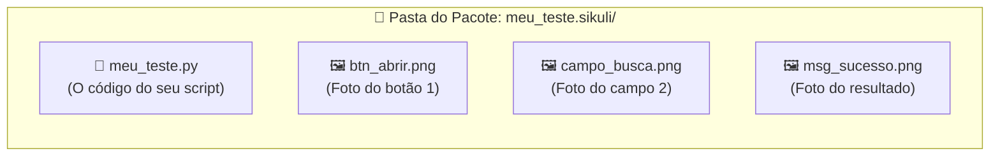
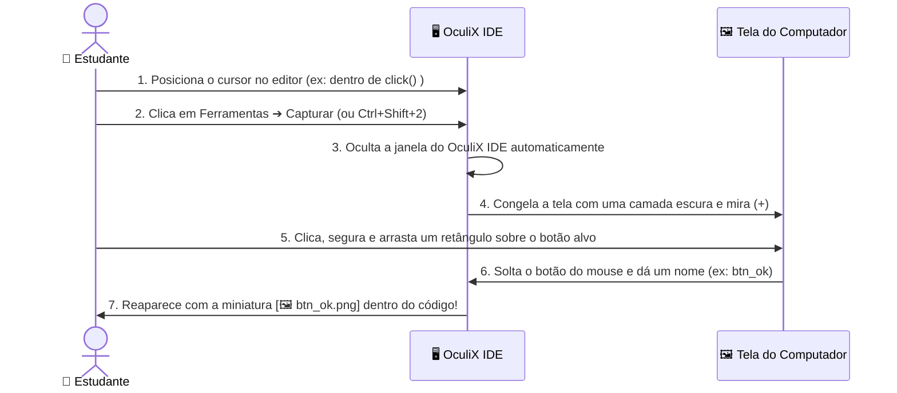

[🏠 Hub Full Stack](../README.md) · [🦎 Menu OculiX](../capitulos/README.md) · [🪶 Menu JMeter](../capitulos-jmeter/README.md)

---

<div align="center">

[⬅️ Anterior: Conhecendo a Interface](02-conhecendo-a-interface-oculix-ide.md) · [🏠 Início](../README.md) · **Capítulo 03 de 12** · [Próximo: Gravador Moderno ➔](04-gravador-moderno-sem-codigo.md)

# 📸 Capítulo 03: Seu Primeiro Teste Automatizado — Captura de Tela e Ações Básicas

-00D2FF?style=flat-square)


</div>

---

## 🎯 Objetivos deste Capítulo

Ao concluir este capítulo, você será capaz de:
- [x] Criar um **Espaço de Trabalho** e salvar um script no formato pacote **`.sikuli`**.
- [x] Capturar recortes perfeitos da tela usando a ferramenta **Capturar** do OculiX IDE.
- [x] Aplicar as **4 Regras de Ouro da Captura Visual** para evitar que o teste falhe.
- [x] Executar cliques (`click`, `doubleClick`, `rightClick`) e entrada de texto (`paste` e `type`).
- [x] Executar testes em **Câmera Lenta** para visualizar onde o OculiX está clicando e usar o atalho de **Parada de Emergência**.
- [x] Montar sequências diretas de ações com capturas, atalhos, pausas e espera por uma imagem.
- [x] Praticar preenchimento, limpeza de campos, login, cálculo e recusa de dados incorretos.

---

## 1. O Segredo da Pasta `.sikuli` (Entenda antes de salvar!)

Diferente de um arquivo de texto comum, um script do OculiX contém **código + imagens**. Por isso, quando você salva um teste no OculiX IDE com o nome `meu_teste`, ele cria automaticamente uma **pasta especial chamada `meu_teste.sikuli`**:



> [!WARNING]
> **Atenção, Estudante!**
> Nunca envie apenas o arquivo `.py` solto para o seu professor ou colega! Sem as imagens `.png` que estão dentro da pasta `.sikuli`, o OculiX não terá o que procurar na tela. Sempre mantenha a pasta **`nome_do_teste.sikuli`** inteira (ou use a função de exportar `.zip`, que veremos no Capítulo 08).

---

## 2. Criando seu Espaço de Trabalho e Primeiro Script

Vamos organizar nossas aulas criando um **Espaço de Trabalho (Workspace)** dedicado:

### Passo 2.1: Criar o Espaço de Trabalho
1. Na Aba de Boas-Vindas (ou no menu **📁 Arquivo ➔ Novo ➔ Espaço de trabalho**), clique em **Novo espaço de trabalho** (<kbd>Ctrl</kbd> + <kbd>Shift</kbd> + <kbd>N</kbd>).
2. Preencha os campos da janela:
   - **Nome:** `Aulas_Oculix`
   - **Descrição:** `Scripts práticos de teste de software`
   - **Autor:** Seu nome
3. Clique em **Criar** e escolha a pasta onde deseja guardá-lo (ex: `Documentos`).
4. Note que o painel **Espaço de trabalho** à esquerda agora exibe o título `Aulas_Oculix`!

### Passo 2.2: Criar e Salvar seu Primeiro Script
1. Clique em **📁 Arquivo ➔ Novo ➔ Script** (ou pressione <kbd>Ctrl</kbd> + <kbd>N</kbd>).
2. Uma nova aba chamada `Sem título` (*Untitled*) aparecerá no editor central.
3. Pressione <kbd>Ctrl</kbd> + <kbd>S</kbd> (ou **📁 Arquivo ➔ Salvar como...**), digite o nome **`aula01_basico`** e clique em **Salvar**.
4. Observe que o cartão **`📄 aula01_basico`** agora aparece salvo (**✔**) no painel do seu Espaço de Trabalho e no topo da Barra Lateral!

---

## 3. Como Capturar Elementos da Tela Passo a Passo

Agora vamos aprender o recurso mais importante do OculiX IDE: a **Captura de Imagem**.



### Experimente agora mesmo no seu OculiX IDE:
1. No editor de código do seu script `aula01_basico`, digite:
   ```python
   click()
   ```
2. Deixe o cursor piscando **exatamente entre os parênteses** `click(|)`.
3. Na Barra Lateral Esquerda, clique em **🛠️ Ferramentas ➔ 📷 Capturar** (ou use o atalho rápido <kbd>Ctrl</kbd> + <kbd>Shift</kbd> + <kbd>2</kbd>).
4. O OculiX IDE vai se esconder e sua tela ficará levemente escurecida com a mensagem *"Selecione uma imagem"*.
5. Clique e arraste o mouse formando um retângulo ao redor de qualquer ícone da sua Área de Trabalho ou Barra de Tarefas (por exemplo, o ícone do menu Iniciar ou da Calculadora) e **solte o botão do mouse**.
6. *(Se você ativou a nomeação manual no Capítulo 02)* Digite `icone_teste` e pressione <kbd>Enter</kbd>.
7. **Olhe para o editor do OculiX IDE:** a foto que você acabou de recortar apareceu **dentro** dos parênteses de `click()`!

> [!TIP]
> **E se eu entrar no modo de captura sem querer?**
> Basta pressionar a tecla <kbd>Esc</kbd> no teclado a qualquer momento enquanto a tela estiver escura para cancelar a captura e voltar ao OculiX IDE!

---

## 4. As 4 Regras de Ouro para uma Captura Perfeita

90% dos erros de estudantes iniciantes acontecem porque o recorte da imagem foi grande demais ou pegou partes que mudam de cor. Siga sempre este guia visual:

| Situação | ❌ Como NÃO Capturar (Errado) | ✅ Como Capturar (Correto) | Por quê? |
| :--- | :--- | :--- | :--- |
| **1. Tamanho do Recorte** | Capturar o botão inteiro junto com um pedaço grande do papel de parede ou da janela de fundo atrás dele. | Recortar **apenas o interior do botão** (o texto/ícone central e um pouquinho da cor do botão). | Se a janela mudar de lugar na tela, o papel de parede ao fundo muda e o OculiX não achará a imagem! |
| **2. Efeito *Hover* (Mouse em cima)** | Deixar a seta do mouse em cima do botão antes de capturar (quando o botão muda de cor ao passar o mouse). | Garantir que o botão esteja no seu **estado normal (em repouso)** antes de iniciar a captura. | Durante o teste, antes de o OculiX clicar, o mouse ainda não está em cima do botão! |
| **3. Cursor Piscando em Campos** | Capturar um campo de texto enquanto a barrinha vertical `\|` de digitação está piscando dentro dele. | Clicar fora do campo primeiro para tirar o foco antes de capturar. | A barrinha piscante altera os pixels internos da caixa de texto. |
| **4. Elementos Repetidos** | Capturar uma palavra genérica como `"Sim"` ou uma caixa branca vazia quando existem várias iguais na tela. | Capturar o botão junto com o rótulo único ao lado (e usar **Target Offset**, que veremos no Cap. 05). | Evita que o OculiX clique no botão ou campo errado. |

---

## 5. Os Comandos Fundamentais de Ação (Mouse e Teclado)

**Consulta organizada:** abra o [catálogo prático de comandos e combinações](03a-catalogo-pratico-de-comandos.md), com 16 categorias: cliques, movimentos, rolagem, texto, teclas, atalhos, navegador, formulários, arquivos, esperas, buscas, capturas, aplicativos, padrões, mensagens e sequências prontas.

No OculiX IDE, escrevemos comandos em Python (Jython). Comece com as ações abaixo e depois combine-as com **esperas e validações**: clicar sem conferir o resultado ainda não demonstra que o programa está correto.

### 🖱️ Ações de Mouse

```python
# 1. Clique simples com o botão esquerdo no centro da imagem:
click("btn_confirmar.png")

# 2. Clique duplo (ideal para abrir ícones na área de trabalho ou pastas):
doubleClick("icone_pasta.png")

# 3. Clique com o botão direito (abre o menu de contexto):
rightClick("arquivo_relatorio.png")

# 4. Apenas mover o mouse para cima do elemento (sem clicar):
hover("menu_suspenso.png")
```

### ⌨️ Ações de Teclado: `paste()` vs. `type()`

Quando queremos preencher um campo de texto em um teste, temos dois comandos: **`paste()`** (colar) e **`type()`** (digitar tecla por tecla).

> [!IMPORTANT]
> **Qual a diferença entre `paste()` e `type()` no Brasil?**
> - Use **`paste("João da Silva - Avaliação Nº 1")`** sempre que o texto tiver **acentos (`ã`, `é`, `ê`), cedilha (`ç`) ou caracteres especiais**! O `paste()` copia o texto para a área de transferência e cola instantaneamente (<kbd>Ctrl</kbd>+<kbd>V</kbd>), funcionando 100% com acentuação em português e sendo muito mais rápido.
> - Use **`type(...)`** quando quiser simular o pressionamento físico de teclas sem acento (ex: `type("12345")`) ou **teclas especiais** como <kbd>Enter</kbd> e <kbd>Tab</kbd> (ex: `type(Key.ENTER)`).

Veja como combiná-los:

```python
# Opção A: Clicar no campo primeiro e depois colar o texto com acentos
click("campo_nome.png")
paste("Maria José Conceição")

# Opção B: Passar a imagem e o texto juntos no mesmo comando!
paste("campo_nome.png", "Maria José Conceição")

# E para apertar a tecla ENTER depois de preencher:
type(Key.ENTER)
```

---

## 6. Executando seu Teste: Modo Normal vs. Câmera Lenta

Depois de montar seus comandos no editor, você tem duas formas de executar o teste no menu **▶️ Executar** da Barra Lateral:

| Modo de Execução | Atalho | Como funciona? |
| :--- | :---: | :--- |
| **▶️ Executar (Normal)** | <kbd>Ctrl</kbd> + <kbd>R</kbd> | Executa os cliques e digitações na velocidade real de teste. |
| **🐢 Executar em câmera lenta** | <kbd>Alt</kbd> + <kbd>Ctrl</kbd> + <kbd>R</kbd> | **O melhor amigo do estudante!** Antes de cada clique, o OculiX desenha um **alvo circular vermelho piscante** na tela exatamente onde encontrou a imagem, permitindo que você veja cada passo com calma! |
| **✂️ Executar seleção** | <kbd>Ctrl</kbd> + <kbd>Shift</kbd> + <kbd>R</kbd> | Executa **apenas as linhas que você selecionou** com o mouse no editor. Perfeito para testar só um pedacinho do script! |

> [!CAUTION]
> **BOTÃO DE EMERGÊNCIA — Como parar o robô imediatamente:**
> Quando o teste está rodando, o OculiX assume o controle do seu mouse e teclado. Se o seu script começar a clicar no lugar errado ou ficar preso em um loop, pressione imediatamente:
> <div align="center">
>
> ### <kbd>Alt</kbd> + <kbd>Shift</kbd> + <kbd>C</kbd>
>
> </div>
> Isso aborta a execução do script na mesma hora e devolve o controle do mouse para você!

---

## 🧪 Laboratório Prático 01: Seu Primeiro Teste no App de Treino

Vamos colocar a mão na massa! Neste exercício, você vai automatizar o login no nosso **Aplicativo Alvo de Treino** que está incluído neste repositório.

### Passo a passo guiado:
1. Abra a pasta do nosso repositório no seu computador e dê um **duplo clique** no arquivo:
   📂 [`exemplos/app-alvo-teste/index.html`](../exemplos/app-alvo-teste/index.html)
   *(Ele abrirá no seu navegador web. Deixe a janela do navegador visível na tela).*
2. No **OculiX IDE**, crie um novo script (<kbd>Ctrl</kbd> + <kbd>N</kbd>) e salve-o (<kbd>Ctrl</kbd> + <kbd>S</kbd>) como **`lab01_login`**.
3. Digite as 3 linhas abaixo, capturando as imagens correspondentes na tela do navegador usando **🛠️ Ferramentas ➔ 📷 Capturar**:
   - Na linha 1: capture o interior da caixa de texto **"Usuário / E-mail"** (onde diz *Digite seu usuário...*).
   - Na linha 2: capture o interior da caixa de texto **"Senha"**.
   - Na linha 3: capture o botão azul **"Entrar no Sistema"**.

<details>
<summary><b>👀 Clique aqui para ver como deve ficar o seu código no OculiX IDE (Gabarito)</b></summary>
<br/>

```python
# Laboratório 01 - Teste de Login Básico
paste("campo_usuario.png", "estudante_qa")
paste("campo_senha.png", "oculix123")
click("btn_entrar.png")
```

> **Dica:** Lembre-se de que no editor do OculiX IDE, no lugar de `"campo_usuario.png"`, você verá a **miniatura da foto** que você capturou!
</details>

4. Deixe o navegador com a página de treino visível ao fundo (não minimize o navegador!).
5. No OculiX IDE, clique em **▶️ Executar ➔ Executar em câmera lenta** (<kbd>Alt</kbd> + <kbd>Ctrl</kbd> + <kbd>R</kbd>) e tire a mão do mouse!
6. Observe o círculo vermelho do OculiX localizar cada campo, preencher os dados e clicar no botão **Entrar no Sistema**!
7. Ao final, confira no painel inferior **MENSAGEM** os logs `[log] CLICK on ...` e no cartão **ÚLTIMA EXECUÇÃO** da Barra Lateral o status **✔ Sucesso**!

---

## 7. Receitas Simples: Capturar, Clicar e Digitar

Cada exemplo abaixo é uma sequência de ações para escrever e executar diretamente no editor do OculiX IDE. Faça um exemplo por vez, com a aplicação aberta e visível.

**Como ler os exemplos:** `click("campo_nome.png")` representa um clique na **captura do campo**. No seu IDE, use a ferramenta Capturar entre os parênteses: o trecho aparecerá como uma miniatura, como no exemplo da aula. Os nomes `.png` usados aqui são sugestões; você precisa capturar esses elementos na sua própria tela.

Comece com estas quatro ações:

| Comando | O que acontece |
| --- | --- |
| `click("imagem.png")` | Clica no elemento que você capturou |
| `paste("Ana")` | Cola o texto no campo que está selecionado |
| `type(Key.ENTER)` | Aperta Enter |
| `sleep(1)` | Espera 1 segundo antes da próxima linha |

Os atalhos abaixo usam **Windows/Linux**, como no exemplo da aula. No macOS, use `Key.CMD` no lugar de `Key.CTRL` nos atalhos de selecionar tudo, copiar e colar. Não é necessário detectar o sistema por código para praticar estes exemplos no seu computador.

### 7.1. Abrir o navegador e acessar um endereço

**Capture:** o ícone do navegador. Deixe esse ícone visível na barra de tarefas ou na área de trabalho.

```python
click("icone_navegador.png")
sleep(2)
type("l", Key.CTRL)
paste("http://localhost:8080")
type(Key.ENTER)
sleep(2)
```

**Linha por linha:** o clique traz o navegador para a frente; <kbd>Ctrl</kbd>+<kbd>L</kbd> seleciona a barra de endereços; `paste` informa a URL; Enter abre a página. Para abrir um ícone da área de trabalho, pode ser necessário trocar a primeira linha por `doubleClick("icone_navegador.png")`.

O endereço acima exige que o servidor do laboratório esteja iniciado. Você também pode usar o endereço do programa que está desenvolvendo.

### 7.2. Apagar o conteúdo de um campo e escrever outro valor

**Capture:** o campo que deseja alterar, no estado em que ele estará no início do exemplo.

```python
click("campo_nome.png")
type("a", Key.CTRL)
type(Key.BACKSPACE)
paste("Ana Silva")
```

**Confira:** o campo deve conter somente `Ana Silva`. O clique escolhe o campo; <kbd>Ctrl</kbd>+<kbd>A</kbd> seleciona o texto; Backspace apaga; `paste` preenche novamente. Esse trecho serve para nome, busca, e-mail ou descrição.

### 7.3. Preencher nome e e-mail e clicar em Enviar

**Capture no seu formulário:** campo Nome, campo E-mail, botão Enviar e mensagem de confirmação. O portal acadêmico do guia não tem esse formulário; use o programa da sua atividade.

```python
click("campo_nome.png")
paste("Ana Silva")
click("campo_email.png")
paste("ana.teste@example.com")
sleep(1)
click("botao_enviar.png")
wait("mensagem_enviado.png", 5)
```

**Confira:** o sistema deve exibir a confirmação. `wait` procura a captura da mensagem por até 5 segundos; se ela não aparecer, a execução falha nessa linha. Capture a confirmação manualmente uma vez antes de montar o roteiro.

### 7.4. Usar Tab para passar ao próximo campo

**Prepare:** um formulário vazio no qual Nome e E-mail sejam campos consecutivos na ordem do teclado. Capture apenas o campo Nome e o botão Enviar.

```python
click("campo_nome.png")
paste("Ana Silva")
type(Key.TAB)
paste("ana.teste@example.com")
click("botao_enviar.png")
wait("mensagem_enviado.png", 5)
```

**Confira:** antes de automatizar, pressione Tab manualmente para verificar onde o foco vai parar. Um botão ou outro controle entre os campos muda essa sequência. Se a ordem não for previsível, clique na captura de cada campo, como no exemplo anterior.

### 7.5. Fazer login no portal de treino

**Prepare:** deixe a tela de login aberta e os campos vazios. Capture os dois campos, o botão Entrar e o título da calculadora que aparece depois de entrar.

```python
click("campo_usuario.png")
paste("estudante_qa")
click("campo_senha.png")
paste("oculix123")
click("botao_entrar.png")
wait("titulo_calculadora.png", 10)
```

**Confira:** a calculadora deve aparecer. Aqui o teste não termina no clique: ele espera a próxima tela. Use a captura do título da calculadora como resultado esperado.

### 7.6. Testar uma senha incorreta

**Prepare:** volte à tela de login. Capture o botão Limpar Login e a mensagem de erro, provocando uma tentativa inválida manualmente primeiro.

```python
click("botao_limpar_login.png")
click("campo_usuario.png")
paste("estudante_qa")
click("campo_senha.png")
paste("senha_errada")
click("botao_entrar.png")
wait("erro_autenticacao.png", 5)
```

**Confira:** deve aparecer o erro de autenticação e o programa deve permanecer no login. Neste caso, encontrar a mensagem de erro é o resultado correto do teste. Execute os exemplos de login separadamente, sempre começando na tela indicada.

### 7.7. Calcular a média de um estudante

**Prepare:** entre no portal. Capture Limpar Formulário, os três campos, Processar Avaliação e o badge APROVADO. Capture também a caixa de média exibindo `9.0`, depois de calcular manualmente uma vez.

```python
click("botao_limpar_formulario.png")
click("campo_nome.png")
paste("Ana Silva")
click("campo_nota1.png")
paste("8.5")
click("campo_nota2.png")
paste("9.5")
click("botao_processar.png")
wait("badge_aprovado.png", 10)
wait("media_9_0.png", 3)
```

**Confira:** a média deve ser `9.0` e a situação APROVADO. Capture o badge completo para diferenciá-lo de REPROVADO. Na média, inclua a moldura da caixa para não confundir o resultado com algum número nos campos.

Se os campos de nota forem muito parecidos, capture o placeholder que distingue cada um. O [capítulo 05](05-ajuste-de-padroes-similaridade-e-offset.md) ensina a clicar no campo usando seu rótulo como referência.

### 7.8. Conferir se o programa recusa uma nota inválida

**Capture:** a mensagem de dados inválidos que aparece ao tentar processar uma nota 15.

```python
click("botao_limpar_formulario.png")
click("campo_nome.png")
paste("Ana Silva")
click("campo_nota1.png")
paste("15")
click("campo_nota2.png")
paste("8")
click("botao_processar.png")
wait("erro_dados_invalidos.png", 5)
```

**Confira:** a mensagem de erro deve aparecer, sem exibir uma média calculada. A primeira linha limpa o resultado anterior, facilitando essa conferência. Para testar campo obrigatório, faça outra execução deixando Nome vazio.

### 7.9. Copiar um texto de um campo para outro

**Prepare:** no seu programa, escolha dois campos de texto editáveis e capture cada um. Deixe o segundo vazio.

```python
click("campo_origem.png")
type("a", Key.CTRL)
type("c", Key.CTRL)
click("campo_destino.png")
type("v", Key.CTRL)
```

**Confira:** os dois campos devem apresentar o mesmo conteúdo. Aqui <kbd>Ctrl</kbd>+<kbd>C</kbd> copia o conteúdo que já existe na tela; `paste("texto")` informa um texto escrito no script.

### 7.10. Abrir um menu e escolher uma opção

**Capture no seu programa:** o menu e a opção que aparece quando você passa o mouse sobre ele.

```python
hover("menu_relatorios.png")
sleep(1)
click("opcao_relatorio_mensal.png")
wait("titulo_relatorio_mensal.png", 5)
```

**Confira:** o relatório mensal deve abrir. Se o menu do seu programa abrir por clique, troque `hover` por `click`.

Para um menu de contexto, use a captura de um arquivo ou item de teste:

```python
rightClick("arquivo_teste.png")
sleep(1)
click("opcao_propriedades.png")
wait("janela_propriedades.png", 5)
type(Key.ESC)
```

**Confira:** a janela de propriedades abre e Esc a fecha, se esse for o comportamento do seu aplicativo.

### 7.11. Rolar uma página e clicar no botão do final

**Prepare:** abra uma página longa do seu projeto. Capture uma área dentro do painel que deve rolar e o botão no final.

```python
hover("area_da_pagina.png")
wheel(WHEEL_DOWN, 5)
sleep(1)
wheel(WHEEL_DOWN, 5)
sleep(1)
click("botao_continuar.png")
wait("titulo_proxima_etapa.png", 5)
```

**Confira:** a próxima etapa deve aparecer. O número de passos de rolagem depende da página e do sistema; ajuste manualmente antes de executar. `WHEEL_UP` rola para cima. Essa receita pressupõe que o botão fique visível após as duas rolagens.

### 7.12. Arrastar um item para outro lugar

**Prepare:** use um quadro de tarefas ou uma atividade de arrastar e soltar. Capture o item de teste e uma área válida de destino.

```python
dragDrop("cartao_tarefa.png", "area_concluido.png")
sleep(1)
wait("tarefa_concluida.png", 5)
```

**Confira:** a tarefa deve estar na coluna Concluído. A imagem final deve mostrar algo que diferencie a tarefa concluída da tarefa original, como um marcador de conclusão. Apenas reencontrar o mesmo cartão em qualquer lugar não comprova que ele foi movido.

### 7.13. Esperar um resultado sem adivinhar o tempo

Para começar, `sleep` ajuda a enxergar as etapas:

```python
click("botao_salvar.png")
sleep(2)
```

Mas a pausa sozinha não confere se salvou. Quando já tiver capturado a confirmação, use:

```python
click("botao_salvar.png")
wait("mensagem_salvo.png", 10)
```

O segundo exemplo continua assim que a mensagem aparece, com limite de 10 segundos. Aprofunde essa diferença no [capítulo 06](06-sincronizacao-esperas-e-validacoes.md).

## 8. Exercício: Monte seu Próprio Roteiro de Ações

Escolha uma tela do seu programa e escreva uma sequência com **5 a 12 linhas**, usando capturas, `click`, `paste`, `type`, `sleep` e um `wait` no final.

1. Escreva o que pretende fazer: por exemplo, preencher nome e e-mail e enviar.
2. Abra a tela no estado inicial e capture os elementos.
3. Digite uma ação por linha, na ordem em que faria manualmente.
4. Execute em câmera lenta, sem mexer no mouse ou teclado.
5. Confira o resultado esperado e ajuste uma linha por vez.

<details>
<summary>Exemplo de resposta: preencher e limpar um formulário</summary>

```python
click("campo_nome.png")
paste("Ana Silva")
click("campo_email.png")
paste("ana.teste@example.com")
sleep(1)
click("botao_limpar.png")
wait("campo_nome_vazio.png", 3)
wait("campo_email_vazio.png", 3)
```

Capture os campos vazios com seus placeholders ou rótulos únicos. O teste deve terminar com os dois campos vazios. Adapte os nomes e o botão à sua aplicação.

</details>

Quando essas sequências estiverem claras, avance para [esperas e validações](06-sincronizacao-esperas-e-validacoes.md), [regiões e OCR](07-regioes-ocr-e-teclado-avancado.md) e [tratamento de erros](08-depuracao-erros-e-boas-praticas.md).

Referências: [ações e buscas](https://docs.oculix.org/region/) e [teclas do OculiX](https://docs.oculix.org/keys/).

---

## ✅ Checklist de Conclusão do Capítulo 03

- [ ] Entendi que todo script do OculiX é salvo em uma pasta `.sikuli` que guarda o `.py` e os arquivos `.png`.
- [ ] Capturei imagens da tela usando `Ferramentas ➔ Capturar` e vi as miniaturas aparecerem no código.
- [ ] Entendi por que devemos usar `paste()` para textos com acentos em português.
- [ ] Executei meu primeiro teste em **Câmera Lenta** (<kbd>Alt</kbd> + <kbd>Ctrl</kbd> + <kbd>R</kbd>) e memorizei o atalho de parada <kbd>Alt</kbd> + <kbd>Shift</kbd> + <kbd>C</kbd>.
- [ ] Usei selecionar tudo, Backspace, Tab e Enter em um formulário.
- [ ] Executei uma sequência de login ou cálculo usando minhas próprias capturas.
- [ ] Entendi a diferença entre pausar com `sleep` e esperar uma imagem com `wait`.
- [ ] Montei um roteiro curto para testar uma tela do meu programa.

---

<div align="center">

| [⬅️ Capítulo 02: Conhecendo a Interface](02-conhecendo-a-interface-oculix-ide.md) | [🏠 Início](../README.md) | [Próximo Capítulo: Gravador Moderno (Sem Código) ➔](04-gravador-moderno-sem-codigo.md) |
| :--- | :---: | ---: |

</div>
