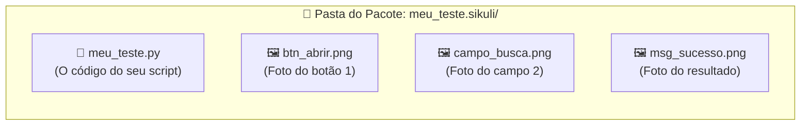
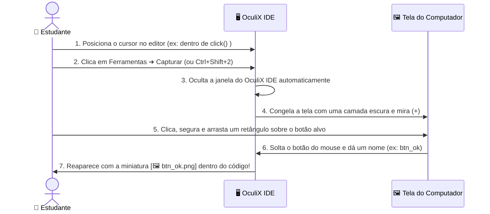

[🏠 Hub Full Stack](../README.md) · [🦎 Menu OculiX](../capitulos/README.md) · [🪶 Menu JMeter](../capitulos-jmeter/README.md)

---

[⬅️ Anterior: Conhecendo a Interface](02-conhecendo-a-interface-oculix-ide.md) · [🏠 Início](../README.md) · **Capítulo 03 de 12** · [Próximo: Gravador Moderno ➔](04-gravador-moderno-sem-codigo.md)

# 📸 Capítulo 03: Seu Primeiro Teste Automatizado — Captura de Tela e Ações Básicas

-00D2FF?style=flat-square)

---

## 🎯 Objetivos deste Capítulo

Ao concluir este capítulo, você será capaz de:
- [x] Criar um **Espaço de Trabalho** e salvar um script no formato pacote **`.sikuli`**.
- [x] Capturar recortes perfeitos da tela usando a ferramenta **Capturar** do OculiX IDE.
- [x] Aplicar as **4 Regras de Ouro da Captura Visual** para evitar que o teste falhe.
- [x] Executar cliques (`click`, `doubleClick`, `rightClick`) e entrada de texto (`paste` e `type`).
- [x] Executar testes em **Câmera Lenta** para visualizar onde o OculiX está clicando e usar o atalho de **Parada de Emergência**.
- [x] Montar sequências diretas de ações com capturas, atalhos, pausas e espera por uma imagem.
- [x] Praticar preenchimento, limpeza de campos, login, cálculo e recusa de dados incorretos.

---

## 1. O Segredo da Pasta `.sikuli` (Entenda antes de salvar!)

Diferente de um arquivo de texto comum, um script do OculiX contém **código + imagens**. Por isso, quando você salva um teste no OculiX IDE com o nome `meu_teste`, ele cria automaticamente uma **pasta especial chamada `meu_teste.sikuli`**:

> [!WARNING]
> **Atenção, Estudante!**
> Nunca envie apenas o arquivo `.py` solto para o seu professor ou colega! Sem as imagens `.png` que estão dentro da pasta `.sikuli`, o OculiX não terá o que procurar na tela. Sempre mantenha a pasta **`nome_do_teste.sikuli`** inteira (ou use a função de exportar `.zip`, que veremos no Capítulo 08).

---

## 2. Criando seu Espaço de Trabalho e Primeiro Script

Vamos organizar nossas aulas criando um **Espaço de Trabalho (Workspace)** dedicado:

### Passo 2.1: Criar o Espaço de Trabalho
1. Na Aba de Boas-Vindas (ou no menu **📁 Arquivo ➔ Novo ➔ Espaço de trabalho**), clique em **Novo espaço de trabalho** (<kbd>Ctrl</kbd> + <kbd>Shift</kbd> + <kbd>N</kbd>).
2. Preencha os campos da janela:
   - **Nome:** `Aulas_Oculix`
   - **Descrição:** `Scripts práticos de teste de software`
   - **Autor:** Seu nome
3. Clique em **Criar** e escolha a pasta onde deseja guardá-lo (ex: `Documentos`).
4. Note que o painel **Espaço de trabalho** à esquerda agora exibe o título `Aulas_Oculix`!

### Passo 2.2: Criar e Salvar seu Primeiro Script
1. Clique em **📁 Arquivo ➔ Novo ➔ Script** (ou pressione <kbd>Ctrl</kbd> + <kbd>N</kbd>).
2. Uma nova aba chamada `Sem título` (*Untitled*) aparecerá no editor central.
3. Pressione <kbd>Ctrl</kbd> + <kbd>S</kbd> (ou **📁 Arquivo ➔ Salvar como...**), digite o nome **`aula01_basico`** e clique em **Salvar**.
4. Observe que o cartão **`📄 aula01_basico`** agora aparece salvo (**✔**) no painel do seu Espaço de Trabalho e no topo da Barra Lateral!

---

## 3. Como Capturar Elementos da Tela Passo a Passo

Agora vamos aprender o recurso mais importante do OculiX IDE: a **Captura de Imagem**.

### Experimente agora mesmo no seu OculiX IDE:
1. No editor de código do seu script `aula01_basico`, digite `click()` (também disponível na tabela única da seção 5).
2. Deixe o cursor piscando **exatamente entre os parênteses** `click(|)`.
3. Na Barra Lateral Esquerda, clique em **🛠️ Ferramentas ➔ 📷 Capturar** (ou use o atalho rápido <kbd>Ctrl</kbd> + <kbd>Shift</kbd> + <kbd>2</kbd>).
4. O OculiX IDE vai se esconder e sua tela ficará levemente escurecida com a mensagem *"Selecione uma imagem"*.
5. Clique e arraste o mouse formando um retângulo ao redor de qualquer ícone da sua Área de Trabalho ou Barra de Tarefas (por exemplo, o ícone do menu Iniciar ou da Calculadora) e **solte o botão do mouse**.
6. *(Se você ativou a nomeação manual no Capítulo 02)* Digite `icone_teste` e pressione <kbd>Enter</kbd>.
7. **Olhe para o editor do OculiX IDE:** a foto que você acabou de recortar apareceu **dentro** dos parênteses de `click()`!

> [!TIP]
> **E se eu entrar no modo de captura sem querer?**
> Basta pressionar a tecla <kbd>Esc</kbd> no teclado a qualquer momento enquanto a tela estiver escura para cancelar a captura e voltar ao OculiX IDE!

---

## 4. As 4 Regras de Ouro para uma Captura Perfeita

90% dos erros de estudantes iniciantes acontecem porque o recorte da imagem foi grande demais ou pegou partes que mudam de cor. Siga sempre este guia visual:

| Situação | ❌ Como NÃO Capturar (Errado) | ✅ Como Capturar (Correto) | Por quê? |
| :--- | :--- | :--- | :--- |
| **1. Tamanho do Recorte** | Capturar o botão inteiro junto com um pedaço grande do papel de parede ou da janela de fundo atrás dele. | Recortar **apenas o interior do botão** (o texto/ícone central e um pouquinho da cor do botão). | Se a janela mudar de lugar na tela, o papel de parede ao fundo muda e o OculiX não achará a imagem! |
| **2. Efeito *Hover* (Mouse em cima)** | Deixar a seta do mouse em cima do botão antes de capturar (quando o botão muda de cor ao passar o mouse). | Garantir que o botão esteja no seu **estado normal (em repouso)** antes de iniciar a captura. | Durante o teste, antes de o OculiX clicar, o mouse ainda não está em cima do botão! |
| **3. Cursor Piscando em Campos** | Capturar um campo de texto enquanto a barrinha vertical `\|` de digitação está piscando dentro dele. | Clicar fora do campo primeiro para tirar o foco antes de capturar. | A barrinha piscante altera os pixels internos da caixa de texto. |
| **4. Elementos Repetidos** | Capturar uma palavra genérica como `"Sim"` ou uma caixa branca vazia quando existem várias iguais na tela. | Capturar o botão junto com o rótulo único ao lado (e usar **Target Offset**, que veremos no Cap. 05). | Evita que o OculiX clique no botão ou campo errado. |

---

## 5. Tabela Única de Comandos e Exemplos

Todos os comandos do catálogo e todas as receitas deste capítulo estão reunidos nesta tabela. Cada linha é uma possibilidade independente. Nas sequências, leia os comandos **de cima para baixo**, separados pelas quebras de linha dentro da mesma célula.

**Capturas:** nomes como `"campo_nome.png"` representam imagens que você deve capturar na sua tela; no IDE elas aparecem como miniaturas. **Textos:** valores como `"Ana Silva"` são os dados a preencher. Faça um exemplo por vez, com a aplicação visível e no estado indicado na última coluna.

Os atalhos usam Windows/Linux; no macOS, selecionar tudo, copiar e colar geralmente usam `Key.CMD`. Os comandos pressupõem a API disponível no editor Jython do OculiX. Se o ambiente exigir, coloque `from sikuli import *` no início do script.

| Categoria | O que fazer | Comando ou sequência de comandos | Preparação e resultado esperado |
| --- | --- | --- | --- |
| **1. Cliques** | Clique esquerdo em captura | `click("botao_salvar.png")` | Acionar um botão |
| Cliques | Duplo clique | `doubleClick("icone_pasta.png")` | Abrir item que exige dois cliques |
| Cliques | Clique direito | `rightClick("registro.png")` | Abrir menu de contexto |
| Cliques | Clique na posição atual | `click()` | Clicar onde o ponteiro já está |
| Cliques | Clique em coordenadas | `click(Location(400, 300))` | Ponto conhecido da tela |
| Cliques | Ctrl + clique | `click("item.png", KeyModifier.CTRL)` | Seleção múltipla, se o programa permitir |
| Cliques | Shift + clique | `click("ultimo_item.png", KeyModifier.SHIFT)` | Selecionar intervalo após selecionar o primeiro |
| Cliques | Clicar após esperar | `click(wait("botao_pronto.png", 5))` | Acionar assim que o alvo aparecer |
| **2. Movimento do mouse e arraste** | Mover até uma captura | `hover("menu.png")` | Abrir submenu ou tooltip |
| Movimento do mouse e arraste | Mover até um ponto | `hover(Location(400, 300))` | Tirar o ponteiro de cima de um botão |
| Movimento do mouse e arraste | Arrastar entre capturas | `dragDrop("cartao.png", "destino.png")` | Quadro de tarefas |
| Movimento do mouse e arraste | Arrastar entre pontos | `dragDrop(Location(300, 400), Location(600, 400))` | Slider em posição conhecida |
| Movimento do mouse e arraste | Segurar botão esquerdo | `mouseDown(Button.LEFT)` | Início de gesto na posição atual |
| Movimento do mouse e arraste | Soltar botão esquerdo | `mouseUp(Button.LEFT)` | Encerrar o gesto |
| Movimento do mouse e arraste | Segurar botão direito | `mouseDown(Button.RIGHT)` | Gesto específico do aplicativo |
| Movimento do mouse e arraste | Soltar botão direito | `mouseUp(Button.RIGHT)` | Encerrar esse gesto |
| **3. Rolagem e deslocamento da página** | Rolar para baixo | `wheel(WHEEL_DOWN, 5)` | Avançar alguns passos |
| Rolagem e deslocamento da página | Rolar para cima | `wheel(WHEEL_UP, 5)` | Voltar alguns passos |
| Rolagem e deslocamento da página | Avançar uma página | `type(Key.PAGE_DOWN)` | Deslocar o painel com foco |
| Rolagem e deslocamento da página | Voltar uma página | `type(Key.PAGE_UP)` | Deslocamento inverso |
| Rolagem e deslocamento da página | Início da linha | `type(Key.HOME)` | Campo de texto |
| Rolagem e deslocamento da página | Fim da linha | `type(Key.END)` | Campo de texto |
| Rolagem e deslocamento da página | Início do conteúdo | `type(Key.HOME, Key.CTRL)` | Documento ou página com foco |
| Rolagem e deslocamento da página | Fim do conteúdo | `type(Key.END, Key.CTRL)` | Ir ao final, se suportado |
| **4. Preenchimento, seleção e edição de texto** | Colar texto | `paste("Ana Silva")` | Campo já selecionado |
| Preenchimento, seleção e edição de texto | Clicar e colar | `paste("campo_nome.png", "Ana Silva")` | Preencher em uma linha |
| Preenchimento, seleção e edição de texto | Digitar caracteres | `type("12345")` | Simular digitação |
| Preenchimento, seleção e edição de texto | Clicar e digitar | `type("campo_codigo.png", "12345")` | Preencher código |
| Preenchimento, seleção e edição de texto | Selecionar tudo | `type("a", Key.CTRL)` | Preparar substituição |
| Preenchimento, seleção e edição de texto | Apagar à esquerda | `type(Key.BACKSPACE)` | Remover seleção ou caractere anterior |
| Preenchimento, seleção e edição de texto | Apagar à direita | `type(Key.DELETE)` | Remover seleção ou próximo caractere |
| Preenchimento, seleção e edição de texto | Copiar seleção | `type("c", Key.CTRL)` | Copiar conteúdo do aplicativo |
| Preenchimento, seleção e edição de texto | Recortar seleção | `type("x", Key.CTRL)` | Mover conteúdo editável |
| Preenchimento, seleção e edição de texto | Colar área de transferência | `type("v", Key.CTRL)` | Colar o que foi copiado antes |
| Preenchimento, seleção e edição de texto | Desfazer | `type("z", Key.CTRL)` | Reverter edição, se suportado |
| Preenchimento, seleção e edição de texto | Refazer | `type("y", Key.CTRL)` | Comum no Windows; varia por editor |
| Preenchimento, seleção e edição de texto | Selecionar até o fim da linha | `type(Key.END, Key.SHIFT)` | Seleção de texto por teclado |
| Preenchimento, seleção e edição de texto | Selecionar até o início da linha | `type(Key.HOME, Key.SHIFT)` | Seleção no sentido inverso |
| **5. Teclas especiais** | Enter | `type(Key.ENTER)` | Confirmar ou quebrar linha |
| Teclas especiais | Tab | `type(Key.TAB)` | Próximo controle |
| Teclas especiais | Escape | `type(Key.ESC)` | Fechar menu ou cancelar |
| Teclas especiais | Espaço | `type(Key.SPACE)` | Marcar opção com foco |
| Teclas especiais | Seta para cima | `type(Key.UP)` | Item anterior |
| Teclas especiais | Seta para baixo | `type(Key.DOWN)` | Próximo item |
| Teclas especiais | Seta esquerda | `type(Key.LEFT)` | Cursor ou opção anterior |
| Teclas especiais | Seta direita | `type(Key.RIGHT)` | Cursor ou próxima opção |
| Teclas especiais | Home / End | `type(Key.HOME)` / `type(Key.END)` | Início/fim |
| Teclas especiais | Page Up / Page Down | `type(Key.PAGE_UP)` / `type(Key.PAGE_DOWN)` | Navegação por página |
| Teclas especiais | Backspace / Delete | `type(Key.BACKSPACE)` / `type(Key.DELETE)` | Apagar |
| Teclas especiais | Teclas F1 a F12 | `type(Key.F1)` / `type(Key.F12)` | Funções definidas pelo aplicativo |
| Teclas especiais | Dígitos do teclado numérico | `type(Key.NUM0)` até `type(Key.NUM9)` | Exercitar entrada numérica |
| Teclas especiais | Operações numéricas | `type(Key.ADD)` / `type(Key.MINUS)` | Soma e subtração |
| Teclas especiais | Multiplicação e divisão | `type(Key.MULTIPLY)` / `type(Key.DIVIDE)` | Calculadora ou campo compatível |
| **6. Modificadores e combinações de teclas** | Ctrl com letra | `type("s", Key.CTRL)` | Salvar no aplicativo com foco |
| Modificadores e combinações de teclas | Alt com tecla | `type(Key.F4, Key.ALT)` | Fechar janela no Windows |
| Modificadores e combinações de teclas | Shift com Tab | `type(Key.TAB, Key.SHIFT)` | Voltar ao controle anterior |
| Modificadores e combinações de teclas | Ctrl + Shift com letra | `type("t", KeyModifier.CTRL + KeyModifier.SHIFT)` | Reabrir aba em muitos navegadores |
| Modificadores e combinações de teclas | Cmd com letra | `type("a", Key.CMD)` | Selecionar tudo no macOS |
| Modificadores e combinações de teclas | Manter Shift pressionado | `keyDown(Key.SHIFT)` | Começar uma seleção |
| Modificadores e combinações de teclas | Soltar Shift | `keyUp(Key.SHIFT)` | Terminar a seleção |
| Modificadores e combinações de teclas | Manter Ctrl pressionado | `keyDown(Key.CTRL)` | Combinação com várias ações |
| Modificadores e combinações de teclas | Soltar Ctrl | `keyUp(Key.CTRL)` | Encerrar a combinação |
| **7. Navegador: endereços, abas e visualização** | Selecionar endereço | `type("l", Key.CTRL)` | Depois cole a URL e pressione Enter |
| Navegador: endereços, abas e visualização | Nova aba | `type("t", Key.CTRL)` | Abrir página de teste separada |
| Navegador: endereços, abas e visualização | Próxima aba | `type(Key.TAB, Key.CTRL)` | Alternar para a seguinte |
| Navegador: endereços, abas e visualização | Aba anterior | `type(Key.TAB, KeyModifier.CTRL + KeyModifier.SHIFT)` | Alternar no sentido inverso |
| Navegador: endereços, abas e visualização | Fechar aba atual | `type("w", Key.CTRL)` | Encerrar a aba de teste |
| Navegador: endereços, abas e visualização | Reabrir aba fechada | `type("t", KeyModifier.CTRL + KeyModifier.SHIFT)` | Recuperar a aba |
| Navegador: endereços, abas e visualização | Recarregar | `type("r", Key.CTRL)` | Atualizar a página |
| Navegador: endereços, abas e visualização | Voltar | `type(Key.LEFT, Key.ALT)` | Histórico anterior |
| Navegador: endereços, abas e visualização | Avançar | `type(Key.RIGHT, Key.ALT)` | Próxima entrada do histórico |
| Navegador: endereços, abas e visualização | Buscar na página | `type("f", Key.CTRL)` | Depois `paste("texto")` |
| Navegador: endereços, abas e visualização | Próxima ocorrência | `type(Key.ENTER)` | Com a busca da página aberta |
| Navegador: endereços, abas e visualização | Fechar busca | `type(Key.ESC)` | Voltar à página |
| Navegador: endereços, abas e visualização | Restaurar zoom | `type("0", Key.CTRL)` | Escala de página padrão |
| Navegador: endereços, abas e visualização | Tela cheia | `type(Key.F11)` | Alternar, quando suportado |
| Navegador: endereços, abas e visualização | Imprimir | `type("p", Key.CTRL)` | Abrir diálogo de impressão |
| Navegador: endereços, abas e visualização | Abrir arquivo local | `type("o", Key.CTRL)` | Escolher HTML/arquivo suportado |
| **8. Formulários e controles** | Campo de nome | `paste("campo_nome.png", "Ana Silva")` | Campo vazio |
| Formulários e controles | E-mail | `paste("campo_email.png", "ana@example.com")` | Campo correto em foco |
| Formulários e controles | Senha de teste | `paste("campo_senha.png", "senha_de_teste")` | Usar conta fictícia |
| Formulários e controles | Número decimal | `paste("campo_nota.png", "8.5")` | Conferir formato aceito |
| Formulários e controles | Campo obrigatório vazio | `click("botao_enviar.png")` | Deixe o campo vazio antes |
| Formulários e controles | Checkbox desmarcado | `click("checkbox_vazio.png")` | Capture especificamente o estado vazio |
| Formulários e controles | Desmarcar checkbox | `click("checkbox_marcado.png")` | Capture o estado marcado |
| Formulários e controles | Checkbox pelo teclado | `type(Key.SPACE)` | Checkbox precisa ter foco |
| Formulários e controles | Botão de opção (rádio) | `click("opcao_presencial.png")` | Capturar opção e rótulo únicos |
| Formulários e controles | Abrir lista | `click("lista_curso.png")` | Capturar o seletor |
| Formulários e controles | Escolher item visível | `click("opcao_informatica.png")` | Lista já aberta |
| Formulários e controles | Navegar em lista nativa | `type(Key.DOWN)` e `type(Key.ENTER)` | Seletor em foco; estado inicial conhecido |
| Formulários e controles | Data digitável | `paste("campo_data.png", "10/11/2026")` | Apenas se o controle aceitar colagem nesse formato |
| Formulários e controles | Abrir calendário | `click("icone_calendario.png")` | Campo com seletor visual |
| Formulários e controles | Limpar formulário | `click("botao_limpar.png")` | Verifique os campos vazios depois |
| **9. Arquivos, upload, download e diálogos nativos** | Escolher arquivo | `click("botao_escolher_arquivo.png")` | Abrir diálogo nativo |
| Arquivos, upload, download e diálogos nativos | Informar caminho Windows | `paste(r"C:\Testes\comprovante.pdf")` | Campo de nome/caminho do diálogo com foco |
| Arquivos, upload, download e diálogos nativos | Informar caminho Linux | `paste("/home/aluno/Testes/comprovante.pdf")` | Ajustar ao arquivo real |
| Arquivos, upload, download e diálogos nativos | Confirmar escolha | `type(Key.ENTER)` | Com o caminho preenchido |
| Arquivos, upload, download e diálogos nativos | Enviar arquivo selecionado | `click("botao_enviar_arquivo.png")` | Acionar upload da aplicação |
| Arquivos, upload, download e diálogos nativos | Abrir Salvar como | `type("s", KeyModifier.CTRL + KeyModifier.SHIFT)` | Se o aplicativo usar esse atalho |
| Arquivos, upload, download e diálogos nativos | Informar nome de saída | `paste("relatorio_teste.pdf")` | Campo Nome do arquivo selecionado |
| Arquivos, upload, download e diálogos nativos | Confirmar salvamento | `click("botao_salvar_arquivo.png")` | Diálogo com destino preparado |
| Arquivos, upload, download e diálogos nativos | Cancelar diálogo | `type(Key.ESC)` | Se o diálogo aceitar cancelamento por Esc |
| Arquivos, upload, download e diálogos nativos | Iniciar download | `click("botao_baixar.png")` | Página/aplicação aberta |
| **10. Pausas, presença e desaparecimento** | Pausa de 1 segundo | `sleep(1)` | Espera sempre 1 s |
| Pausas, presença e desaparecimento | Pausa fracionada | `sleep(0.5)` | Espera meio segundo |
| Pausas, presença e desaparecimento | Pausa pela API de espera | `wait(2)` | Pausa fixa de 2 s |
| Pausas, presença e desaparecimento | Esperar botão | `wait("botao.png", 5)` | Continua quando aparece; falha após o limite |
| Pausas, presença e desaparecimento | Esperar mensagem | `wait("salvo.png", 10)` | Mesmo comportamento, outro alvo |
| Pausas, presença e desaparecimento | Esperar sumir | `waitVanish("carregando.png", 10)` | Retorna True/False; confira o retorno |
| Pausas, presença e desaparecimento | Exigir que desapareça | `assert waitVanish("carregando.png", 10)` | Reprova se continuar presente |
| Pausas, presença e desaparecimento | Presença com prazo | `exists("aviso.png", 3)` | Retorna Match ou None |
| **11. Buscar e conferir o resultado** | Localizar uma imagem | `find("registro.png")` | Retorna a correspondência ou gera FindFailed |
| Buscar e conferir o resultado | Localizar e clicar | `click(find("registro.png"))` | Ação no resultado localizado |
| Buscar e conferir o resultado | Marcar posição visualmente | `find("registro.png").highlight(2)` | Depuração por 2 segundos |
| Buscar e conferir o resultado | Conferir presença | `assert exists("sucesso.png", 5)` | Reprovar se a confirmação não aparecer |
| Buscar e conferir o resultado | Conferir ausência | `assert not exists("erro.png", 2)` | Reprovar se o erro aparecer durante a consulta |
| Buscar e conferir o resultado | Mensagem de falha própria | `assert exists("total_correto.png", 3), "Total incorreto"` | Explicar a asserção |
| Buscar e conferir o resultado | Obter vários alvos | `list(findAll("icone_linha.png"))` | Lista de correspondências visíveis |
| Buscar e conferir o resultado | Contar alvos | `print(len(list(findAll("icone_linha.png"))))` | Mostrar quantidade no console |
| **12. Capturas de tela e evidências** | Captura principal em arquivo temporário | `print(capture(SCREEN))` | Mostra o caminho no console |
| Capturas de tela e evidências | Salvar no bundle | `capture(SCREEN, getBundlePath(), "resultado")` | Grava resultado.png |
| Capturas de tela e evidências | Capturar recorte conhecido | `capture(Region(100, 200, 600, 300), getBundlePath(), "formulario")` | Grava formulário nessa área |
| Capturas de tela e evidências | Capturar segundo monitor | `capture(Screen(1), getBundlePath(), "monitor_2")` | Exige segundo monitor disponível |
| Capturas de tela e evidências | Selecionar uma região manualmente | `Screen().selectRegion()` | Pausa para a pessoa escolher uma área |
| Capturas de tela e evidências | Mostrar pasta do script | `print(getBundlePath())` | Local onde estão código e imagens |
| **13. Aplicativos e janelas** | Abrir Calculadora no Windows | `App.open("calc.exe")` | Exemplo local dependente do SO |
| Aplicativos e janelas | Abrir executável por caminho | `App.open(r"C:\MeuPrograma\programa.exe")` | Ajustar ao aplicativo instalado |
| Aplicativos e janelas | Focar por título/nome | `App.focus("Calculadora")` | Depende do nome reconhecido no ambiente |
| Aplicativos e janelas | Alternar janela | `type(Key.TAB, Key.ALT)` | Alternância comum no Windows/Linux |
| Aplicativos e janelas | Fechar janela | `type(Key.F4, Key.ALT)` | Janela ativa no Windows |
| Aplicativos e janelas | Fechar pelo botão capturado | `click("fechar_janela.png")` | Controle do próprio aplicativo |
| **14. Ajustes de imagem, regiões e OCR** | Exigir maior semelhança | `click(Pattern("botao.png").similar(0.90))` | Reduzir correspondência ambígua |
| Ajustes de imagem, regiões e OCR | Correspondência quase exata | `find(Pattern("selo.png").exact())` | Limiar 0.99; não implica igualdade perfeita de pixels |
| Ajustes de imagem, regiões e OCR | Clicar ao lado do rótulo | `click(Pattern("rotulo_nome.png").targetOffset(120, 0))` | Campo à direita do rótulo |
| Ajustes de imagem, regiões e OCR | Clicar abaixo do rótulo | `click(Pattern("rotulo_nome.png").targetOffset(0, 40))` | Campo abaixo |
| Ajustes de imagem, regiões e OCR | Buscar apenas em um painel | `Region(100, 200, 600, 300).find("salvar.png")` | Evitar outro botão igual |
| Ajustes de imagem, regiões e OCR | Clicar apenas nesse painel | `Region(100, 200, 600, 300).click("salvar.png")` | Busca e ação restritas |
| Ajustes de imagem, regiões e OCR | Destacar uma área | `Region(100, 200, 600, 300).highlight(2)` | Conferir coordenadas |
| Ajustes de imagem, regiões e OCR | Ler texto de uma área | `print(Region(100, 200, 600, 100).text())` | OCR do conteúdo visível |
| Ajustes de imagem, regiões e OCR | Ler abaixo de uma âncora | `print(find("rotulo_total.png").below(60).text())` | OCR próximo de um rótulo |
| **15. Console, avisos e controle da execução** | Escrever no console | `print("Etapa 1: preenchendo nome")` | Acompanhar o roteiro |
| Console, avisos e controle da execução | Exibir aviso | `popup("Prepare o formulario e clique OK")` | Preparação assistida |
| Console, avisos e controle da execução | Exibir mensagem de erro | `popError("Confira os dados do teste")` | Aviso visual para a pessoa |
| Console, avisos e controle da execução | Solicitar texto | `nome = input("Nome do estudante:")` | Entrada manual em aula |
| Console, avisos e controle da execução | Colar o texto recebido | `paste(nome)` | Campo já em foco; confira cancelamento antes |
| Console, avisos e controle da execução | Encerrar normalmente | `exit(0)` | Parar o script com código zero |
| Console, avisos e controle da execução | Encerrar com falha | `exit(1)` | Parar com código diferente de zero |
| **16. Sequências completas** | **Substituir um valor existente** | `click("campo_nome.png")` `type("a", Key.CTRL)` `type(Key.BACKSPACE)` `paste("Ana Silva")` | Capture os elementos indicados e deixe a aplicação pronta para essa ação. |
| Sequências completas | **Preencher campos consecutivos e voltar um campo** | `click("campo_nome.png")` `paste("Ana Silva")` `type(Key.TAB)` `paste("ana@example.com")` `type(Key.TAB, Key.SHIFT)` | O último comando deve retornar ao campo Nome, se essa for a ordem real de foco. |
| Sequências completas | **Marcar um checkbox conhecido e confirmar** | `click("checkbox_aceite_vazio.png")` `wait("checkbox_aceite_marcado.png", 3)` `click("botao_continuar.png")` `wait("titulo_proxima_etapa.png", 5)` | Capture os elementos indicados e deixe a aplicação pronta para essa ação. |
| Sequências completas | **Escolher um item de lista visual** | `click("lista_curso.png")` `wait("opcao_informatica.png", 3)` `click("opcao_informatica.png")` `wait("curso_informatica_selecionado.png", 3)` | Capture os elementos indicados e deixe a aplicação pronta para essa ação. |
| Sequências completas | **Copiar o conteúdo de um campo para outro** | `click("campo_origem.png")` `type("a", Key.CTRL)` `type("c", Key.CTRL)` `click("campo_destino.png")` `type("a", Key.CTRL)` `type("v", Key.CTRL)` | Capture os elementos indicados e deixe a aplicação pronta para essa ação. |
| Sequências completas | **Acessar uma URL numa aba nova** | `type("t", Key.CTRL)` `paste("http://localhost:8080")` `type(Key.ENTER)` `wait("titulo_portal.png", 10)` | Capture os elementos indicados e deixe a aplicação pronta para essa ação. |
| Sequências completas | **Escolher e enviar um arquivo no Windows** | `click("botao_escolher_arquivo.png")` `wait("dialogo_abrir.png", 5)` `paste(r"C:\Testes\comprovante.pdf")` `type(Key.ENTER)` `click("botao_enviar_arquivo.png")` `wait("arquivo_enviado.png", 10)` | O diálogo deve abrir com foco no campo de caminho; se não abrir assim, capture e clique nesse campo antes de colar. O arquivo precisa existir e a captura de arquivo enviado deve identificar o resultado esperado. |
| Sequências completas | **Salvar e guardar evidência** | `click("botao_salvar.png")` `wait("mensagem_salvo.png", 10)` `assert not exists("mensagem_erro.png", 1)` `capture(SCREEN, getBundlePath(), "cadastro_salvo")` | Capture as duas mensagens de referência antes de executar, inclusive a de erro. O exemplo sobrescreve uma evidência anterior com o mesmo nome. |
| Sequências completas | **Esperar uma operação terminar** | `click("botao_processar.png")` `wait("resultado_pronto.png", 10)` `assert waitVanish("carregando.png", 3)` | Esperar o resultado primeiro evita concluir sucesso só porque o indicador de carregamento ainda não havia aparecido. |
| Receitas do capítulo 03 | **Abrir navegador e acessar endereço** | `click("icone_navegador.png")` `sleep(2)` `type("l", Key.CTRL)` `paste("http://localhost:8080")` `type(Key.ENTER)` `sleep(2)` | **Prepare:** Capture o ícone do navegador e deixe-o visível. Inicie o servidor local ou substitua pela URL do seu projeto. **Confira:** O navegador abre o endereço. Ctrl + L seleciona a barra de endereços. Na área de trabalho, use `doubleClick` se o ícone exigir dois cliques. |
| Receitas do capítulo 03 | **Apagar e substituir um campo** | `click("campo_nome.png")` `type("a", Key.CTRL)` `type(Key.BACKSPACE)` `paste("Ana Silva")` | **Prepare:** Capture o campo no estado inicial do teste. **Confira:** O campo deve conter somente Ana Silva. Ctrl + A seleciona; Backspace apaga; paste preenche. |
| Receitas do capítulo 03 | **Preencher nome e e-mail e enviar** | `click("campo_nome.png")` `paste("Ana Silva")` `click("campo_email.png")` `paste("ana.teste@example.com")` `sleep(1)` `click("botao_enviar.png")` `wait("mensagem_enviado.png", 5)` | **Prepare:** No seu programa, capture Nome, E-mail, Enviar e a confirmação. Deixe os campos vazios. **Confira:** A confirmação deve aparecer em até 5 s. Capture essa mensagem manualmente antes de montar o teste. |
| Receitas do capítulo 03 | **Passar ao próximo campo com Tab** | `click("campo_nome.png")` `paste("Ana Silva")` `type(Key.TAB)` `paste("ana.teste@example.com")` `click("botao_enviar.png")` `wait("mensagem_enviado.png", 5)` | **Prepare:** Deixe o formulário vazio. Nome e E-mail devem ser consecutivos na ordem de foco. Capture Nome, Enviar e a confirmação. **Confira:** Tab leva ao E-mail e o envio exibe a confirmação. Se Tab focar outro controle, clique na captura do campo desejado. |
| Receitas do capítulo 03 | **Login com senha correta** | `click("campo_usuario.png")` `paste("estudante_qa")` `click("campo_senha.png")` `paste("oculix123")` `click("botao_entrar.png")` `wait("titulo_calculadora.png", 10)` | **Prepare:** No portal de treino, deixe o login aberto e vazio. Capture Usuário, Senha, Entrar e o título da calculadora. **Confira:** A calculadora aparece em até 10 s. |
| Receitas do capítulo 03 | **Login com senha incorreta** | `click("botao_limpar_login.png")` `click("campo_usuario.png")` `paste("estudante_qa")` `click("campo_senha.png")` `paste("senha_errada")` `click("botao_entrar.png")` `wait("erro_autenticacao.png", 5)` | **Prepare:** Comece na tela de login. Capture Limpar Login, os campos, Entrar e a mensagem de credenciais inválidas. **Confira:** O erro aparece e a calculadora não abre. Neste teste, a recusa da senha é o resultado correto. |
| Receitas do capítulo 03 | **Calcular a média** | `click("botao_limpar_formulario.png")` `click("campo_nome.png")` `paste("Ana Silva")` `click("campo_nota1.png")` `paste("8.5")` `click("campo_nota2.png")` `paste("9.5")` `click("botao_processar.png")` `wait("badge_aprovado.png", 10)` `wait("media_9_0.png", 3)` | **Prepare:** Entre no portal. Capture Limpar Formulário, os três campos, Processar, o badge APROVADO completo e a caixa de média 9.0. **Confira:** Média 9.0 e APROVADO. Capture os campos de nota com seus placeholders distintos; use offset do capítulo 05 se necessário. |
| Receitas do capítulo 03 | **Recusar nota inválida** | `click("botao_limpar_formulario.png")` `click("campo_nome.png")` `paste("Ana Silva")` `click("campo_nota1.png")` `paste("15")` `click("campo_nota2.png")` `paste("8")` `click("botao_processar.png")` `wait("erro_dados_invalidos.png", 5)` | **Prepare:** Entre no portal. Capture os controles do formulário e a mensagem de dados inválidos, provocando o erro manualmente uma vez. **Confira:** Nota 15 deve gerar erro, sem exibir média. A primeira linha limpa qualquer resultado anterior. |
| Receitas do capítulo 03 | **Copiar de um campo para outro** | `click("campo_origem.png")` `type("a", Key.CTRL)` `type("c", Key.CTRL)` `click("campo_destino.png")` `type("v", Key.CTRL)` | **Prepare:** Capture dois campos editáveis do seu programa. Deixe o destino vazio. **Confira:** O destino deve receber o texto da origem. Use Ctrl + V para colar o conteúdo copiado, sem substituí-lo com paste. |
| Receitas do capítulo 03 | **Abrir menu ao passar o mouse** | `hover("menu_relatorios.png")` `sleep(1)` `click("opcao_relatorio_mensal.png")` `wait("titulo_relatorio_mensal.png", 5)` | **Prepare:** Capture o menu Relatórios, a opção mensal e o título do relatório no seu programa. **Confira:** O relatório mensal abre. Se o menu abrir por clique, substitua hover por click. |
| Receitas do capítulo 03 | **Abrir menu de contexto** | `rightClick("arquivo_teste.png")` `sleep(1)` `click("opcao_propriedades.png")` `wait("janela_propriedades.png", 5)` `type(Key.ESC)` | **Prepare:** Capture um arquivo de teste, a opção Propriedades e a janela de propriedades. **Confira:** A janela abre; Esc a fecha se o aplicativo aceitar esse atalho. |
| Receitas do capítulo 03 | **Rolar e continuar** | `hover("area_da_pagina.png")` `wheel(WHEEL_DOWN, 5)` `sleep(1)` `wheel(WHEEL_DOWN, 5)` `sleep(1)` `click("botao_continuar.png")` `wait("titulo_proxima_etapa.png", 5)` | **Prepare:** Capture o painel que deve rolar, o botão Continuar no final e o título da próxima etapa. Ajuste a rolagem manualmente. **Confira:** A próxima etapa aparece. O botão deve estar visível após as duas rolagens. WHEEL_UP rola para cima. |
| Receitas do capítulo 03 | **Arrastar e soltar** | `dragDrop("cartao_tarefa.png", "area_concluido.png")` `sleep(1)` `wait("tarefa_concluida.png", 5)` | **Prepare:** No seu quadro, capture o cartão, uma área válida de destino e um marcador que identifique a tarefa concluída. **Confira:** A tarefa fica em Concluído. A captura final deve distinguir esse estado da posição original. |
| Receitas do capítulo 03 | **Fazer uma pausa fixa** | `click("botao_salvar.png")` `sleep(2)` | **Prepare:** Capture o botão Salvar. **Confira:** A execução espera 2 s. A pausa sozinha não verifica se o programa salvou. |
| Receitas do capítulo 03 | **Esperar a confirmação de salvamento** | `click("botao_salvar.png")` `wait("mensagem_salvo.png", 10)` | **Prepare:** Capture Salvar e a mensagem de sucesso. **Confira:** Continua assim que a confirmação aparece, com limite de 10 s. Se não aparecer, o teste falha. |
| Exercício | **Preencher e limpar um formulário** | `click("campo_nome.png")` `paste("Ana Silva")` `click("campo_email.png")` `paste("ana.teste@example.com")` `sleep(1)` `click("botao_limpar.png")` `wait("campo_nome_vazio.png", 3)` `wait("campo_email_vazio.png", 3)` | Capture os campos vazios com placeholders ou rótulos únicos. Ao terminar, Nome e E-mail devem estar vazios. |
| Aplicativos e janelas | Guardar referência e focar aplicativo | `app = App.open("calc.exe")` `app.focus()` | Windows: abrir e trazer a Calculadora para frente. |
| Aplicativos e janelas | Fechar aplicativo pela referência | `app.close()` | Use a referência app criada no exemplo anterior; feche apenas o aplicativo de teste. |
| Texto e edição | Preencher nome com acentos | `click("campo_nome.png")` `paste("Maria José Conceição")` | Capture o campo e confira os acentos depois de colar. |
| Laboratório 01 | Login básico do primeiro laboratório | `paste("campo_usuario.png", "estudante_qa")` `paste("campo_senha.png", "oculix123")` `click("btn_entrar.png")` | Deixe a tela de login aberta, com campos vazios. Confira a abertura da calculadora. |

### Observações de uso da tabela

Consulte os detalhes quando precisar preparar o alvo ou entender uma limitação do comando.

1. Cliques — orientações de uso

Coordenadas são pixels da tela e precisam ser ajustadas ao computador. Para botões que mudam de posição, prefira capturas. Um Ctrl + clique depende do contexto: numa lista pode selecionar; num link pode abrir outra aba.

2. Movimento do mouse e arraste — orientações de uso

Prefira `dragDrop` para arrastar. `mouseDown` deve ser acompanhado de `mouseUp`; não execute a linha de pressionar isoladamente. Para gestos longos, o capítulo 08 explica como tratar interrupções. Um tooltip pode desaparecer quando o mouse sai do alvo: capture-o nesse estado antes de montar o teste.

3. Rolagem e deslocamento da página — orientações de uso

Antes de `wheel`, posicione o mouse no painel correto com `hover("painel.png")`. Antes de teclas de navegação, confira qual controle tem foco. Se houver um campo de texto selecionado, Ctrl + End pode mover o cursor dentro dele em vez de rolar a página.

4. Preenchimento, seleção e edição de texto — orientações de uso

`paste("texto")` muda a área de transferência. Portanto, depois de copiar algo com Ctrl + C, use `type("v", Key.CTRL)` para colar aquele conteúdo; um `paste("outro texto")` o substituiria. Acentos podem exigir ajustes do ambiente: prefira `paste` e confira o valor preenchido.

5. Teclas especiais — orientações de uso

F1 pode abrir ajuda e F12 pode abrir ferramentas do navegador, mas isso depende do aplicativo/SO. Teclas numéricas também dependem do estado do teclado. Para digitar o valor de uma nota, `paste("8.5")` costuma ser mais simples.

6. Modificadores e combinações de teclas — orientações de uso

`Key.CTRL`, `Key.SHIFT`, `Key.ALT` e `Key.CMD` representam essas teclas. Nos exemplos com múltiplos modificadores, `KeyModifier` fornece a combinação esperada pela API. Para começar, prefira `type(tecla, modificador)`, que já pressiona e solta; não deixe um `keyDown` sem seu `keyUp`.

7. Navegador: endereços, abas e visualização — orientações de uso

Estas são combinações de teclado enviadas ao navegador, não métodos próprios de navegação do OculiX. Confira os atalhos na versão usada em aula e coloque a janela correta em foco.

Recarregar pode reenviar formulários; fechar uma aba pode descartar dados de teste. Voltar e Avançar dependem do histórico existente. Mudanças de zoom exigem novas capturas ou retorno à escala em que as imagens foram feitas.

8. Formulários e controles — orientações de uso

Checkbox alterna a cada clique: clicar duas vezes desfaz a primeira ação. Datas, listas e componentes personalizados variam; teste manualmente primeiro. Não existe um único comando visual que configure todo tipo de calendário, dropdown ou máscara de campo.

9. Arquivos, upload, download e diálogos nativos — orientações de uso

O arquivo de entrada deve existir e o destino deve ser uma pasta de teste. Se já existir um arquivo com o mesmo nome, pode surgir confirmação de substituição. O navegador pode baixar diretamente em Downloads sem abrir Salvar como; o teste precisa seguir a configuração usada. Veja [arquivos no capítulo 11](11-recursos-avancados-web-fullstack.md).

10. Pausas, presença e desaparecimento — orientações de uso

**Regra de leitura:** `sleep(2)` espera tempo; `wait("imagem.png", 2)` espera imagem. `waitVanish` sozinho não reprova o roteiro quando retorna False. A ausência de um alvo em `exists` não gera FindFailed, mas a imagem de referência precisa estar disponível no bundle.

11. Buscar e conferir o resultado — orientações de uso

`findAll` pode gerar FindFailed se não encontrar nada. Contar resultados visuais não inclui outras páginas nem linhas fora da tela. `assert not exists` consulta por um período limitado; não é um monitor contínuo. Observação em segundo plano está no [capítulo 11](11-recursos-avancados-web-fullstack.md).

12. Capturas de tela e evidências — orientações de uso

Use nomes de saída diferentes para preservar execuções anteriores. Uma captura não é uma validação: combine-a com `wait` ou `assert`. A captura interativa serve para preparação ou aula assistida; ela exige uma pessoa e não deve ficar no meio de uma execução autônoma.

13. Aplicativos e janelas — orientações de uso

As linhas para abrir, focar e fechar pela referência `app` estão na tabela acima. O comportamento de `App` varia por plataforma e por aplicativos que criam processos auxiliares. Espere uma captura da janela antes de começar a digitar e feche somente o aplicativo preparado para o teste.

14. Ajustes de imagem, regiões e OCR — orientações de uso

Esta parte complementa as ações básicas. Use quando precisar resolver uma ambiguidade concreta; há exemplos detalhados nos capítulos 05 e 07.

Offset é medido a partir do centro da captura: x positivo vai para a direita, y positivo para baixo; valores negativos vão no sentido oposto. Coordenadas e medidas são exemplos. OCR exige contraste/idioma adequados e pode errar caracteres. Não abaixe a similaridade apenas para esconder uma falha.

15. Console, avisos e controle da execução — orientações de uso

`input` retorna None quando a pessoa cancela; não envie esse valor a `paste`. `popup` e `popError` são mensagens do script, não capturas de mensagens da aplicação; mostrar `popError` não equivale, sozinho, a reprovar uma asserção. Em testes autônomos, use logs e validações, pois diálogos exigem intervenção.

---

## 6. Executando seu Teste: Modo Normal vs. Câmera Lenta

Depois de montar seus comandos no editor, você tem duas formas de executar o teste no menu **▶️ Executar** da Barra Lateral:

| Modo de Execução | Atalho | Como funciona? |
| :--- | :---: | :--- |
| **▶️ Executar (Normal)** | <kbd>Ctrl</kbd> + <kbd>R</kbd> | Executa os cliques e digitações na velocidade real de teste. |
| **🐢 Executar em câmera lenta** | <kbd>Alt</kbd> + <kbd>Ctrl</kbd> + <kbd>R</kbd> | **O melhor amigo do estudante!** Antes de cada clique, o OculiX desenha um **alvo circular vermelho piscante** na tela exatamente onde encontrou a imagem, permitindo que você veja cada passo com calma! |
| **✂️ Executar seleção** | <kbd>Ctrl</kbd> + <kbd>Shift</kbd> + <kbd>R</kbd> | Executa **apenas as linhas que você selecionou** com o mouse no editor. Perfeito para testar só um pedacinho do script! |

> [!CAUTION]
> **BOTÃO DE EMERGÊNCIA — Como parar o robô imediatamente:**
> Quando o teste está rodando, o OculiX assume o controle do seu mouse e teclado. Se o seu script começar a clicar no lugar errado ou ficar preso em um loop, pressione imediatamente:
> 

>
> ### <kbd>Alt</kbd> + <kbd>Shift</kbd> + <kbd>C</kbd>
>
> 

> Isso aborta a execução do script na mesma hora e devolve o controle do mouse para você!

---

## 🧪 Laboratório Prático 01: Seu Primeiro Teste no App de Treino

Vamos colocar a mão na massa! Neste exercício, você vai automatizar o login no nosso **Aplicativo Alvo de Treino** que está incluído neste repositório.

### Passo a passo guiado:
1. Abra a pasta do nosso repositório no seu computador e dê um **duplo clique** no arquivo:
   📂 [`exemplos/app-alvo-teste/index.html`](../exemplos/app-alvo-teste/index.html)
   *(Ele abrirá no seu navegador web. Deixe a janela do navegador visível na tela).*
2. No **OculiX IDE**, crie um novo script (<kbd>Ctrl</kbd> + <kbd>N</kbd>) e salve-o (<kbd>Ctrl</kbd> + <kbd>S</kbd>) como **`lab01_login`**.
3. Digite as 3 linhas abaixo, capturando as imagens correspondentes na tela do navegador usando **🛠️ Ferramentas ➔ 📷 Capturar**:
   - Na linha 1: capture o interior da caixa de texto **"Usuário / E-mail"** (onde diz *Digite seu usuário...*).
   - Na linha 2: capture o interior da caixa de texto **"Senha"**.
   - Na linha 3: capture o botão azul **"Entrar no Sistema"**.

**Código do laboratório:** use a linha **Laboratório 01 → Login básico do primeiro laboratório** na tabela única da seção 5. Capture as imagens indicadas naquela sequência.

4. Deixe o navegador com a página de treino visível ao fundo (não minimize o navegador!).
5. No OculiX IDE, clique em **▶️ Executar ➔ Executar em câmera lenta** (<kbd>Alt</kbd> + <kbd>Ctrl</kbd> + <kbd>R</kbd>) e tire a mão do mouse!
6. Observe o círculo vermelho do OculiX localizar cada campo, preencher os dados e clicar no botão **Entrar no Sistema**!
7. Ao final, confira no painel inferior **MENSAGEM** os logs `[log] CLICK on ...` e no cartão **ÚLTIMA EXECUÇÃO** da Barra Lateral o status **✔ Sucesso**!

---

## 7. Praticando com a Tabela Única

Na tabela da seção 5, as linhas da categoria **Receitas do capítulo 03** incluem navegador, preenchimento, login válido e inválido, cálculo, nota incorreta, menus, rolagem e arraste. Escolha uma linha, prepare as capturas indicadas e execute a sequência completa daquela célula.

As linhas de **Sequências completas** combinam vários comandos; as demais categorias ajudam a consultar uma ação específica. Todos os exemplos permanecem na mesma tabela.

## 8. Exercício: Monte seu Próprio Roteiro de Ações

Escolha uma tela do seu programa e escreva uma sequência com **5 a 12 linhas**, usando capturas, `click`, `paste`, `type`, `sleep` e um `wait` no final.

1. Escreva o que pretende fazer: por exemplo, preencher nome e e-mail e enviar.
2. Abra a tela no estado inicial e capture os elementos.
3. Digite uma ação por linha, na ordem em que faria manualmente.
4. Execute em câmera lenta, sem mexer no mouse ou teclado.
5. Confira o resultado esperado e ajuste uma linha por vez.

**Resposta de referência:** consulte **Exercício → Preencher e limpar um formulário** na tabela única da seção 5.

Quando essas sequências estiverem claras, avance para [esperas e validações](06-sincronizacao-esperas-e-validacoes.md), [regiões e OCR](07-regioes-ocr-e-teclado-avancado.md) e [tratamento de erros](08-depuracao-erros-e-boas-praticas.md).

Referências: [ações e buscas](https://docs.oculix.org/region/) e [teclas do OculiX](https://docs.oculix.org/keys/).

---

## ✅ Checklist de Conclusão do Capítulo 03

- [ ] Entendi que todo script do OculiX é salvo em uma pasta `.sikuli` que guarda o `.py` e os arquivos `.png`.
- [ ] Capturei imagens da tela usando `Ferramentas ➔ Capturar` e vi as miniaturas aparecerem no código.
- [ ] Entendi por que devemos usar `paste()` para textos com acentos em português.
- [ ] Executei meu primeiro teste em **Câmera Lenta** (<kbd>Alt</kbd> + <kbd>Ctrl</kbd> + <kbd>R</kbd>) e memorizei o atalho de parada <kbd>Alt</kbd> + <kbd>Shift</kbd> + <kbd>C</kbd>.
- [ ] Usei selecionar tudo, Backspace, Tab e Enter em um formulário.
- [ ] Executei uma sequência de login ou cálculo usando minhas próprias capturas.
- [ ] Entendi a diferença entre pausar com `sleep` e esperar uma imagem com `wait`.
- [ ] Montei um roteiro curto para testar uma tela do meu programa.

---

| [⬅️ Capítulo 02: Conhecendo a Interface](02-conhecendo-a-interface-oculix-ide.md) | [🏠 Início](../README.md) | [Próximo Capítulo: Gravador Moderno (Sem Código) ➔](04-gravador-moderno-sem-codigo.md) |
| :--- | :---: | ---: |

