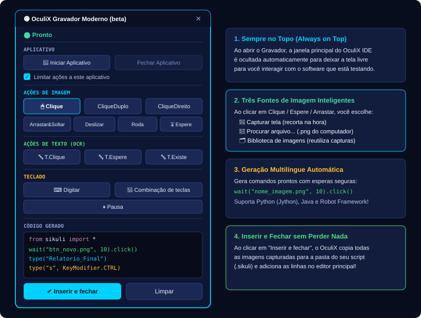
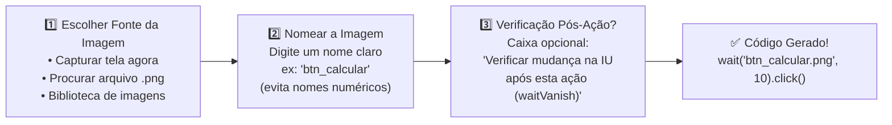

[🏠 Hub Full Stack](../README.md) · [🦎 Menu OculiX](../capitulos/README.md) · [🪶 Menu JMeter](../capitulos-jmeter/README.md) · [🛡️ Menu ZAP](../capitulos-zap/README.md)

---

<div align="center">

[⬅️ Anterior: Primeiro Script e Captura](03-primeiro-script-e-captura-de-tela.md) · [🏠 Início](../README.md) · **Capítulo 04 de 12** · [Próximo: Similaridade e Desvio do Alvo ➔](05-ajuste-de-padroes-similaridade-e-offset.md)

# 🟢 Capítulo 04: Usando o Gravador Moderno — Criando Testes Sem Digitar Código

-00D2FF?style=flat-square)


</div>

---

## 🎯 Objetivos deste Capítulo

Ao concluir este capítulo, você será capaz de:
- [x] Iniciar e configurar o **OculiX Gravador Moderno (beta)** na interface gráfica.
- [x] Gravar cliques, esperas, rolagens de tela e arrastar-e-soltar apenas clicando em botões visuais.
- [x] Reutilizar imagens já capturadas através da **Biblioteca de Imagens** do gravador.
- [x] Utilizar **Ações de Texto (OCR)** (`T.Clique`, `T.Espere`, `T.Existe`) e o construtor visual de **Combinação de Teclas** (<kbd>Ctrl</kbd>+<kbd>S</kbd>, <kbd>Enter</kbd>, <kbd>Tab</kbd>).
- [x] Inserir automaticamente o código gerado e as imagens no seu projeto `.sikuli`.

---

## 1. O que é o Gravador Moderno do OculiX IDE?

E se você pudesse montar um script de teste completo — já com esperas inteligentes de 12 segundos para a tela não travar — apenas escolhendo botões em um controle remoto flutuante?

Essa é a função do **OculiX Gravador Moderno (beta)**! Quando você o abre:
1. A janela grande do OculiX IDE **se esconde automaticamente** para não atrapalhar sua visão.
2. Um painel compacto e flutuante (**sempre no topo**) fica no canto da sua tela.
3. Para cada botão que você aperta no gravador, ele guia você passo a passo e **escreve o código sozinho** (em **Python**, **Java** ou **Robot Framework**)!

<div align="center">

</div>

---

## 2. Como Abrir e Escolher a Linguagem do Gravador

1. Certifique-se de ter um script aberto no OculiX IDE (se não tiver, pressione <kbd>Ctrl</kbd> + <kbd>N</kbd>).
2. Na Barra Lateral Esquerda, clique em **🛠️ Ferramentas ➔ 🟢 Gravador moderno (beta)**.
3. A janela **Configuração do gravador** aparecerá perguntando qual **Idioma (Linguagem de programação)** você deseja gerar:
   - **🐍 Python (Jython):** **(Recomendado para as aulas!)** Gera scripts nativos `.py` prontos para rodar direto no OculiX IDE.
   - **☕ Java:** Gera uma classe Java completa (`RecordedTest`) usando a biblioteca `org.sikuli.script.*`.
   - **🤖 Robot Framework:** Gera casos de teste em formato tabular (`*** Settings ***`, `*** Test Cases ***`).
4. Mantenha **Python** selecionado e clique em **Iniciar Gravação**.

---

## 3. Conhecendo Cada Seção do Gravador Moderno

Vamos explorar os recursos de cada faixa do painel flutuante, de cima para baixo:

### 🚀 Seção 1: APLICATIVO (Escopo de Janela)

| Botão / Opção | O que faz? | Código que ele gera (Python) |
| :--- | :--- | :--- |
| **Iniciar Aplicativo** | Abre um programa automaticamente no início do teste (ex: `notepad.exe`, `calc.exe` ou até uma tela remota VNC via SSH!). | `app = App.open("calc.exe")`<br/>`app.focus()` |
| **Fechar Aplicativo** | Encerra o aplicativo ao final do teste para deixar o ambiente limpo. | `app.close()` |
| **☑ Limitar ações a este aplicativo** | Restringe todas as buscas de imagem apenas à janela daquele programa (`app.window()`), tornando o teste mais rápido e seguro! | `app = app.window()`<br/>`app.wait("img.png", 10).click()` |

> [!TIP]
> Se o aplicativo que você quer testar **já está aberto na tela** (como o seu navegador web), você não precisa clicar em *Iniciar Aplicativo*! Pode ir direto para as **Ações de Imagem**.

---

### 🖱️ Seção 2: AÇÕES DE IMAGEM (O Fluxo Inteligente de 3 Passos)

Esta seção contém 7 botões visuais: **`Clique`**, **`CliqueDuplo`**, **`CliqueDireito`**, **`Arrastar&Soltar`**, **`Deslizar`**, **`Roda`** e **`Espere`**.

Sempre que você clica em um botão como **`Clique`**, o Gravador Moderno executa um fluxo guiado em **3 etapas super inteligentes**:



#### Entenda as 3 opções de Fonte da Imagem:
1. **📸 Capturar tela:** O gravador se esconde por um instante, você desenha o retângulo na tela sobre o botão e dá um nome para a foto (ex: `btn_salvar`).
2. **📂 Procurar arquivo...:** Permite escolher uma imagem `.png` ou `.jpg` que você já tinha salvo em uma pasta do computador.
3. **🗂️ Usar imagem existente (Biblioteca de imagens):** Se você já capturou o botão `btn_salvar.png` antes na mesma sessão, não precisa recortar de novo! Basta escolhê-lo na lista!

#### O que são os botões especiais `Roda` e `Deslizar`?
- **🎡 Roda (Scroll do Mouse):** Abre uma janela visual onde você vê a região capturada, escolhe a **Direção** (para cima ou para baixo) e a quantidade de **Etapas (giros da rodinha)** do mouse!
- **👆 Deslizar (Swipe):** Abre uma janela interativa onde você define a direção (Cima, Baixo, Esquerda, Direita) e a distância em pixels (`px`) para arrastar na tela (ótimo para sliders, mapas ou telas móveis Android/VNC).

> [!NOTE]
> **Por que o Gravador Moderno gera `wait("imagem.png", 10).click()` em vez de apenas `click("imagem.png")`?**
> Porque na vida real os programas demoram alguns décimos de segundo para carregar! Ao colocar `wait(..., 10)` antes do `.click()`, o código gerado pelo Gravador espera até **10 segundos** para o botão aparecer na tela antes de clicar, tornando seu teste muito mais resistente a falhas!

---

### 🔤 Seção 3: AÇÕES DE TEXTO (OCR sem precisar de fotos!)

Às vezes você quer apenas clicar em uma palavra escrita na tela ou conferir se um texto apareceu, sem precisar tirar print de uma imagem. Para isso servem os 3 botões de OCR:

| Botão no Gravador | O que pergunta para você? | Código Gerado |Quando usar? |
| :--- | :--- | :--- | :--- |
| **`T.Clique`** | *"Texto para clicar:"* | `click("Confirmar")` | Para clicar diretamente sobre uma palavra visível na tela. |
| **`T.Espere`** | *"Texto para aguardar:"* | `wait("Concluído", 10)` | Para pausar o teste até que aquela palavra apareça na tela. |
| **`T.Existe`** | *"Texto a verificar:"* | `exists("Aprovado")` | Para checar se uma palavra está presente na tela atual. |

---

### ⌨️ Seção 4: TECLADO E PAUSA

| Botão no Gravador | Como funciona? | Exemplo de Código Gerado |
| :--- | :--- | :--- |
| **`Digitar`** | Abre uma caixa pedindo o texto que deve ser digitado no campo em foco. | `type("texto digitado")` |
| **`Combinação de teclas`** | Abre o construtor visual **Configuração de combinação de teclas**! Você marca caixinhas para os **Modificadores** (<kbd>Ctrl</kbd>, <kbd>Shift</kbd>, <kbd>Alt</kbd>, <kbd>Meta/Win</kbd>) e escolhe a **Tecla** (<kbd>ENTER</kbd>, <kbd>TAB</kbd>, <kbd>ESC</kbd>, <kbd>F5</kbd>, <kbd>A</kbd>–<kbd>Z</kbd>), vendo o código ser montado ao vivo! | `type("a", KeyModifier.CTRL)`<br/>ou<br/>`type(Key.ENTER)` |
| **`Pausa`** | Pergunta quantos segundos o robô deve esperar parado antes do próximo passo. | `sleep(2)` |

---

### 💻 Seção 5: CÓDIGO GERADO e "Inserir e fechar"

Na caixa inferior do Gravador Moderno, você vê todas as linhas que foram gravadas até o momento.

Quando terminar de gravar os passos do seu teste:
1. Clique no botão **`Inserir e fechar`**.
2. O OculiX perguntará onde você deseja inserir as linhas geradas:
   - **`Script Atual` (Current Script):** Adiciona as novas linhas no final do script que já estava aberto (sem duplicar o cabeçalho `from sikuli import *`!).
   - **`Novo Script` (New Script):** Cria uma aba nova em folha com o código gravado.
3. Todas as imagens `.png` que você capturou durante a gravação são **copiadas automaticamente** para dentro da pasta do seu script!

---

## 🧪 Laboratório Prático 02: Gravando um Teste Completo Sem Digitar Código

Vamos usar o **Gravador Moderno** para automatizar um fluxo no nosso aplicativo de treino (`exemplos/app-alvo-teste/index.html`) sem escrever nenhuma linha manualmente!

### Passo a passo:
1. Certifique-se de que o arquivo [`exemplos/app-alvo-teste/index.html`](../exemplos/app-alvo-teste/index.html) está aberto no seu navegador.
2. No OculiX IDE, crie um novo script (<kbd>Ctrl</kbd> + <kbd>N</kbd>) e salve-o como **`lab02_gravador`**.
3. Vá em **🛠️ Ferramentas ➔ 🟢 Gravador moderno (beta)**, mantenha **Python** e clique em **Iniciar Gravação**.
4. Com o painel flutuante na tela, realize esta sequência:
   - **Passo A:** Clique no botão **`Clique`** do gravador ➔ escolha **Capturar tela** ➔ recorte o campo **"Usuário / E-mail"** no navegador ➔ dê o nome `inp_usuario` ➔ deixe desmarcada a opção pós-ação e clique em **OK**.
   - **Passo B:** Clique no botão **`Digitar`** do gravador ➔ digite `aluno_gravador` ➔ clique em **OK**.
   - **Passo C:** Clique no botão **`Combinação de teclas`** ➔ deixe os modificadores desmarcados, escolha a tecla **`TAB`** na lista (para pular para o campo de senha!) e clique em **OK**.
   - **Passo D:** Clique no botão **`Digitar`** ➔ digite `oculix123` ➔ clique em **OK**.
   - **Passo E:** Clique no botão **`Clique`** ➔ escolha **Capturar tela** ➔ recorte o botão **"Entrar no Sistema"** ➔ dê o nome `btn_entrar` ➔ clique em **OK**.
5. Observe na caixa **CÓDIGO GERADO** do gravador as linhas que foram criadas para você!

<details>
<summary><b>👀 Clique aqui para conferir o código que o Gravador Moderno gerou para você!</b></summary>
<br/>

```python
from sikuli import *

wait("inp_usuario.png", 10).click()
type("aluno_gravador")
type(Key.TAB)
type("oculix123")
wait("btn_entrar.png", 10).click()
```
</details>

6. Clique em **`Inserir e fechar`** ➔ escolha **`Script Atual`**.
7. Salve o script (<kbd>Ctrl</kbd> + <kbd>S</kbd>) e pressione <kbd>Alt</kbd> + <kbd>Ctrl</kbd> + <kbd>R</kbd> (**Executar em câmera lenta**) para assistir ao seu teste gravado rodando sozinho!

---

## ✅ Checklist de Conclusão do Capítulo 04

- [ ] Abri o **Gravador Moderno (beta)** pelo menu Ferramentas e selecionei a linguagem Python.
- [ ] Gravei ações de imagem (`Clique`) nomeando as capturas de forma organizada.
- [ ] Utilizei o construtor visual de `Combinação de teclas` e `Digitar`.
- [ ] Cliquei em **Inserir e fechar** e executei o script gerado no OculiX IDE.

---

<div align="center">

| [⬅️ Capítulo 03: Primeiro Script e Captura](03-primeiro-script-e-captura-de-tela.md) | [🏠 Início](../README.md) | [Próximo Capítulo: Similaridade e Desvio do Alvo ➔](05-ajuste-de-padroes-similaridade-e-offset.md) |
| :--- | :---: | ---: |

</div>
