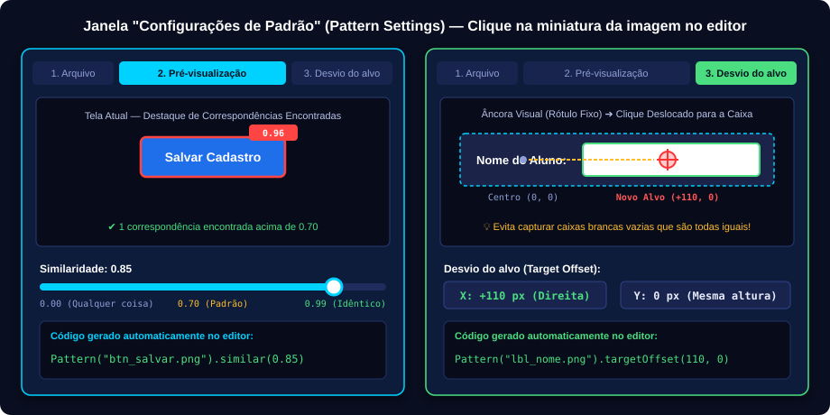
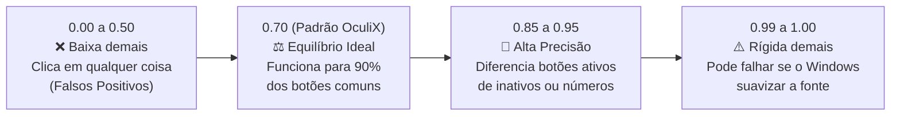

[🏠 Hub Full Stack](../README.md) · [🦎 Menu OculiX](../capitulos/README.md) · [🪶 Menu JMeter](../capitulos-jmeter/README.md)

---

<div align="center">

[⬅️ Anterior: Gravador Moderno](04-gravador-moderno-sem-codigo.md) · [🏠 Início](../README.md) · **Capítulo 05 de 12** · [Próximo: Sincronização e Validações ➔](06-sincronizacao-esperas-e-validacoes.md)

# 🎯 Capítulo 05: Ajuste de Padrões — Similaridade e Desvio do Alvo (Target Offset)

-00D2FF?style=flat-square)


</div>

---

## 🎯 Objetivos deste Capítulo

Ao concluir este capítulo, você será capaz de:
- [x] Abrir a janela **Configurações de Padrão (Pattern Settings)** clicando em qualquer miniatura de imagem no editor.
- [x] Renomear arquivos de imagem de forma segura pela aba **Arquivo**.
- [x] Calibrar o índice de **Similaridade (`similar`)** na aba **Pré-visualização da comparação** para evitar cliques em botões parecidos.
- [x] Dominar a técnica de **Desvio do Alvo (`targetOffset`)** para clicar em caixas de texto vazias, checkboxes e ícones repetidos usando rótulos como âncora visual.

---

## 1. Como Abrir as Configurações de Padrão (Pattern Settings)

Você sabia que toda miniatura de imagem que aparece dentro do editor de código do OculiX IDE é, na verdade, um **botão interativo**?

Quando você dá um **clique simples** com o botão esquerdo sobre qualquer imagem dentro do seu script (por exemplo, sobre `[🖼️ btn_entrar.png]`), o OculiX IDE abre a janela **Configurações de padrão (Pattern Settings)**, dividida em **3 abas**:

<div align="center">

</div>

Vamos aprender a usar cada uma dessas 3 abas na prática!

---

## 2. Aba 1: Arquivo (Renomeando Imagens com Segurança)

Imagine que você capturou uma imagem às pressas e ela ficou com um nome automático como `1731169042.png` ou um nome que você quer melhorar.

> [!WARNING]
> **Nunca renomeie as imagens diretamente pelo Explorador de Arquivos do Windows!**
> Se você mudar o nome do arquivo `.png` por fora do OculiX IDE, o código do script continuará procurando o nome antigo e falhará!

### Como renomear corretamente dentro do OculiX IDE:
1. Clique na miniatura da imagem dentro do editor de código.
2. Na janela **Configurações de padrão**, selecione a primeira aba: **Arquivo (File)**.
3. No campo **Nome do arquivo (Filename)**, apague o nome antigo e digite o novo nome sem espaços nem acentos (ex: `btn_calcular_media`).
4. Clique em **OK** (ou **Aplicar**).
5. O OculiX IDE renomeia o arquivo `.png` na pasta `.sikuli` **e atualiza o seu código simultaneamente**!

---

## 3. Aba 2: Pré-visualização da Comparação e Similaridade (`similar`)

### O que é a Similaridade?
Quando o OculiX procura uma imagem na tela usando o motor OpenCV, ele compara os pixels da sua foto com os pixels da tela e dá uma **nota de semelhança (Score)** que vai de **`0.00`** (totalmente diferente) até **`1.00`** (100% idêntico pixel por pixel).

Por padrão, o OculiX aceita qualquer elemento na tela que tenha nota **`0.70` (70% de similaridade)** ou maior.



### Quando você DEVE ajustar a Similaridade?

| Situação Real de Teste | O que acontece com `0.70`? | Qual Similaridade configurar? |
| :--- | :--- | :---: |
| **Botão Habilitado vs. Desabilitado (Cinza)** | O formato do texto no botão é tão parecido que o OculiX pode achar que o botão cinza já está ativo (`nota ~0.78`). | Aumente para **`0.88` a `0.92`** |
| **Ícones com pequenas diferenças (ex: 🔒 Cadeado Fechado vs. 🔓 Aberto)** | O contorno do ícone é quase igual; com `0.70` ele pode confundir os dois. | Aumente para **`0.85` a `0.90`** |
| **Textos ou números curtos (ex: validar `"Nota: 10,0"` vs `"Nota: 10,8"`)** | Como só muda um dígito, a imagem inteira tem mais de 80% de semelhança! | Aumente para **`0.92` a `0.95`** |
| **Pequena variação de renderização de fonte no navegador** | O botão está na tela, mas a nota deu `0.68` e falhou por muito pouco. | Reduza levemente para **`0.65`** |

### Passo a passo na aba "Pré-visualização da comparação":
1. Deixe na tela ao fundo o software que contém o botão que você quer calibrar.
2. No OculiX IDE, clique na miniatura da imagem no editor e vá para a aba **Pré-visualização da comparação (Matching Preview)**.
3. O OculiX mostrará uma foto da sua tela atual destacando com retângulos coloridos todos os lugares onde ele encontrou a imagem!
4. Arraste o controle deslizante **Similaridade (Similarity)** para a direita (ex: `0.85`) até que **apenas o elemento exato desejado** fique destacado na pré-visualização.
5. Clique em **OK**.
6. Observe no editor que a imagem agora ganhou uma borda/configuração especial que equivale ao código:
   ```python
   click(Pattern("btn_salvar.png").similar(0.85))
   ```
   *(E no modo de miniaturas do OculiX IDE, você verá o valor `0.85` exibido junto à imagem!)*

---

## 4. Aba 3: Desvio do Alvo (`Target Offset`) — O Superpoder do Testador!

### 🧩 O Problema Clássico das Caixas de Texto em Branco
Imagine uma tela de cadastro com 4 campos em branco um embaixo do outro:
- **Nome do Aluno:** `[                    ]`
- **Matrícula:** `[                    ]`
- **Nota 1:** `[                    ]`
- **Nota 2:** `[                    ]`

Se você recortar apenas o retângulo branco vazio `[        ]` do campo **Nota 2**, onde o OculiX vai clicar?
**Ele vai clicar no primeiro retângulo branco que encontrar na tela (ou seja, no campo errado)!** Além disso, se o campo já estiver preenchido com algum texto, ele deixa de ser branco e o teste quebra!

### 💡 A Solução Inteligente: Âncora Visual + Desvio do Alvo (Target Offset)

Em vez de capturar apenas a caixa branca vazia, nós capturamos **o rótulo de texto fixo (`Nota 2:`) junto com a caixa de texto**, e dizemos ao OculiX:
> *"OculiX, procure na tela a palavra **Nota 2:**, mas na hora de clicar, desvie o clique alguns pixels para a direita (ou para baixo), bem dentro da caixa branca!"*

```text
   ┌──────────────────────────────────────────────────────┐
   │  Nota 2:     [               🎯 (+95, 0)          ]  │
   │              ▲               ▲                       │
   │         Centro (0,0)     Novo Alvo do Clique         │
   │         da imagem        (Target Offset)             │
   └──────────────────────────────────────────────────────┘
```

### Passo a passo para configurar o Desvio do Alvo (Target Offset):
1. Ao usar **🛠️ Ferramentas ➔ 📷 Capturar**, faça um retângulo que englobe **tanto o rótulo fixo (ex: `"Nome do Aluno"`) quanto a caixa de texto** onde você quer clicar.
2. No editor do OculiX IDE, clique sobre a miniatura dessa imagem recém-capturada.
3. Na janela **Configurações de padrão**, clique na 3ª aba: **Desvio do alvo (Target Offset)**.
4. Você verá a sua imagem ampliada com uma **mira vermelha (`+`)** exatamente no centro `(0, 0)`.
5. **Dê um clique com o mouse dentro da caixa de texto** na imagem de pré-visualização!
6. A mira vermelha (`+`) saltará imediatamente para onde você clicou, e os campos **Desvio do alvo X** e **Y** mostrarão quantos pixels o clique foi deslocado (por exemplo: `X: 80, Y: 18`).
7. Clique em **OK**!

Internamente, o OculiX IDE transforma o seu comando em:
```python
paste(Pattern("campo_nome_com_rotulo.png").targetOffset(80, 18), "Diogo Silva")
```

> [!TIP]
> **Onde mais o Target Offset é indispensável?**
> - **Caixas de seleção (Checkboxes `[ ]`) e Botões de Rádio (`( )`):** Existem dezenas de quadradinhos `[ ]` idênticos numa tela. Capture o texto da opção junto com o quadradinho (ex: `[ ] Aceito os termos`) e coloque a mira do **Target Offset** em cima do quadradinho `[ ]`!
> - **Linhas de Tabelas com vários botões "Excluir" 🗑️:** Capture o nome do produto na linha junto com a lixeira e aponte o Target Offset para o ícone da lixeira!

---

## 🧪 Laboratório Prático 03: Preenchendo Formulários com Target Offset

Vamos praticar o **Target Offset** no nosso aplicativo de treino!

### Passo a passo:
1. Abra o arquivo [`exemplos/app-alvo-teste/index.html`](../exemplos/app-alvo-teste/index.html) no navegador e faça login (usuário: `estudante_qa`, senha: `oculix123`) para entrar no painel **"Calculadora & Cadastro de Avaliação"**.
2. Observe que há 3 campos de formulário com rótulos claros acima de cada caixa:
   - **Nome Completo do Estudante**
   - **Nota Prática 1 (0 a 10)**
   - **Nota Prática 2 (0 a 10)**
3. No OculiX IDE, crie um novo script (<kbd>Ctrl</kbd> + <kbd>N</kbd>) e salve como **`lab03_offset`**.
4. Para cada um dos 3 campos:
   - Use `paste()` e capture uma imagem que inclua **o título do campo + a caixa de entrada logo abaixo dele**.
   - Clique na miniatura da imagem no editor ➔ aba **Desvio do alvo** ➔ clique no meio da caixa de entrada para posicionar a mira vermelha (`+`) dentro do campo ➔ clique em **OK**.
5. Preencha o nome `"Ana Beatriz Conceição"`, a Nota 1 `"8.5"` e a Nota 2 `"9.5"`.

<details>
<summary><b>👀 Clique aqui para ver o Gabarito do Laboratório 03</b></summary>
<br/>

```python
# Laboratório 03 - Preenchendo Campos com Target Offset
# A mira vermelha de cada Pattern aponta para dentro da respectiva caixa de texto!
paste(Pattern("rotulo_nome_estudante.png").targetOffset(0, 22), "Ana Beatriz Conceição")
paste(Pattern("rotulo_nota1.png").targetOffset(0, 22), "8.5")
paste(Pattern("rotulo_nota2.png").targetOffset(0, 22), "9.5")
```
</details>

6. Execute em **Câmera Lenta** (<kbd>Alt</kbd> + <kbd>Ctrl</kbd> + <kbd>R</kbd>) e repare como o círculo vermelho mostra exatamente o deslocamento da âncora para o ponto exato da mira!

---

## ✅ Checklist de Conclusão do Capítulo 05

- [ ] Abri a janela **Configurações de padrão** clicando em uma miniatura de imagem no editor.
- [ ] Renomeei uma imagem pela aba **Arquivo**.
- [ ] Testei o controle deslizante de **Similaridade** na aba **Pré-visualização da comparação**.
- [ ] Configurei a mira vermelha na aba **Desvio do alvo (Target Offset)** para clicar dentro de um campo de formulário a partir do seu rótulo.

---

<div align="center">

| [⬅️ Capítulo 04: Gravador Moderno](04-gravador-moderno-sem-codigo.md) | [🏠 Início](../README.md) | [Próximo Capítulo: Sincronização, Esperas e Validações ➔](06-sincronizacao-esperas-e-validacoes.md) |
| :--- | :---: | ---: |

</div>
