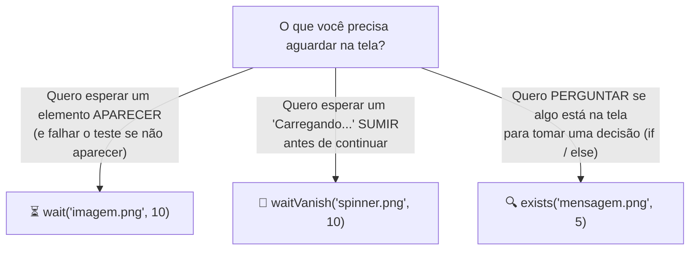

[🏠 Hub Full Stack](../README.md) · [🦎 Menu OculiX](../capitulos/README.md) · [🪶 Menu JMeter](../capitulos-jmeter/README.md) · [🛡️ Menu ZAP](../capitulos-zap/README.md)

---

<div align="center">

[⬅️ Anterior: Similaridade e Desvio do Alvo](05-ajuste-de-padroes-similaridade-e-offset.md) · [🏠 Início](../README.md) · **Capítulo 06 de 12** · [Próximo: Regiões, OCR e Teclado ➔](07-regioes-ocr-e-teclado-avancado.md)

# ⏳ Capítulo 06: Sincronização, Esperas Inteligentes e Validação de Testes (Asserções)

-00D2FF?style=flat-square)

-4ADE80?style=flat-square)

</div>

---

## 🎯 Objetivos deste Capítulo

Ao concluir este capítulo, você será capaz de:
- [x] Diferenciar uma **espera fixa (`sleep`)** de uma **espera inteligente (`wait` e `waitVanish`)**.
- [x] Utilizar o comando **`exists()`** para verificar se uma mensagem apareceu na tela sem quebrar o script.
- [x] Transformar um script de automação em um **Caso de Teste de Software** real usando **`assert`** (Oráculo de Teste: `PASS` vs. `FAIL`).
- [x] Destacar elementos validados na tela com **`highlight()`** e salvar **fotos de evidência de teste** automaticamente.

---

## 1. Por que os Testes Precisam de Sincronização?

O computador executa linhas de código em milissegundos, mas os softwares reais precisam de tempo para abrir janelas, consultar bancos de dados ou exibir animações de *"Processando..."*.

Se você clicar em **"Calcular Média"** e na linha seguinte tentar validar imediatamente o resultado, o OculiX olhará para a tela **antes** de o resultado existir!

### Batalha das Esperas: `sleep()` vs. `wait()`

| Tipo de Espera | Comando no OculiX | Como funciona? | Veredito em Testes |
| :--- | :--- | :--- | :---: |
| **Espera Cega (Fixa)** | `sleep(10)` | Para o script obrigatoriamente por **10 segundos inteiros**, mesmo que a tela já tenha carregado em 1 segundo! E se num dia lento demorar 11 segundos, o teste falha. | ⚠️ Use apenas para pausas curtas pontuais (ex: `sleep(0.5)`). |
| **Espera Inteligente (Dinâmica)** | `wait("resultado.png", 10)` | Fica vigiando a tela continuamente **por até 10 segundos**. Assim que a imagem aparecer (mesmo que em `0.4` segundos!), ele avança imediatamente! | ✅ **Padrão Ouro em QA!** Rápido quando o sistema está rápido, paciente quando está lento. |

---

## 2. Os 3 Comandos de Sincronização Visual do OculiX

Use o fluxograma abaixo para saber qual comando escolher em cada momento do seu teste:



### 2.1. `wait(imagem, segundos)` — Aguardando algo aparecer
Por padrão, qualquer `click("img.png")` no OculiX espera apenas **3 segundos** antes de desistir. Quando uma tela demora mais para abrir, usamos `wait()`:

```python
# Espera até 10 segundos pelo botão aparecer e já clica nele assim que surgir:
wait("btn_confirmar_pedido.png", 10).click()
```

### 2.2. `waitVanish(imagem, segundos)` — Aguardando algo desaparecer
Muitos softwares exibem uma barra de progresso ou aviso de *"Aguarde, processando dados..."*. Para esperar esse aviso sumir antes do próximo passo:

```python
click("btn_processar.png")

# Aguarda até 15 segundos para a mensagem "Processando..." desaparecer da tela:
waitVanish("msg_processando.png", 15)

# Agora a tela já terminou de carregar!
```

### 2.3. `exists(imagem, segundos)` — Verificando sem dar erro!
Se você usar `find("msg_erro.png")` ou `wait("msg_erro.png")` e a imagem **não** estiver na tela, o OculiX interrompe o script imediatamente com o erro `FindFailed`.

Já o comando **`exists("imagem.png", segundos)`** é educado:
- Se encontrar a imagem dentro do tempo limite, ele devolve os dados da posição encontrada (**Verdadeiro**).
- Se **não** encontrar, ele simplesmente devolve `None` (**Falso**), **sem travar o seu script**!

```python
# Exemplo: Fechar um banner de aviso se ele aparecer, ou continuar normalmente se não aparecer
if exists("btn_fechar_popup.png", 2):
    click("btn_fechar_popup.png")
    print("[INFO] Pop-up fechado com sucesso!")
else:
    print("[INFO] Nenhum pop-up apareceu, seguindo o teste...")
```

---

## 3. O Oráculo de Teste: Como Validar se o Software Passou ou Falhou?

> [!IMPORTANT]
> **Conceito Fundamental de Teste de Software:**
> Um script que apenas clica e digita não testa nada se não **conferir o resultado final**!
> Em Engenharia de Software, chamamos essa verificação final de **Oráculo de Teste (Asserção)**: comparar o **Resultado Obtido na Tela** com o **Resultado Esperado**.

No OculiX IDE, temos duas maneiras elegantes de validar um Caso de Teste:

### Método A: Usando `assert exists(...)` (Aprovação Automática na Barra Lateral)
A palavra-chave `assert` do Python exige que a condição ao lado dela seja verdadeira.
- Se a imagem do resultado esperado aparecer na tela, o teste termina com **código 0** e o painel **ÚLTIMA EXECUÇÃO** da Barra Lateral fica verde (**✔ Sucesso**)!
- Se a imagem **não** aparecer, o `assert` interrompe o teste com `AssertionError`, marcando a execução em vermelho (**❌ Falha**) para alertar o testador!

```python
# Caso de Teste: Verificar se o aluno com média >= 7 recebe o selo APROVADO
wait("btn_calcular.png", 5).click()
waitVanish("msg_calculando.png", 10)

# ORÁCULO DO TESTE (Validação Final):
assert exists(Pattern("selo_aprovado.png").similar(0.85), 5), "FALHA NO TESTE: O selo APROVADO não apareceu na tela!"
print("✅ TESTE PASSOU: O selo APROVADO foi exibido corretamente!")
```

### Método B: Destacando o Resultado Visualmente com `.highlight(segundos)`
Quer deixar o seu professor e seus colegas impressionados ao apresentar o teste rodando?
Quando o `exists()` ou `wait()` encontra a mensagem de resultado na tela, você pode chamar `.highlight(2)` para que o OculiX desenhe uma **moldura vermelha brilhante na tela por 2 segundos** ao redor do elemento validado!

```python
# Encontra o resultado na tela:
resultado = exists(Pattern("selo_aprovado.png").similar(0.85), 5)

# Valida se encontrou e destaca na tela por 2 segundos!
assert resultado is not None, "FALHA: Selo Aprovado não foi exibido!"
resultado.highlight(2)
print("✅ TESTE PASSOU! Elemento destacado na tela.")
```

---

## 4. Gerando Evidências de Teste Automaticamente (Screenshots)

No mercado de trabalho de QA (Qualidade de Software), todo teste executado precisa gerar uma **evidência visual** (um print da tela inteira no momento da aprovação ou falha) para anexar ao relatório de testes.

No OculiX, você pode tirar uma foto da tela inteira e salvá-la dentro da pasta do seu próprio script com apenas **duas linhas**:

```python
import shutil

# Tira foto da tela inteira e salva na pasta atual do script (.sikuli)
foto_temp = Screen().capture(Screen().getBounds()).getFile()
shutil.copy(foto_temp, os.path.join(getBundlePath(), "evidencia_final.png"))
print("📸 Evidência salva na pasta do script como evidencia_final.png!")
```

---

## 🧪 Laboratório Prático 04: Casos de Teste Positivo e Negativo

Um bom testador de software não testa apenas quando o usuário faz tudo certo (**Caminho Feliz / Teste Positivo**), mas também testa se o sistema bloqueia dados inválidos (**Teste Negativo**)!

Vamos testar o nosso aplicativo [`exemplos/app-alvo-teste/index.html`](../exemplos/app-alvo-teste/index.html):

1. Abra o `index.html` no navegador e entre com `estudante_qa` / `oculix123`.
2. Repare o que acontece quando você preenche um aluno e clica em **"Processar Avaliação"**:
   - Primeiro aparece uma caixa amarela *"⏳ Processando cálculo no servidor..."* durante **2 segundos**.
   - Depois que ela some, aparece o cartão de resultado com o selo verde **`APROVADO`** (se média ≥ 7.0) ou vermelho **`REPROVADO`** (se média < 7.0).
   - E se você tentar clicar em **"Processar Avaliação"** deixando o nome em branco ou colocando uma nota maior que 10 (ex: `15`), aparece um alerta vermelho de erro!
3. Crie um script no OculiX IDE chamado **`lab04_validacao`** que:
   - Preencha os dados de um aluno com notas `8.0` e `9.0`.
   - Clique em **"Processar Avaliação"**.
   - Aguarde o aviso *"Processando..."* desaparecer (ou aguarde até 5 segundos pelo selo **`APROVADO`**).
   - Valide com `assert exists(...)` e destaque o selo **`APROVADO`** por 2 segundos com `.highlight(2)`!

<details>
<summary><b>👀 Clique aqui para ver o Gabarito Completo do Laboratório 04</b></summary>
<br/>

```python
# Laboratório 04 - Sincronização e Validação de Caso de Teste
from sikuli import *

# 1. Limpa o formulário caso tenha dados anteriores
if exists("btn_limpar.png", 2):
    click("btn_limpar.png")

# 2. Preenche os dados de entrada (Dados de Teste)
paste(Pattern("rotulo_nome_estudante.png").targetOffset(0, 22), "Carlos Eduardo Teste")
paste(Pattern("rotulo_nota1.png").targetOffset(0, 22), "8.0")
paste(Pattern("rotulo_nota2.png").targetOffset(0, 22), "9.0")

# 3. Dispara o processamento
click("btn_processar_avaliacao.png")

# 4. Sincronização Inteligente: aguarda até 6 segundos pelo selo APROVADO aparecer
# (já esperando automaticamente os 2 segundos do spinner "Processando..."!)
selo = exists(Pattern("selo_aprovado.png").similar(0.85), 6)

# 5. Oráculo de Teste (Asserção + Destaque Visual)
assert selo is not None, "FALHA NO TESTE: O sistema não exibiu o status APROVADO para média 8.5!"
selo.highlight(2)
print("✅ CASO DE TESTE CT-01 APROVADO COM SUCESSO!")
```
</details>

---

## ✅ Checklist de Conclusão do Capítulo 06

- [ ] Entendi por que `wait()` e `waitVanish()` são melhores e mais confiáveis que `sleep()`.
- [ ] Utilizei `exists()` para verificar elementos na tela sem causar erro `FindFailed`.
- [ ] Escrevi uma asserção com `assert` e vi o indicador verde **✔ Sucesso** na Barra Lateral.
- [ ] Usei `.highlight(2)` para destacar visualmente o elemento validado na tela.

---

<div align="center">

| [⬅️ Capítulo 05: Similaridade e Desvio do Alvo](05-ajuste-de-padroes-similaridade-e-offset.md) | [🏠 Início](../README.md) | [Próximo Capítulo: Regiões de Busca, OCR e Teclado ➔](07-regioes-ocr-e-teclado-avancado.md) |
| :--- | :---: | ---: |

</div>
