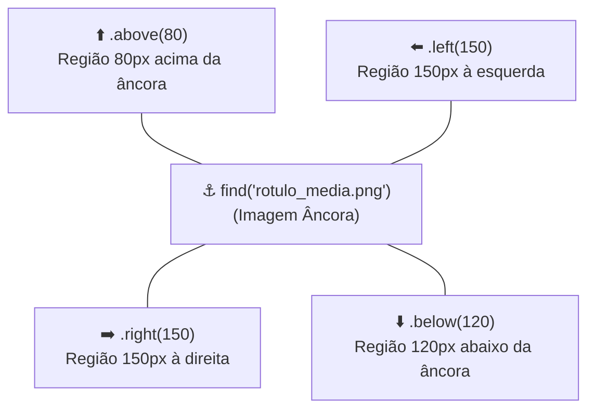

[🏠 Hub Full Stack](../README.md) · [🦎 Menu OculiX](../capitulos/README.md) · [🪶 Menu JMeter](../capitulos-jmeter/README.md) · [🛡️ Menu ZAP](../capitulos-zap/README.md)

---

<div align="center">

[⬅️ Anterior: Sincronização e Validações](06-sincronizacao-esperas-e-validacoes.md) · [🏠 Início](../README.md) · **Capítulo 07 de 12** · [Próximo: Depuração e Tratamento de Erros ➔](08-depuracao-erros-e-boas-praticas.md)

# 🔤 Capítulo 07: Regiões de Busca (ROI), Leitura de Texto por OCR e Teclado Avançado

-00D2FF?style=flat-square)


</div>

---

## 🎯 Objetivos deste Capítulo

Ao concluir este capítulo, você será capaz de:
- [x] Restringir a busca do OculiX a um pedaço específico da tela (**Região / ROI**) para deixar o teste até **5x mais rápido** e evitar cliques ambíguos.
- [x] Criar **Regiões Relativas** (`.right()`, `.below()`, `.above()`, `.left()`) a partir de uma imagem âncora.
- [x] Extrair e validar textos ou números dinâmicos da tela usando o leitor **OCR Tesseract** embutido (`regiao.text()`).
- [x] Utilizar atalhos de teclado (`Key`, `KeyModifier`), rolagem do mouse (`wheel`) e arrastar-e-soltar (`dragDrop`).

---

## 1. Regiões de Busca (Region / ROI — *Region of Interest*)

Quando você escreve apenas `click("btn_ok.png")`, o OculiX precisa procurar essa imagem em **todos os 2.073.600 pixels** de um monitor Full HD (`1920x1080`).

Isso traz dois desafios:
1. **Velocidade:** Vasculhar a tela inteira leva mais tempo do que olhar apenas dentro de um pequeno quadrado.
2. **Ambiguidade:** E se houver dois painéis abertos na tela e ambos tiverem um botão **"Limpar"** idêntico?

A solução é dizer ao OculiX para olhar apenas dentro de uma **Região (Region)**!

### A Técnica Mais Poderosa: Regiões Relativas (`.right`, `.below`, `.above`, `.left`)

Em vez de adivinhar coordenadas `(X, Y)` fixas que mudam se o usuário arrastar a janela de lugar, você pode encontrar um **rótulo fixo (âncora)** e esticar uma área de leitura ao redor dele:



Veja como é simples no código:

```python
# 1. Localiza o rótulo "Média Calculada:" na tela
ancora = wait("rotulo_media.png", 5)

# 2. Cria uma região de 120 pixels imediatamente à DIREITA desse rótulo:
regiao_valor = ancora.right(120)

# 3. Destaca a região na tela por 2 segundos para você ver exatamente onde ele está olhando!
regiao_valor.highlight(2)
```

> [!TIP]
> **Sempre use `.highlight(2)` enquanto estiver construindo seu teste!**
> O comando `regiao.highlight(2)` desenha um retângulo vermelho transparente na tela mostrando o tamanho exato da sua região. Assim você ajusta o número de pixels (ex: `.right(120)` ou `.right(180)`) visualmente sem precisar adivinhar!

---

## 2. Leitura de Textos Dinâmicos por OCR (`Tesseract` Integrado)

Imagine que você está testando uma calculadora ou um sistema financeiro:
- Você digita `Nota 1 = 7.5` e `Nota 2 = 9.5`.
- O sistema exibe na tela o resultado calculado.
- Mas e se você quiser **ler o número que apareceu na tela** e guardá-lo em uma variável para conferir no console ou fazer contas?

O OculiX IDE já traz o motor **Tesseract OCR** integrado (lembra da bolinha verde `🟢 Tesseract integrado` na Barra Lateral?). Basta chamar **`.text()`** em qualquer Região!

### Exemplo Prático: Lendo um Valor da Tela com `.text()`

```python
# 1. Encontra o rótulo "Média Final:" e olha 140 pixels para a direita
regiao_media = wait("lbl_media_final.png", 5).right(140)
regiao_media.highlight(1)

# 2. Usa o OCR para ler o texto escrito dentro daquela região!
texto_lido = regiao_media.text().strip()
print("Texto lido da tela pelo OCR:", texto_lido)

# 3. Valida se o valor esperado "8.5" está no texto lido!
assert "8.5" in texto_lido, "FALHA: Média calculada incorreta! Lido: " + texto_lido
print("✅ Sucesso! O OCR confirmou que a média na tela é 8.5!")
```

> [!IMPORTANT]
> **3 Dicas para o OCR ler com 100% de precisão:**
> 1. **Nunca faça `Screen().text()` na tela inteira:** O OCR tentará ler todos os ícones da sua barra de tarefas e abas do navegador. Sempre crie uma **região pequena** (`ancora.right(150)` ou `ancora.below(60)`) contendo apenas a palavra ou número que você quer ler!
> 2. **Use `.strip()`:** O método `.text()` do OCR costuma incluir uma quebra de linha no final. Usar `.strip()` em Python limpa espaços em branco extras no início e no fim.
> 3. **Habilite nas Preferências:** Certifique-se de que em `Arquivo ➔ Preferências ➔ mais opções...`, a caixa **`permitir OCR`** está marcada (como configuramos no Capítulo 02).

---

## 3. Teclado Avançado: Teclas Especiais e Atalhos (`Key` e `KeyModifier`)

Muitas vezes, testar um software envolve navegar com <kbd>Tab</kbd>, confirmar com <kbd>Enter</kbd>, fechar modais com <kbd>Esc</kbd> ou usar atalhos como <kbd>Ctrl</kbd> + <kbd>A</kbd> (Selecionar tudo) e <kbd>Backspace</kbd> (Apagar).

### 🎹 Tabela de Teclas Especiais Mais Usadas (`Key.NOME`)

| Tecla Física | Como escrever no OculiX | Exemplo de Uso Prático |
| :---: | :--- | :--- |
| <kbd>Enter</kbd> | `Key.ENTER` | `type(Key.ENTER)` — Envia um formulário ou confirma diálogo. |
| <kbd>Tab</kbd> | `Key.TAB` | `type(Key.TAB)` — Pula para o próximo campo do formulário. |
| <kbd>Esc</kbd> | `Key.ESC` | `type(Key.ESC)` — Fecha uma janela modal ou menu aberto. |
| <kbd>Backspace</kbd> | `Key.BACKSPACE` | `type(Key.BACKSPACE)` — Apaga o caractere ou texto selecionado. |
| <kbd>Delete</kbd> | `Key.DELETE` | `type(Key.DELETE)` — Exclui um item selecionado. |
| <kbd>Espaço</kbd> | `Key.SPACE` | `type(Key.SPACE)` — Marca/desmarca uma caixa de seleção (*checkbox*) em foco! |
| <kbd>⬆️</kbd> <kbd>⬇️</kbd> <kbd>⬅️</kbd> <kbd>➡️</kbd> | `Key.UP`, `Key.DOWN`, `Key.LEFT`, `Key.RIGHT` | `type(Key.DOWN)` — Escolhe o próximo item de uma lista suspensa (*dropdown*). |
| <kbd>F1</kbd> a <kbd>F12</kbd> | `Key.F1`, `Key.F5`, `Key.F11`... | `type(Key.F5)` — Atualiza a página do navegador. |

### 🔗 Como Fazer Combinações de Teclas (`KeyModifier`)

Para segurar <kbd>Ctrl</kbd>, <kbd>Alt</kbd> ou <kbd>Shift</kbd> junto com outra tecla, passe o modificador como segundo parâmetro de `type()`:

```python
# Truque profissional para LIMPAR um campo de texto que já tem coisas escritas dentro:
click("campo_nome.png")
type("a", KeyModifier.CTRL)   # Pressiona Ctrl + A (seleciona todo o texto antigo)
type(Key.BACKSPACE)           # Apaga tudo!
paste("Novo Nome Limpo")      # Cola o novo valor com segurança!

# Pressionar Ctrl + Shift + N:
type("n", KeyModifier.CTRL + KeyModifier.SHIFT)

# Fechar uma janela com Alt + F4:
type(Key.F4, KeyModifier.ALT)
```

---

## 4. Rolagem de Tela (`wheel`) e Arrastar e Soltar (`dragDrop`)

### 🎡 Rolando uma Página para Baixo ou para Cima (`wheel`)
Se um botão está no final da página e você precisa girar a rodinha do mouse (*scroll*) para que ele apareça:

```python
# Posiciona o mouse no meio da janela e gira a roda para BAIXO 5 vezes:
wheel( WHEEL_DOWN, 5 )

# Ou gira a roda para CIMA 3 vezes sobre uma região específica:
wheel("painel_tabela.png", WHEEL_UP, 3)
```

### ✋ Arrastar e Soltar (`dragDrop`)
Para arrastar um arquivo, card de Kanban ou controle deslizante de um ponto até outro:

```python
# Arrasta a primeira imagem e solta exatamente em cima da segunda imagem:
dragDrop("card_tarefa_pendente.png", "coluna_concluido.png")
```

---

## 🧪 Laboratório Prático 05: Lendo a Média Calculada com Região Relativa e OCR

Vamos testar o leitor **OCR** e as **Regiões Relativas** no nosso aplicativo de treino!

### Passo a passo:
1. No navegador com o [`exemplos/app-alvo-teste/index.html`](../exemplos/app-alvo-teste/index.html) aberto e logado, preencha uma avaliação manualmente (ex: Nota 1 = `9.0`, Nota 2 = `10.0`) e clique em **"Processar Avaliação"**.
2. Quando o cartão de resultado aparecer, observe onde fica o rótulo **`MÉDIA FINAL:`** e o número grande logo abaixo dele (ex: **`9.5`**).
3. No OculiX IDE, crie um novo script (<kbd>Ctrl</kbd> + <kbd>N</kbd>) e salve como **`lab05_ocr`**.
4. Capture apenas o pequeno título **`MÉDIA FINAL`** como sua imagem âncora (`lbl_media_final.png`).
5. Use `.below(55)` para criar uma região exatamente embaixo desse título (onde fica o número `9.5`), destaque com `.highlight(2)` e leia o valor com `.text()`!

<details>
<summary><b>👀 Clique aqui para ver o Gabarito do Laboratório 05</b></summary>
<br/>

```python
# Laboratório 05 - Extraindo a Média Calculada com Região Relativa e OCR
from sikuli import *

# 1. Encontra o título "MÉDIA FINAL" no cartão de resultado
ancora_media = wait("lbl_media_final.png", 5)

# 2. Cria uma região 55 pixels ABAIXO da âncora (onde o número da média é desenhado)
regiao_numero = ancora_media.below(55)

# 3. Destaca com moldura vermelha por 2 segundos para conferirmos o recorte
regiao_numero.highlight(2)

# 4. Lê o texto da região via OCR Tesseract
media_lida = regiao_numero.text().strip()
print("==========================================")
print("📊 Média lida pelo OCR na tela:", media_lida)
print("==========================================")

# 5. Valida se o número lido corresponde ao cálculo esperado
assert "9.5" in media_lida, "Erro no cálculo! Valor lido: " + media_lida
print("✅ Validação por OCR concluída com sucesso!")
```
</details>

---

## ✅ Checklist de Conclusão do Capítulo 07

- [ ] Criei uma região relativa usando `.right()` ou `.below()` e visualizei seu tamanho na tela com `.highlight(2)`.
- [ ] Utilizei `.text()` para extrair um texto ou número da tela via OCR e imprimi no console inferior.
- [ ] Aprendi o truque `type("a", KeyModifier.CTRL)` + `type(Key.BACKSPACE)` para limpar campos antes de preencher.

---

<div align="center">

| [⬅️ Capítulo 06: Sincronização e Validações](06-sincronizacao-esperas-e-validacoes.md) | [🏠 Início](../README.md) | [Próximo Capítulo: Depuração, Erros e Boas Práticas ➔](08-depuracao-erros-e-boas-praticas.md) |
| :--- | :---: | ---: |

</div>
