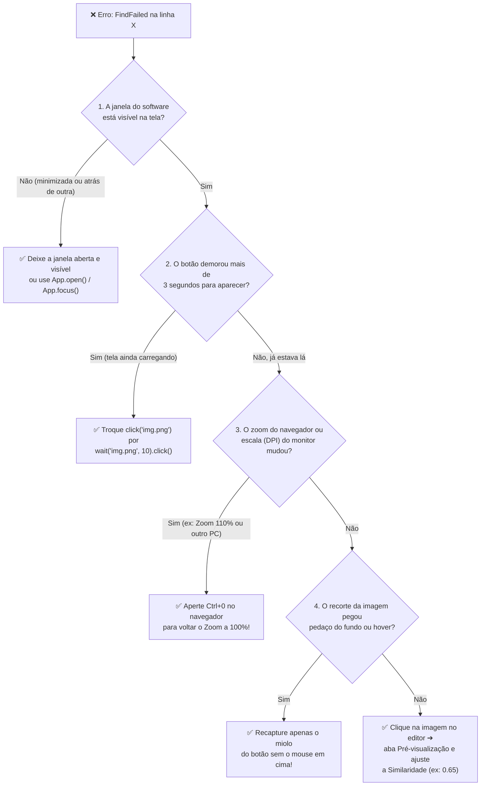

[🏠 Hub Full Stack](../README.md) · [🦎 Menu OculiX](../capitulos/README.md) · [🪶 Menu JMeter](../capitulos-jmeter/README.md) · [🛡️ Menu ZAP](../capitulos-zap/README.md)

---

<div align="center">

[⬅️ Anterior: Regiões, OCR e Teclado](07-regioes-ocr-e-teclado-avancado.md) · [🏠 Início](../README.md) · **Capítulo 08 de 12** · [Próximo: Projeto Prático Completo ➔](09-projeto-pratico-completo.md)

# 🛠️ Capítulo 08: Tratamento de Erros (`FindFailed`), Depuração e Boas Práticas

-00D2FF?style=flat-square)


</div>

---

## 🎯 Objetivos deste Capítulo

Ao concluir este capítulo, você será capaz de:
- [x] Interpretar a mensagem de erro **`FindFailed`** no Console do OculiX IDE sem pânico.
- [x]Seguir o **Fluxograma de Diagnóstico em 5 Passos** para descobrir por que uma imagem não foi encontrada.
- [x] Utilizar blocos **`try ... except FindFailed:`** para registrar falhas elegantes sem abortar toda a suíte de testes.
- [x] Padronizar nomes de imagens e exportar seu projeto (`.zip`) para entregar atividades ou subir no GitHub.

---

## 1. Desvendando o Erro Número 1: `FindFailed`

Mais cedo ou mais tarde, todo testador que usa o OculiX IDE vê esta mensagem vermelha no painel **MENSAGEM** (Console inferior):

```text
[error] script [ meu_teste ] stopped with error in line 4
[error] FindFailed ( btn_salvar.png: (142x38) seen at (0, 0) with 0.00 in S(0)[0,0 1920x1080] E:Y, T:3.0 )
[error] --- Traceback --- error source first
line: module ( function ) statement
4: main (  <module> )     click("btn_salvar.png")
```

### 🔍 Como ler essa mensagem como um detetive?
1. **`stopped with error in line 4`:** O erro aconteceu exatamente na **linha 4** do seu script!
2. **`FindFailed ( btn_salvar.png: (142x38) ... )`:** O OculiX procurou a imagem `btn_salvar.png` (que mede 142×38 pixels), mas **não a encontrou na tela**.
3. **`in S(0)[0,0 1920x1080]`:** Ele procurou no monitor principal `S(0)` inteiro.
4. **`T:3.0`:** Ele tentou procurar durante **3.0 segundos** antes de desistir.

---

## 2. Fluxograma de Diagnóstico Rápido: Por que deu `FindFailed`?

Sempre que o seu script parar com `FindFailed`, siga este mapa visual de perguntas:



### ⚠️ As 5 Armadilhas Campeãs em Sala de Aula

| Armadilha | Por que acontece? | Como evitar para sempre? |
| :--- | :--- | :--- |
| **1. Zoom do Navegador alterado (<kbd>Ctrl</kbd> + Roda do mouse)** | Se você capturou a imagem com o Chrome em `100%` de zoom e depois deu zoom para `110%`, o botão ficou 10% maior em pixels! | Antes de capturar e antes de testar no navegador, sempre pressione **<kbd>Ctrl</kbd> + <kbd>0</kbd> (zero)** para fixar o zoom em **100%**. |
| **2. Tema Escuro vs. Tema Claro do Sistema/Site** | Se você capturou um botão branco com letras pretas e depois ativou o Modo Escuro no site, as cores se inverteram. | Mantenha o mesmo tema visual no software testado durante toda a bateria de testes. |
| **3. Captura feita com o botão selecionado (borda azul de foco)** | Quando você clica num botão, às vezes ele ganha um contorno pontilhado ou azul. Na execução seguinte, antes do clique, ele não tem esse contorno. | Tire o foco do botão antes de capturar a imagem. |
| **4. Troca de Monitor (Notebook 125% vs. Monitor Externo 100%)** | Mover o navegador da tela do notebook para um monitor externo com escala de DPI diferente muda a densidade de pixels. | Capture e execute os testes sempre no mesmo monitor (preferencialmente na tela principal `S(0)`). |
| **5. Dois monitores conectados** | Por padrão, `Screen()` olha para o monitor principal `S(0)`. Se o programa estiver aberto no monitor secundário `S(1)`, ele não verá! | Mantenha o software testado no monitor principal (ou use `Screen(1)` se quiser testar no segundo monitor). |

---

## 3. Tratando Falhas com Elegância: `try ... except FindFailed`

E se você tiver um script com **3 Casos de Teste seguidos**, e quiser que, caso o Teste 1 falhe, o OculiX tire um print da tela do erro, escreva uma mensagem clara no console e **continue executando os Testes 2 e 3**?

Em Python (Jython), fazemos isso com o bloco **`try ... except FindFailed:`**!

```python
from sikuli import *
import os, shutil

try:
    print("▶️ Iniciando Teste: Clicar no botão Processar...")
    wait("btn_processar.png", 5).click()
    print("✅ SUCESSO: Botão clicado corretamente!")

except FindFailed as erro:
    print("❌ FALHA DETECTADA: Não foi possível encontrar a imagem na tela!")
    print("Detalhe técnico:", erro)
    
    # Tira um print automático da tela no momento exato do erro para o relatório!
    print_erro = Screen().capture(Screen().getBounds()).getFile()
    caminho_evidencia = os.path.join(getBundlePath(), "erro_capturado.png")
    shutil.copy(print_erro, caminho_evidencia)
    print("📸 Foto da tela do erro salva em:", caminho_evidencia)
```

> [!TIP]
> **Por que os professores e recrutadores adoram ver `try ... except`?**
> Porque demonstra que você não apenas gravou cliques automáticos, mas pensou como um **Engenheiro de Testes**: prevendo falhas do software e coletando evidências (`erro_capturado.png`) automaticamente para que o desenvolvedor possa consertar o bug!

---

## 4. Boas Práticas de Organização e Nomenclatura

Quando o seu script cresce e passa a ter 10 ou 15 imagens, nomes como `173116801.png` tornam impossível saber o que cada linha faz quando o arquivo é lido no GitHub.

### 🏷️ Padrão de Prefixos Recomendado para Nomear Imagens

Adote sempre estes prefixos curtos ao dar nome às suas capturas no OculiX IDE:

| Prefixo | Tipo de Elemento Visual | Exemplos de Bons Nomes |
| :---: | :--- | :--- |
| **`btn_`** | Botões clicáveis (*Buttons*) | `btn_entrar.png`, `btn_salvar.png`, `btn_limpar.png` |
| **`inp_`** | Caixas de texto / Campos de entrada (*Inputs*) | `inp_usuario.png`, `inp_senha.png`, `inp_nota1.png` |
| **`lbl_`** | Rótulos e títulos fixos usados como âncora (*Labels*) | `lbl_nome_estudante.png`, `lbl_media_final.png` |
| **`msg_`** | Mensagens de alerta, sucesso ou erro (*Messages*) | `msg_erro_nota_invalida.png`, `msg_processando.png` |
| **`selo_`** / **`ico_`** | Selos de status ou ícones (*Badges / Icons*) | `selo_aprovado.png`, `selo_reprovado.png`, `ico_lupa.png` |

---

## 5. Como Exportar e Entregar seu Projeto (ou Subir no GitHub)

Terminou sua atividade prática e precisa enviar para o professor ou subir no seu repositório do GitHub?

### Opção A: Exportar como Pacote Compactado (`.zip` / `.skl`) pelo OculiX IDE
1. Salve seu script (<kbd>Ctrl</kbd> + <kbd>S</kbd>).
2. Na Barra Lateral Esquerda, clique em **📁 Arquivo ➔ `Export packed source...`** (ou pressione <kbd>Ctrl</kbd> + <kbd>Shift</kbd> + <kbd>E</kbd>).
3. Escolha onde salvar. O OculiX IDE criará um único arquivo compactado contendo o script `.py` e todas as imagens `.png` utilizadas!

### Opção B: Subindo para o GitHub
Para subir no GitHub, basta enviar a pasta **`nome_do_seu_teste.sikuli`** inteira!
Dentro do GitHub, os avaliadores poderão:
- Abrir o arquivo `nome_do_seu_teste.py` para ler o seu código comentado.
- Visualizar todas as imagens `.png` capturadas na mesma pasta.

---

## ✅ Checklist de Qualidade antes de Entregar seu Teste

Antes de considerar qualquer script pronto, passe por esta lista de verificação:

- [ ] **Nomes claros:** Todas as imagens usam nomes descritivos (`btn_...`, `lbl_...`) sem espaços nem acentos?
- [ ] **Comentários no código:** Cada etapa do teste tem um comentário `# Passo X: ...` explicando o que está sendo testado?
- [ ] **Esperas inteligentes:** Usei `wait(..., 5)` ou `exists(..., 5)` nos pontos em que a tela carrega?
- [ ] **Oráculo de Teste:** Meu script termina validando se o resultado esperado realmente apareceu na tela?
- [ ] **Teste a Frio:** Fechei e reabri a tela inicial do software e rodei meu script do início ao fim sem tocar no mouse?

---

<div align="center">

| [⬅️ Capítulo 07: Regiões, OCR e Teclado](07-regioes-ocr-e-teclado-avancado.md) | [🏠 Início](../README.md) | [Próximo Capítulo: Projeto Prático Completo (Laboratório) ➔](09-projeto-pratico-completo.md) |
| :--- | :---: | ---: |

</div>
