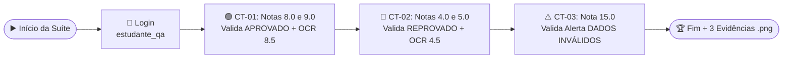

[🏠 Hub Full Stack](../README.md) · [🦎 Menu OculiX](../capitulos/README.md) · [🪶 Menu JMeter](../capitulos-jmeter/README.md) · [🛡️ Menu ZAP](../capitulos-zap/README.md)

---

<div align="center">

[⬅️ Anterior: Depuração e Boas Práticas](08-depuracao-erros-e-boas-praticas.md) · [🏠 Início](../README.md) · **Capítulo 09 de 12** · [Próximo: Glossário e Cheat Sheet ➔](10-glossario-e-folha-de-consulta.md)

# 🏆 Capítulo 09: Projeto Prático Completo — Construindo uma Suíte de Testes de Ponta a Ponta

-00D2FF?style=flat-square)


</div>

---

## 🎯 Objetivos deste Capítulo

Chegou a hora de reunir **tudo o que você aprendeu** nos Capítulos 01 a 08 em um projeto prático real de Engenharia de Testes de Software! Ao concluir este laboratório, você terá:
- [x] Executado um **Plano de Testes** estruturado com **3 Casos de Teste** (Positivo, Regra de Limite e Negativo).
- [x] Combinado **Target Offset**, **Similaridade**, **Esperas Inteligentes (`wait`/`exists`)**, **Leitura por OCR (`.text()`)** e **Geração Automática de Evidências (`.png`)** em um único script robusto.
- [x] Preenchido um **Relatório de Execução de Testes** no formato Markdown para publicar no seu GitHub.

---

## 1. Cenário do Projeto: Auditando o Portal Acadêmico OculiX

Você foi contratado(a) como Analista de Qualidade (QA) para validar o **Portal Acadêmico OculiX** ([`exemplos/app-alvo-teste/index.html`](../exemplos/app-alvo-teste/index.html)) antes do lançamento para os professores.

### 📋 Especificação de Requisitos do Software
1. **Requisito RF-01 (Autenticação):** O sistema só deve liberar acesso com o usuário `estudante_qa` e a senha `oculix123`.
2. **Requisito RF-02 (Cálculo de Média e Aprovação):** O sistema calcula a média aritmética simples entre a `Nota Prática 1` e a `Nota Prática 2`:
   $$\text{Média Final} = \frac{\text{Nota 1} + \text{Nota 2}}{2}$$
   - Se $\text{Média Final} \ge 7.0$, deve exibir o selo verde **`APROVADO`**.
   - Se $\text{Média Final} < 7.0$, deve exibir o selo vermelho **`REPROVADO`**.
3. **Requisito RF-03 (Crítica de Dados Inválidos):** O sistema deve bloquear notas menores que `0.0` ou maiores que `10.0`, exibindo o alerta vermelho **`DADOS INVÁLIDOS`**.

---

## 2. Plano de Testes (Casos de Teste que Vamos Automatizar)

Veja a matriz dos **3 Casos de Teste (CTs)** que o seu script no OculiX IDE deverá executar em sequência:

| ID | Nome do Caso de Teste | Dados de Entrada | Resultado Esperado (Oráculo) |
| :---: | :--- | :--- | :--- |
| **CT-01** | **Validar Aprovação de Estudante (Caminho Feliz)** | • Nome: `"Lucas Almeida"`<br/>• Nota 1: `"8.0"`<br/>• Nota 2: `"9.0"` | 1. Exibir selo verde **`APROVADO`**.<br/>2. Exibir **`MÉDIA FINAL`** igual a **`8.5`** (lida via OCR). |
| **CT-02** | **Validar Reprovação por Média Insuficiente** | • Nome: `"Mariana Costa"`<br/>• Nota 1: `"4.0"`<br/>• Nota 2: `"5.0"` | 1. Exibir selo vermelho **`REPROVADO`**.<br/>2. Exibir **`MÉDIA FINAL`** igual a **`4.5`** (lida via OCR). |
| **CT-03** | **Validar Bloqueio de Nota Acima do Limite (Teste Negativo)** | • Nome: `"Pedro Silva"`<br/>• Nota 1: `"15.0"` *(Inválida!)*<br/>• Nota 2: `"8.0"` | 1. Exibir alerta vermelho **`DADOS INVÁLIDOS`**.<br/>2. Não exibir painel de resultado. |



---

## 3. Guia Passo a Passo de Preparação das Capturas

### Passo 3.1: Preparar a Tela e o Script
1. Abra o arquivo [`exemplos/app-alvo-teste/index.html`](../exemplos/app-alvo-teste/index.html) no seu navegador.
2. Pressione <kbd>Ctrl</kbd> + <kbd>0</kbd> no navegador para garantir que o zoom está em **100%**.
3. No **OculiX IDE**, crie um novo script (<kbd>Ctrl</kbd> + <kbd>N</kbd>) e salve-o (<kbd>Ctrl</kbd> + <kbd>S</kbd>) com o nome **`projeto_final_qa`**.

### Passo 3.2: Lista de Imagens para Capturar (`Ferramentas ➔ Capturar`)
Para que o seu script fique organizado e profissional, capture as seguintes imagens conforme interage com a página de treino:

| Nome Sugerido da Imagem | O que recortar na tela? | Configuração em *Configurações de Padrão* |
| :--- | :--- | :--- |
| **`lbl_usuario.png`** | O rótulo azul `Usuário / E-mail` + a caixa abaixo | **Desvio do alvo (Target Offset):** Clique dentro da caixa branca (`Y: +24px`). |
| **`lbl_senha.png`** | O rótulo azul `Senha de Acesso` + a caixa abaixo | **Desvio do alvo (Target Offset):** Clique dentro da caixa branca (`Y: +24px`). |
| **`btn_entrar.png`** | O interior do botão azul `🚀 Entrar no Sistema` | Padrão (`0.70`). |
| **`lbl_nome_estudante.png`** | O rótulo `Nome Completo do Estudante` + caixa abaixo | **Desvio do alvo (Target Offset):** Clique dentro da caixa branca (`Y: +24px`). |
| **`lbl_nota1.png`** | O rótulo `Nota Prática 1 (0 a 10)` + caixa abaixo | **Desvio do alvo (Target Offset):** Clique dentro da caixa branca (`Y: +24px`). |
| **`lbl_nota2.png`** | O rótulo `Nota Prática 2 (0 a 10)` + caixa abaixo | **Desvio do alvo (Target Offset):** Clique dentro da caixa branca (`Y: +24px`). |
| **`btn_processar.png`** | O interior do botão verde `⚙️ Processar Avaliação` | Padrão (`0.70`). |
| **`btn_limpar.png`** | O interior do botão cinza `🧹 Limpar Formulário` | Padrão (`0.70`). |
| **`lbl_media_final.png`** | Apenas o pequeno título azul `MÉDIA FINAL` no resultado | Usaremos `.below(55)` para ler o número via OCR! |
| **`selo_aprovado.png`** | O selo verde `APROVADO` | **Similaridade:** `0.85` |
| **`selo_reprovado.png`** | O selo vermelho `REPROVADO` | **Similaridade:** `0.85` |
| **`msg_dados_invalidos.png`** | O trecho `⚠️ DADOS INVÁLIDOS` do alerta vermelho | **Similaridade:** `0.80` |

---

## 4. Construindo e Executando o Script Completo

Tente escrever o código dos 3 Casos de Teste no seu OculiX IDE usando as imagens da tabela acima. Quando quiser conferir ou precisar de ajuda, expanda o gabarito completo abaixo:

<details>
<summary><b>💻 Clique aqui para abrir o Gabarito Comentado do Projeto Final (`projeto_final_qa.py`)</b></summary>
<br/>

```python
# ==============================================================================
# PROJETO PRÁTICO FINAL — SUÍTE AUTOMATIZADA DE TESTES COM OCULIX IDE
# Aplicativo Alvo: exemplos/app-alvo-teste/index.html
# ==============================================================================
from sikuli import *
import os
import shutil

# Função auxiliar para salvar print da tela como evidência de cada Caso de Teste
def salvar_evidencia(nome_arquivo):
    foto_temp = Screen().capture(Screen().getBounds()).getFile()
    destino = os.path.join(getBundlePath(), nome_arquivo)
    shutil.copy(foto_temp, destino)
    print("📸 Evidência salva com sucesso:", nome_arquivo)

print("====================================================")
print("🚀 INICIANDO SUÍTE DE TESTES NO OCULIX IDE")
print("====================================================")

# ------------------------------------------------------------------------------
# ETAPA 0: REALIZAR LOGIN (Se estiver na tela de login)
# ------------------------------------------------------------------------------
if exists("btn_entrar.png", 2):
    print("🔐 Realizando login no Portal Acadêmico...")
    paste(Pattern("lbl_usuario.png").targetOffset(0, 24), "estudante_qa")
    paste(Pattern("lbl_senha.png").targetOffset(0, 24), "oculix123")
    click("btn_entrar.png")

# Garante que a tela principal carregou
wait("btn_processar.png", 5)

# ------------------------------------------------------------------------------
# CASO DE TESTE CT-01: Validar Aprovação (Notas 8.0 e 9.0 -> Média 8.5)
# ------------------------------------------------------------------------------
print("\n▶️ Executando CT-01: Validar Aprovação de Estudante...")
click("btn_limpar.png")

paste(Pattern("lbl_nome_estudante.png").targetOffset(0, 24), "Lucas Almeida")
paste(Pattern("lbl_nota1.png").targetOffset(0, 24), "8.0")
paste(Pattern("lbl_nota2.png").targetOffset(0, 24), "9.0")
click("btn_processar.png")

# Aguarda até 6 segundos pelo selo APROVADO aparecer (após o carregamento de 1.8s)
selo_ok = exists(Pattern("selo_aprovado.png").similar(0.85), 6)
assert selo_ok is not None, "❌ FALHA CT-01: Selo APROVADO não apareceu!"
selo_ok.highlight(1)

# Lê a média calculada com Região Relativa + OCR
regiao_media = wait("lbl_media_final.png", 3).below(55)
regiao_media.highlight(1)
media_ct01 = regiao_media.text().strip()
print("📊 Média lida via OCR no CT-01:", media_ct01)
assert "8.5" in media_ct01, "❌ FALHA CT-01: Média incorreta! Esperado 8.5, lido: " + media_ct01

salvar_evidencia("evidencia_ct01_aprovado.png")
print("✅ CT-01 PASSOU COM SUCESSO!")

# ------------------------------------------------------------------------------
# CASO DE TESTE CT-02: Validar Reprovação (Notas 4.0 e 5.0 -> Média 4.5)
# ------------------------------------------------------------------------------
print("\n▶️ Executando CT-02: Validar Reprovação por Média Insuficiente...")
click("btn_limpar.png")

paste(Pattern("lbl_nome_estudante.png").targetOffset(0, 24), "Mariana Costa")
paste(Pattern("lbl_nota1.png").targetOffset(0, 24), "4.0")
paste(Pattern("lbl_nota2.png").targetOffset(0, 24), "5.0")
click("btn_processar.png")

# Aguarda até 6 segundos pelo selo REPROVADO aparecer
selo_rep = exists(Pattern("selo_reprovado.png").similar(0.85), 6)
assert selo_rep is not None, "❌ FALHA CT-02: Selo REPROVADO não apareceu!"
selo_rep.highlight(1)

# Confere a média 4.5 via OCR
regiao_media2 = wait("lbl_media_final.png", 3).below(55)
regiao_media2.highlight(1)
media_ct02 = regiao_media2.text().strip()
print("📊 Média lida via OCR no CT-02:", media_ct02)
assert "4.5" in media_ct02, "❌ FALHA CT-02: Média incorreta! Esperado 4.5, lido: " + media_ct02

salvar_evidencia("evidencia_ct02_reprovado.png")
print("✅ CT-02 PASSOU COM SUCESSO!")

# ------------------------------------------------------------------------------
# CASO DE TESTE CT-03: Teste Negativo — Bloqueio de Nota Inválida (15.0)
# ------------------------------------------------------------------------------
print("\n▶️ Executando CT-03: Validar Crítica de Nota Inválida (> 10.0)...")
click("btn_limpar.png")

paste(Pattern("lbl_nome_estudante.png").targetOffset(0, 24), "Pedro Silva")
paste(Pattern("lbl_nota1.png").targetOffset(0, 24), "15.0")
paste(Pattern("lbl_nota2.png").targetOffset(0, 24), "8.0")
click("btn_processar.png")

# Valida se o alerta vermelho de erro apareceu na tela
alerta_erro = exists(Pattern("msg_dados_invalidos.png").similar(0.80), 4)
assert alerta_erro is not None, "❌ FALHA CT-03: O sistema aceitou uma nota maior que 10 sem exibir alerta!"
alerta_erro.highlight(2)

salvar_evidencia("evidencia_ct03_erro_validado.png")
print("✅ CT-03 PASSOU COM SUCESSO!")

print("\n====================================================")
print("🏆 TODOS OS 3 CASOS DE TESTE FORAM APROVADOS (100%)!")
print("====================================================")
```
</details>

---

## 5. Modelo de Relatório de Testes para o seu GitHub

Ao finalizar a execução da sua suíte de testes, copie o modelo Markdown abaixo para documentar seus resultados no `README.md` do seu trabalho acadêmico:

```markdown
# 📋 Relatório de Execução de Testes Automatizados — OculiX IDE

- **Estudante / QA:** [Seu Nome Completo]
- **Data da Execução:** [DD/MM/AAAA]
- **Ferramenta:** OculiX IDE (OpenCV + Tesseract OCR)
- **Sistema Testado:** Portal Acadêmico OculiX v1.0

## 📊 Resumo dos Resultados

| Caso de Teste | Descrição | Status | Tempo | Evidência Gerada |
| :---: | :--- | :---: | :---: | :--- |
| **CT-01** | Validar Aprovação (Média 8.5) | ✅ **PASSOU** | 3.2s | `evidencia_ct01_aprovado.png` |
| **CT-02** | Validar Reprovação (Média 4.5) | ✅ **PASSOU** | 3.1s | `evidencia_ct02_reprovado.png` |
| **CT-03** | Validar Bloqueio de Nota Inválida (15.0) | ✅ **PASSOU** | 1.4s | `evidencia_ct03_erro_validado.png` |
```

---

## ✅ Checklist de Conclusão do Capítulo 09

- [ ] Capturei os elementos visuais do Portal Acadêmico de Treino aplicando **Target Offset** nos campos de formulário.
- [ ] Executei os 3 Casos de Teste (`CT-01`, `CT-02` e `CT-03`) do início ao fim.
- [ ] Verifiquei na pasta `.sikuli` do meu script que as 3 fotos de evidência (`evidencia_ct01...png`, `evidencia_ct02...png`, `evidencia_ct03...png`) foram geradas automaticamente!

---

<div align="center">

| [⬅️ Capítulo 08: Depuração e Boas Práticas](08-depuracao-erros-e-boas-praticas.md) | [🏠 Início](../README.md) | [Próximo Capítulo: Glossário e Folha de Consulta (Cheat Sheet) ➔](10-glossario-e-folha-de-consulta.md) |
| :--- | :---: | ---: |

</div>
