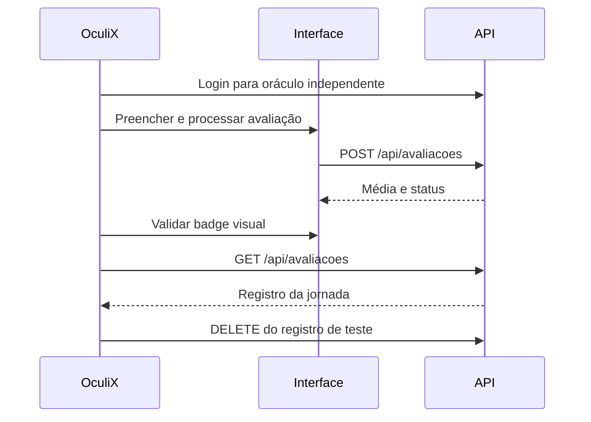

[🏠 Hub Full Stack](../README.md) · [🦎 Menu OculiX](../capitulos/README.md) · [🪶 Menu JMeter](../capitulos-jmeter/README.md)

---

# 🦎 Capítulo 12: Testes híbridos de interface e API

**Objetivo:** verificar uma ação visual por um oráculo HTTP independente e observar a UI durante carga moderada. Requer o servidor ativo em `http://localhost:8080`, OculiX com Jython e as capturas do formulário no bundle.

## Por que combinar as camadas?

Uma tela pode mostrar aprovação sem salvar o registro; uma API correta pode ter um botão inacessível. Faça a ação na interface e consulte o backend para conferir seu efeito. O laboratório armazena dados apenas em memória, portanto esse teste não comprova persistência em banco.



## Script guiado no Jython 2.7

Abra o laboratório no navegador e faça login pela UI antes de executar. Capture os campos, botão Limpar, botão Processar e badge aprovado. `urllib2` já pertence à biblioteca padrão do Jython; `requests` não é uma dependência necessária.

```python
from sikuli import *
import json
import urllib2
import uuid

BASE = "http://localhost:8080"
def api(method, path, data=None, token=None):
    headers = {"Content-Type": "application/json"}
    if token:
        headers["Authorization"] = "Bearer " + token
    body = json.dumps(data).encode("utf-8") if data is not None else None
    request = urllib2.Request(BASE + path, body, headers)
    request.get_method = lambda: method
    response = urllib2.urlopen(request, timeout=10)
    try:
        return json.loads(response.read().decode("utf-8"))
    finally:
        response.close()

token = api("POST", "/api/auth/login", {
    "usuario": "estudante_qa", "senha": "oculix123"
})["token"]
nome = "UI-" + str(uuid.uuid4())
click("limpar_formulario.png")
click("campo_nome.png"); paste(nome)
click("campo_nota1.png"); paste("8.5")
click("campo_nota2.png"); paste("9.5")
click("processar.png")
wait("aprovado.png", 10)
registros = api("GET", "/api/avaliacoes", token=token)
encontrados = [r for r in registros if r["nome"] == nome]
assert len(encontrados) == 1, "Cadastro visual não corresponde à API"
registro = encontrados[0]
try:
    assert registro["media"] == 9.0
    assert registro["status"] == "APROVADO"
    assert exists("aprovado.png")
finally:
    api("DELETE", "/api/avaliacoes/" + str(registro["id"]), token=token)
```

O token do script é independente do token da UI. Reabrir o HTML via `file://` permite treinar pixels, mas não cria registros na API; nesse modo a asserção híbrida deve falhar. Se uma etapa de UI falhar após criar o registro, procure pelo prefixo único para limpar o dado remanescente ou reinicie o laboratório.

## UI sob carga moderada

1. Rode primeiro o teste acima sem carga e registre duração e captura.
2. Em outro terminal, execute o [plano JMeter](../exemplos/jmeter/plano_api_e_carga_fullstack.jmx) com `-Jfuncional=false -Jcarga=true -Jusuarios=5 -Jrampup=5 -Jduracao=60` conforme o [capítulo CLI](../capitulos-jmeter/09-metricas-listeners-cli-e-relatorio-html.md).
3. Durante a execução, repita a jornada OculiX com outro nome único. Não interaja manualmente com o desktop durante o script.
4. Compare badge, média, registro da API, P95 das consultas e duração visual. A interface pede atraso intencional de 1800 ms; separe esse tempo da degradação observada.

## Exercício e entrega

Faça a mesma jornada com média reprovada, alterando as notas, o padrão visual esperado e as assertions HTTP.

<details>
<summary>Gabarito comentado</summary>

Notas 4 e 5 devem produzir média 4.5 e REPROVADO em ambas as camadas. O nome UUID identifica apenas a avaliação da jornada, mesmo quando outros usuários usam a API. Entregue o script, capturas próprias, parâmetros de carga e relatório com tempos medidos; não confunda sucesso visual com capacidade de produção.

</details>

- [ ] Executei sem carga e com carga moderada.
- [ ] Validei o mesmo registro na UI e API.
- [ ] Removi os dados criados pelo teste.
- [ ] Registrei limites de ambiente e medições reais.

[Referência do runtime Jython](https://www.oculix.org/guides/jython/).

---

[← Capítulo 11](11-recursos-avancados-web-fullstack.md) · [Menu OculiX](README.md) · [Projeto JMeter →](../capitulos-jmeter/10-projeto-pratico-fullstack-e-cheat-sheet.md)
