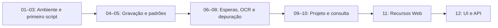

[🏠 Hub Full Stack](../README.md) · [🦎 Menu OculiX](../capitulos/README.md) · [🪶 Menu JMeter](../capitulos-jmeter/README.md)

---

# 🦎 Trilha OculiX IDE — interface visual e E2E

Do primeiro clique à validação híbrida de um projeto Web. Preserve a escala da tela, capture suas próprias imagens e valide um oráculo observável em cada caso.

| Capítulo | Conteúdo |
| --- | --- |
| 01 | [📦 Capítulo 01: Introdução aos Testes Visuais e Instalação do Ambiente](01-introducao-e-instalacao.md) |
| 02 | [🖥️ Capítulo 02: Conhecendo a Interface Gráfica do OculiX IDE](02-conhecendo-a-interface-oculix-ide.md) |
| 03 | [📸 Capítulo 03: Seu Primeiro Teste Automatizado — Captura de Tela e Ações Básicas](03-primeiro-script-e-captura-de-tela.md) |
| 04 | [🟢 Capítulo 04: Usando o Gravador Moderno — Criando Testes Sem Digitar Código](04-gravador-moderno-sem-codigo.md) |
| 05 | [🎯 Capítulo 05: Ajuste de Padrões — Similaridade e Desvio do Alvo (Target Offset)](05-ajuste-de-padroes-similaridade-e-offset.md) |
| 06 | [⏳ Capítulo 06: Sincronização, Esperas Inteligentes e Validação de Testes (Asserções)](06-sincronizacao-esperas-e-validacoes.md) |
| 07 | [🔤 Capítulo 07: Regiões de Busca (ROI), Leitura de Texto por OCR e Teclado Avançado](07-regioes-ocr-e-teclado-avancado.md) |
| 08 | [🛠️ Capítulo 08: Tratamento de Erros (`FindFailed`), Depuração e Boas Práticas](08-depuracao-erros-e-boas-praticas.md) |
| 09 | [🏆 Capítulo 09: Projeto Prático Completo — Construindo uma Suíte de Testes de Ponta a Ponta](09-projeto-pratico-completo.md) |
| 10 | [📋 Capítulo 10: Folha de Consulta Rápida (Cheat Sheet) e Glossário Ilustrado](10-glossario-e-folha-de-consulta.md) |
| 11 | [🦎 Capítulo 11: Recursos avançados para Web Full Stack](11-recursos-avancados-web-fullstack.md) |
| 12 | [🦎 Capítulo 12: Testes híbridos de interface e API](12-testes-hibridos-ui-api.md) |

Os capítulos 01–10 mantêm os caminhos originais. Continue nos capítulos 11–12 para arquivos, CSV, observadores, canvas e integração HTTP.

**Material de consulta:** [Catálogo prático de comandos e combinações — 16 categorias](03a-catalogo-pratico-de-comandos.md). Use ao lado do editor para montar sequências de ações com suas capturas.

**Atalhos:** [Instalação](01-introducao-e-instalacao.md) · [Gravador](04-gravador-moderno-sem-codigo.md) · [Consulta rápida](10-glossario-e-folha-de-consulta.md) · [Laboratório](../exemplos/README.md).

No OculiX, capture imagens pelo editor, use `wait` em vez de pausas fixas e restrinja buscas com `Region`. O runtime padrão é Jython 2.7; o Python 3 do servidor é um processo separado.
